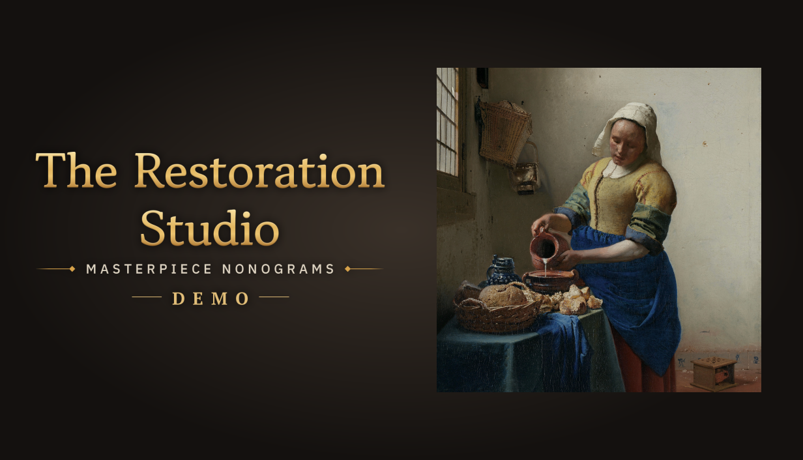

## 🎯 核心看点速览

- **Demo 已上线 Steam**：官方确认《The Restoration Studio: Masterpiece Nonograms》试玩版现已开放下载，免费体验。
- **玩法核心是数织填格**：也就是 Nonogram，根据行列数字提示推理填格，最终拼出像素画。
- **修复工作室主题包装**：把解谜过程做成修复画作、还原名作的体验，氛围感比单纯刷题更足。
- **不是喜加一**：Demo 属于免费试玩版，不是限时免费领取永久入库，正式版仍需单独购买。

## 📌 重点深度解析

这次最值得关注的，是试玩版终于把门推开了。对于喜欢数织、像素拼图、逻辑解谜的玩家来说，Demo 就是最直接的试吃装：不用先掏钱，也不用看一堆宣传片猜手感，直接下载开填。

从游戏标题和定位来看，《The Restoration Studio: Masterpiece Nonograms》走的是“修复工作室 + 数织解谜”的组合路线。每一关不只是冷冰冰的方格，而是围绕修复画作展开：你填下的每一格，都会逐渐揭晓画面内容。对老数织玩家来说，这种包装能明显提升连续解题的沉浸感；对新手来说，也比纯数字表格更容易坚持。

需要提醒的是，目前官方公开的信息很克制，只确认了 Demo 上线。具体收录多少关卡、是否有教学关、正式版关卡规模和定价，建议以 Steam 商店页后续标注为准。我的建议很简单：先下 Demo 试手感，别急着把正式版预期拉满。

## 💡 玩家实操与上手建议

1. **下载方式**：打开 Steam，搜索游戏名《The Restoration Studio: Masterpiece Nonograms》，或者直接搜 AppID 5354800，进入商店页后点击试玩版下载按钮。
2. **数织新手技巧**：优先找 0 行、满行和接近满行的提示，先把确定格子标出来；不确定的格子打 X 标记，别靠感觉硬猜。
3. **卡关处理**：数织最怕连续猜错。建议每填几行就回头交叉验证行列数字，必要时退一步重开，比死磕省时间。
4. **配置与体验**：这类逻辑解谜通常配置要求不高，办公本也能跑。建议窗口化游玩，方便边查资料边推格子。
5. **购买建议**：Demo 免费，先试玩再决定是否加愿望单。正式版发售日和价格未公布，别把试玩版误当成永久入库福利。

## 📢 官方 Telegram 频道推荐

想第一时间蹲 Steam 限免、临时工价、史低折扣和喜加一？加入 **@steamhunterlink**，推送速度比闹钟还勤快。这次《The Restoration Studio》Demo 不是喜加一，但正式版以后要是有折扣，频道会帮你盯着。

## ❓ 常见问题 FAQ

**Q1：这个 Demo 是限时免费领取吗？能永久入库吗？**
A：Demo 是免费试玩版，不是喜加一活动，也不会作为正式版永久入库。能否一直下载以 Steam 商店页为准，正式版需要单独购买。

**Q2：Demo 的进度会继承到正式版吗？**
A：官方暂未说明。按常见试玩版情况，进度不保证继承，建议以正式版实际规则为准。

**Q3：游戏支持中文吗？配置要求高不高？**
A：语言支持请以 Steam 商店页标签为准；数织类游戏配置要求通常较低，轻薄本一般也能玩，具体仍以商店页最低配置为准。
