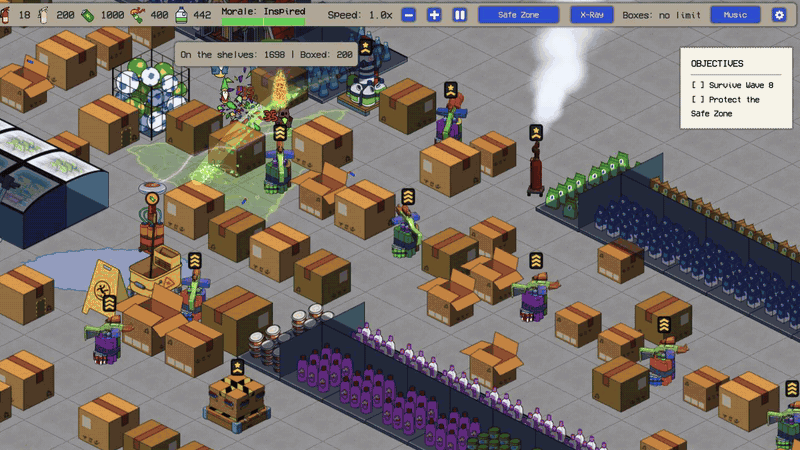

各位塔防老哥，我是你们的主理人。今天这条消息有点“临门一脚改期”的味道：原本盯着10月30日入库的《Clearance Defence》，现在把发售日挪到了11月2日。别急着拍桌，Steam审核窗口排起长龙，制作组等到10月31日才拿到过审结果，于是只能顺延几天。好消息是，完整版会把十夜战役一口气端上来，而且Demo进度还能继承。下面我把这次更新日志里的干货拆开聊。

## 🎯 核心看点速览

- **发售日调整**：从10月30日顺延到11月2日（周一），原因是Steam审核积压，游戏已在10月31日通过审核。
- **完整版内容**：本体就是完整战役，从Night 1教学一路打到Night 10 Final Clearance，共十夜。
- **Demo进度继承**：如果你在同一台Windows PC上玩过Demo，首次启动完整版时会提示把进度带过来。
- **Boss阵容加码**：第6夜The Commodore、第9夜The Snapper、第10夜Grillmarshal，三场硬仗各有解法。
- **安全区与物流**：安全区扩容，新增Storage Boxes与Logistics设置，箱子能打包成托盘带入下一夜。
- **难度分化更明显**：Easy模式材料管够、报酬翻倍；Hard模式波次间隔更充裕，还能买Delivery Drones飞墙送货。
- **防守者上限提升**：普通与困难下，第6、7夜可同时部署20名防守者，与第8至10夜持平。

## 📌 重点深度解析

### 发售日小插曲：审核排队，11月2日见

这次跳票不是内容翻车，而是Steam审核时间超出预期。制作组原本把日子定在10月30日，但审核请求堆积，最终10月31日才过审，于是发售日改到11月2日。对玩家来说，多等几天换一个稳妥上架，不算坏事。至少现在日期明确，愿望单可以先点好。

### 最后两夜：守安全区，迎战Grillmarshal

**Night 9: The Retreat**的关键词是“护送”和“别堵路”。你的HQ会搬进安全区，安全区一丢，这一夜直接凉凉。平民会自己离开货架往安全区跑，所以你必须给他们留一条通畅的路。好几波突袭者也会冲着安全区来。本夜Boss是**The Snapper**，一只充气鳄鱼，谁在开阔地露头就咬谁。打它的核心思路是别让它卡在通往安全区的路线上，不然平民和防线都要遭重。

**Night 10: Final Clearance**是战役终点，最终波由**Grillmarshal**领衔。她面前如果有墙、塔或者货架，会先蓄力，然后喷出一道宽锥形火焰把障碍烧穿。换句话说，别把关键承伤件全堆在她正面。撑到最后一波并击败她，就能看到完整结局；如果她把你掀翻，结算界面允许你重开本夜，或者选一个已保存的波次再和她碰一碰。

### 第6夜新Boss：The Commodore

第6夜现在有自己的Boss了：**The Commodore**，一只巨型充气虎鲸。普通和困难难度下，它滚动时你的塔只能对它造成三分之二伤害。不过它伤不到你的防守者，所以解法很清晰：在塔覆盖的过道里横着摆一列防守者，它会被这列人墙顶住，停下来之后塔就能打满伤害。别光顾着堆塔，拿防守者当“刹车片”才是关键。

### 安全区扩容与物流箱

从第2夜开始，安全区会变大，并多出存储区域。**Storage Boxes**要放在标记点上，每三个密封箱带入下一夜，会打包成一个托盘。普通和困难难度下，你可以在**Logistics**标签里设置安全区存储多少物资。这个系统让跨夜规划更有存在感，别只顾眼前波次，箱子怎么带、带多少，会影响下一夜的节奏。

另外，普通与困难下，第6、7夜的防守者上限从12和16提高到20，和第8至10夜一致。人多了，拦截、卡位和拖Boss都更从容。

### Easy更解压，Hard更硬核

从第2夜起，**Easy**模式明显松弛：每晚开局给1500建筑材料，塔不会耗尽；清波报酬翻倍，每击败一个Armoured Gnome给50；第一波到达时间减半，而且没有侏儒会以超过正常两倍的速度冲脸；管理项也少了，没有存储限制和防守者，安全区面板只显示订单和箱子。想熟悉地图和机制，这个模式很合适。

**Hard**则给足你布防时间：第一波前至少一分半，波与波之间有一分钟。更重要的是，Hard下可以在安全区购买**Delivery Drones**，安全区送货会直接飞过你的墙，不用绕路。对喜欢精打细算的老哥来说，这才是硬核塔防该有的味道。

> 日志末尾还提到了塔、破口与暂停相关段落，具体手感与细节，等发售进游戏验收最稳。

## 💡 玩家实操与上手建议

- **先加愿望单，盯紧11月2日**：日期已经明确，发售当天直接在Steam下载安装即可。
- **Demo进度继承看这里**：必须在同一台Windows PC上玩过Demo，首次启动完整版时留意继承提示，别手快点掉。
- **打The Commodore别只堆塔**：普通和困难下，用防守者横线拦住它，等它停下来再让塔打满伤害。
- **Night 9给平民留路**：安全区是命门，路径别堵死；The Snapper靠近路线时要优先处理。
- **Night 10别把家当全摆正面**：Grillmarshal会蓄力喷宽锥火焰，关键墙、塔、货架分散摆，避免被一锅端。
- **难度选择建议**：想轻松看内容选Easy，材料管够、报酬翻倍；想挑战运营选Hard，利用Delivery Drones解决送货绕路问题。
- **开黑与联机避坑**：本作目前以单人战役体验为主，发售前先确认好友是否都入手，别到时候一个人守夜到天亮。

## 📢 官方 Telegram 频道推荐

想第一时间收到秒级限免、特惠和发售提醒，建议加入官方 Telegram 频道 **@steamhunterlink**。像《Clearance Defence》这种临时调整发售日的情况，频道推送比你自己刷商店页更省心。

## ❓ 常见问题 FAQ

**Q1：为什么发售日从10月30日变成了11月2日？**

A：制作组原本计划10月30日发售，但Steam审核请求积压，审核耗时超出预期，游戏在10月31日才通过审核，因此顺延到11月2日。

**Q2：Demo进度怎么继承到完整版？**

A：在同一台Windows PC上玩过Demo后，首次启动完整版时游戏会提示把进度带过来，按提示确认即可。换电脑或换系统环境不一定能继承，建议沿用原来的机器。

**Q3：第6夜The Commodore在普通和困难下怎么打更稳？**

A：它滚动时塔只能造成三分之二伤害，但它伤不到防守者。用一列防守者横在塔覆盖的过道里把它拦住，等它停下来，塔就能打满伤害。
