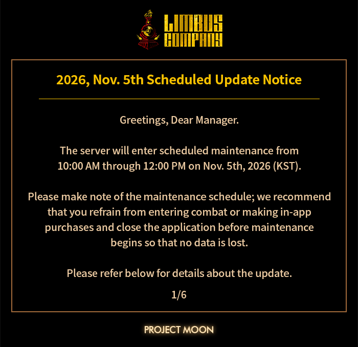
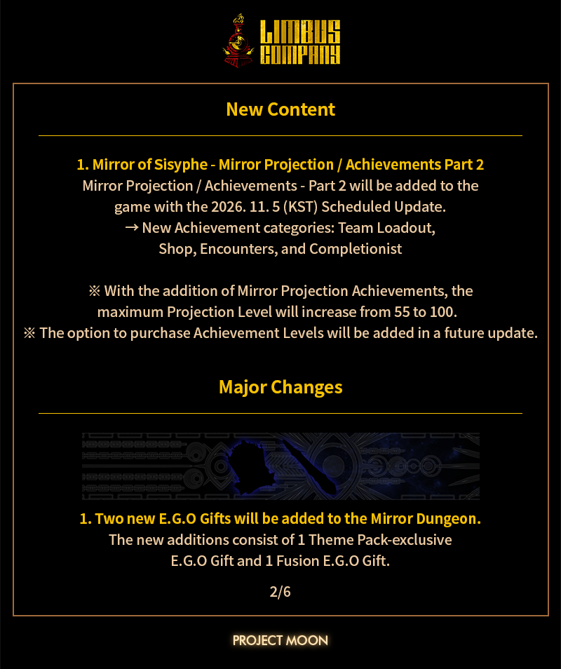
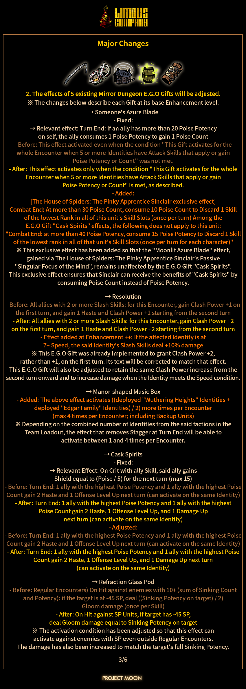
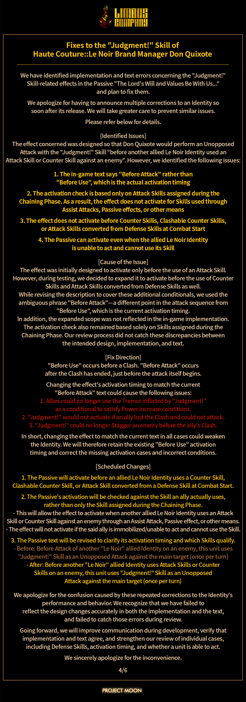
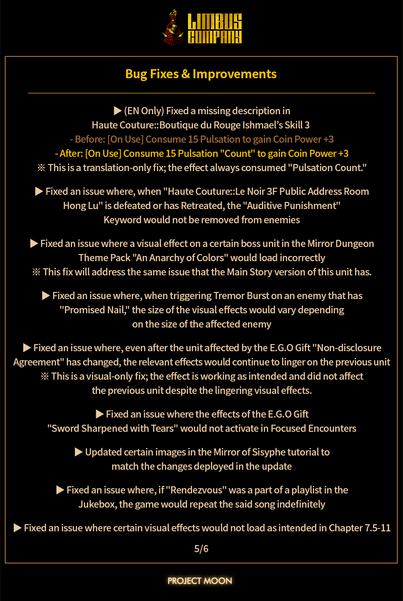
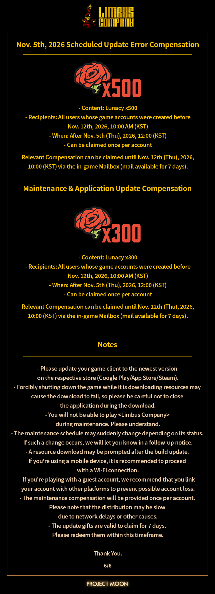

# 《边狱公司》2026年11月5日定期更新：这次维护前，你得先做完这几件事

各位罪人管理同好，我是你们的老朋友。Project Moon 那边又按惯例把新一轮定期更新公告放出来了——2026年11月5日，边狱公司准时进厂维修。官方这次依旧走的是「一张图一个板块」的信息流风格，时间、卡池、活动、商城、修复项全塞在几张公告图里，眼神不好的兄弟容易漏掉关键行。

所以这篇我按玩家真正关心的顺序给你捋一遍：什么时间维护、卡池怎么排、活动能捞多少狂气、以及维护前后有哪些「手慢就亏」的操作。

## 🎯 核心看点速览

- **维护性质**：本次为定期版本更新（Scheduled Update），服务器将进入停机维护状态，期间无法登录、无法进行抽取与战斗，维护结束后需下载更新包才能进游戏。
- **内容板块**：公告图依次覆盖了更新维护时间与补偿说明、新一期人格／E.G.O 相关内容、剧情与限时活动安排、商城与礼包变动，以及系统优化与问题修复清单。
- **卡池节奏**：按边狱公司一贯的排期逻辑，新一期卡池与活动会在维护结束后同步开启，老卡池同步下架，**维护前是当期限定内容的最后窗口期**。
- **补偿发放**：停机维护补偿（狂气等）通常在开服后通过游戏内邮箱统一发放，有领取期限，别放着不管。
- **最重要的提醒**：维护前把脑啡肽清空、镜牢周常打掉、当期卡池该抽的抽完，别等服务器关了才想起来。

## 📌 重点深度解析

### 一、卡池与抽取：别把狂气花在「明天就下架」的地方

每次定期更新最牵动钱包的就是卡池轮换。按公告的板块顺序，新一期人格与E.G.O会在维护后开放，伴随对应的概率提升安排。这里给两个硬核判断标准：

1. **看你缺的是「功能位」还是「强度位」**。边狱公司的战斗是拼队伍机制拼速度拼抗性的活儿，一张能补上队伍短板的人格，价值远高于数值好看但和你现有队伍打不出协同的角色。
2. **看碎片能否补齐**。如果你差的那张人格已经能用碎片在兑换处换到手，那这次卡池对你来说更多是「省碎片」而不是「必须抽」，优先级可以往后放。

另外提醒一句：**维护开始前不要压着保底不抽**。卡池一换，计数与当期内容都会跟着走，想赌的请在停机前解决战斗；不想赌的，就老老实实把狂气留到新池子首日再决定。

### 二、剧情与活动：限时内容的时间窗最容易被忽略

边狱公司的活动奖励向来给得不算小气，但也从不惯着拖延症。公告里的活动板块通常包含开启时间、结束时间与奖励构成，重点盯三件事：

- **活动的开启时间是否与维护结束同步**，不同步的话别一开服就冲进去找活动入口；
- **活动商店的兑换截止时间**，很多兄弟只记得打关卡，忘了把代币换成材料，最后烂在背包里；
- **是否有每日次数限制的关卡**，这类内容越早开始做，越不容易在最后两天疯狂补作业。

剧情方面，边狱公司的更新往往会推进一段可阅读内容，建议开服后先别急着抽卡，把剧情过一遍——一方面能拿到通关奖励，另一方面新剧情的关卡经常能白嫖到不少资源，正好补贴你接下来的抽取预算。

### 三、系统优化与问题修复：这些细节影响手感

公告的最后通常会附一段优化与修复说明，别看它不起眼，实战体验的差别往往就在这儿。常见的改动方向包括技能描述文本校正、判定与状态结算的修正、界面信息展示与操作流程的优化，以及部分关卡与演出表现的问题处理。

对普通玩家来说，最值得关注的是「**与你主力队伍相关的修复项**」。如果你常玩的那套队伍里有角色的技能结算被调整过，更新后的第一件事就是去训练场或低难度关卡跑一遍，确认伤害与状态挂载是否还符合你原来的连招思路。别直接拿新版本队伍去打高难，容易翻车翻得莫名其妙。

### 四、商城与礼包：先算账，再点购买

商城板块一般会列出新上架礼包、限时售卖周期与包含内容。我的建议很朴素：**把礼包拆成「狂气价值 + 材料价值」两部分粗算一遍**。如果材料你已经在镜牢里刷到溢出，那这包对你的实际收益就打折了；反之，如果正好卡在认知提升或升级的资源瓶颈上，那它可能比直接买狂气划算。

## 💡 玩家实操与上手建议

**维护前的 24 小时清单（照着做就不亏）**

| 事项 | 为什么现在做 |
| --- | --- |
| 清空脑啡肽 | 维护期间自然恢复会浪费，能刷多少刷多少 |
| 结算镜牢周常 | 周常奖励与更新周期容易撞车，提前拿稳 |
| 领完邮箱与活动奖励 | 部分邮件有有效期，别让补偿和奖励过期 |
| 当期卡池做决定 | 卡池一换，抽卡安排全变 |
| 截图记录当前队伍与配装 | 更新后对照调整，省得凭记忆瞎猜 |

**开服后的正确顺序**

1. **先下载更新、再进游戏**，别在更新中途反复重登，容易卡在验证环节；
2. 领维护补偿邮件，顺手确认邮件截止日期；
3. 过新剧情、拿通关奖励，把资源盘点清楚；
4. 再根据手头狂气决定抽不抽；
5. 最后再去碰高难关卡与镜牢，用更新后的队伍实测一遍手感。

**开黑与联机避坑**

边狱公司本身以单人推进为主，但社群讨论、攻略对照、进度分享非常活跃。新版本首日信息混乱，看到「某某人格无敌」「某某队伍必练」的结论先别急着跟，等两三天实测数据出来再投入资源更稳。资源是不可逆的，尤其丝线与碎片，砸错方向要难受很久。

**配置与体验优化**

更新后如果遇到闪退或卡顿，优先做三件事：验证游戏文件完整性、更新显卡驱动、清理缓存并预留足够磁盘空间。演出类内容较多，机械硬盘用户建议把游戏放在固态上，加载体验差别明显。

## 📢 官方 Telegram 频道推荐

边狱公司的更新节奏快、活动窗口短，最容易吃的亏就是「看到的时候已经结束了」。想第一时间拿到限免、史低、版本更新与活动开启的秒级推送，建议加入官方 Telegram 频道 **@steamhunterlink**，把通知打开，剩下的交给它提醒你。

## ❓ 常见问题 FAQ

**Q1：维护期间能登录游戏吗？会不会影响我的存档？**

A：停机维护期间无法登录，属于正常的服务器端操作，不会影响你的账号数据与抽取记录。维护结束后下载更新包即可正常进入，建议不要在维护中反复尝试登录，避免卡在验证界面。

**Q2：维护补偿什么时候发？我错过领取会怎样？**

A：补偿一般在开服后通过游戏内邮箱统一发放，通常设有领取期限。错过期限的邮件会失效，所以开服第一件事就是进邮箱把补偿和活动奖励一起领掉。

**Q3：更新后卡池换了，我之前的抽取进度还在吗？**

A：不同卡池的计数与保底规则各自独立，卡池结束后对应计数不会延续到新池子里。所以当期卡池的抽取安排请在维护前做完决定，别指望「留到下次一起用」。

**Q4：更新后我原来的队伍还能打吗？**

A：绝大多数情况下可以，但公告里若涉及你主力角色的技能结算或状态判定修正，实战表现可能会有细微变化。开服后先在低难度内容里跑一遍手感，再决定是否调整队伍配置。
