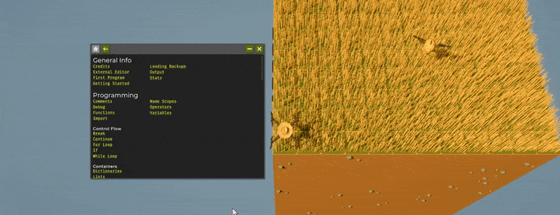
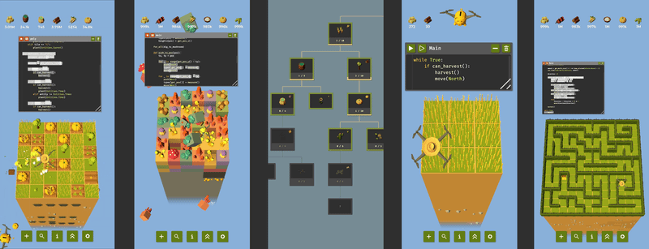

兄弟们，今天这消息对喜欢“写代码种田”的硬核玩家来说相当炸裂——《The Farmer Was Replaced》不仅把新DLC《The Miner Was Replaced》端上来了，还顺手把手机版也推上线了。过去你只需要琢磨怎么让无人机把农场自动化，现在它能直接下矿，把整个地下世界挖穿，顺便塞给你一堆全新的编程题。

## 🎯 核心看点速览
- **DLC《The Miner Was Replaced》现已发售**：Steam 商店页：[点我查看](https://store.steampowered.com/app/4521700/The_Miner_Was_Replaced/)。
- **矿区内容加入解锁树**：新机制、新问题、新资源，无人机可下矿作业。
- **本体同步大更新**：游戏内文档重做，交互式代码示例可直接运行，搜索、返回按钮、锁定页面提示全部优化。
- **手机版同步上线**：包含《The Miner Was Replaced》DLC 内容，并配有专属代码键盘。
- **原帖配图**：见下方文档与手机版段落。

## 📌 重点深度解析

### ⛏️ 矿工DLC：从农场主到地下包工头
这次DLC不是简单加一张地图，而是把“编程自动化”的舞台从农田搬进了矿洞。你的无人机现在能深入地下，挖煤、找石英，处理蘑菇分拣，在黏土上种水稻，还会遇到一个灵感来自扫雷的编程挑战。解锁树里新增了一整块矿区分支，新机制和新问题会随着进度逐步展开，足够让喜欢琢磨逻辑的老哥啃上一阵。

对老玩家来说，最爽的点是“自动化对象”变了：以前是作物、地块和路线，现在多了资源、矿层和更复杂的分拣逻辑。你写的每一行代码，最后都会变成地下流水线上的实际产出。

### 📖 本体文档重做：新手少走弯路，老手查函数更顺
本体这次也迎来了一轮很实在的更新：游戏内文档被重新梳理，单个函数和概念的说明更好懂。官方重写了大量解释，补了更多例子，相关主题之间的跳转也更顺。最香的是**交互式代码示例**——可以直接在文档窗口里跑起来，不用切出去自己从头试。文档还加了返回按钮，搜索也做了优化，被锁住的页面会直接告诉你需要哪项研究才能解锁。

这对新手来说能少走不少弯路，对老手来说查函数、试写法也更省时间。以前遇到不熟的函数只能硬啃，现在文档里就能把示例跑通再改，效率高很多。

### 📱 手机版：真能在手机上写代码？
《The Farmer Was Replaced》手机版今天也一起上线了，而且**包含矿工DLC内容**。官方专门为移动端做了自定义键盘，目标是让在手机或平板上写代码、改代码更舒服。说实话，手机写代码听着有点邪门，但 Ateo 团队确实在这块下了功夫，官方也表示实际效果比想象中好。

手机版入口：[官方页面](https://farmer.ateo.ch/)，Google Play 和 App Store 均已上架。

## 💡 玩家实操与上手建议
- **购买建议**：想玩矿区内容，需要先有本体，再补《The Miner Was Replaced》DLC；新玩家直接本体+DLC一起入更省事。
- **开荒顺序**：先把本体农场的自动化基础打牢，再进矿区。优先解锁资源挖取和分拣相关能力，再去碰扫雷式挑战，不然容易卡逻辑。
- **文档用法**：遇到新函数先翻文档，能跑交互式示例就直接跑，改几个参数看结果，比干瞪眼强。
- **手机版定位**：适合随时看文档、轻量改代码；复杂工程还是PC键鼠更稳，手机上建议外接键盘或大屏平板。
- **单机提醒**：这游戏偏单机编程解谜，没有联机开黑那一套，别指望拉兄弟一起下矿。
- **配置优化**：本体体量不大，老电脑也能跑；手机版长时间玩注意电量和散热，复杂自动化跑起来时别开太多后台。

## 📢 官方 Telegram 频道推荐
想第一时间蹲 Steam 限免、史低背刺、突发更新和喜加一消息？建议加入官方 Telegram 频道 **@steamhunterlink**，秒级推送限免与特惠，不用天天刷商店页。

## ❓ 常见问题 FAQ
**Q1：玩《The Miner Was Replaced》必须买本体吗？**
A：需要。DLC 是《The Farmer Was Replaced》的扩展内容，得先有本体；手机版官方说明已包含矿工DLC内容，具体以商店页为准。

**Q2：手机版和PC版存档互通吗？**
A：这次官方公告没有提到跨平台存档互通，建议以各自平台的实际表现为准；如果两边都玩，最好分开规划进度。

**Q3：本体这次文档重做要额外付费吗？**
A：不用。文档重做、交互式示例、搜索优化和一堆修复是随本体更新免费推给所有本体玩家的，DLC 才是单独购买内容。
