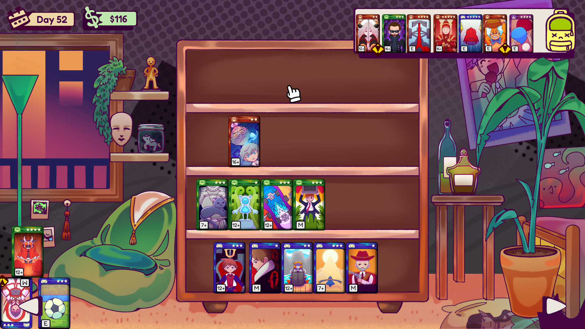
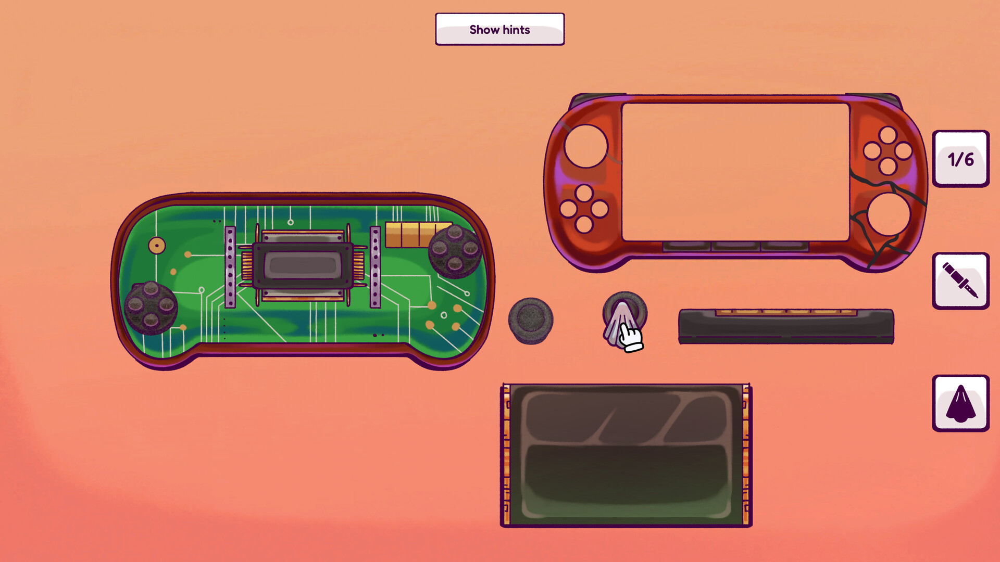
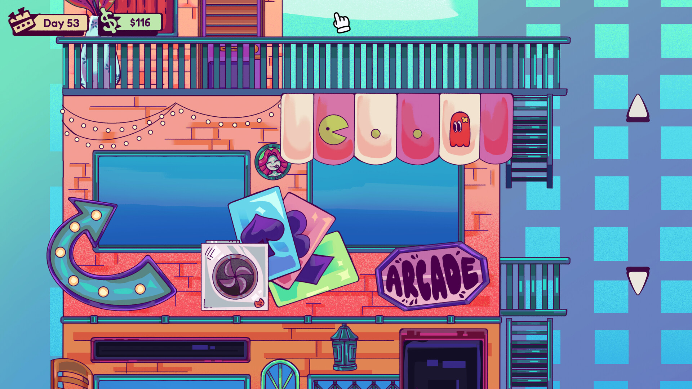
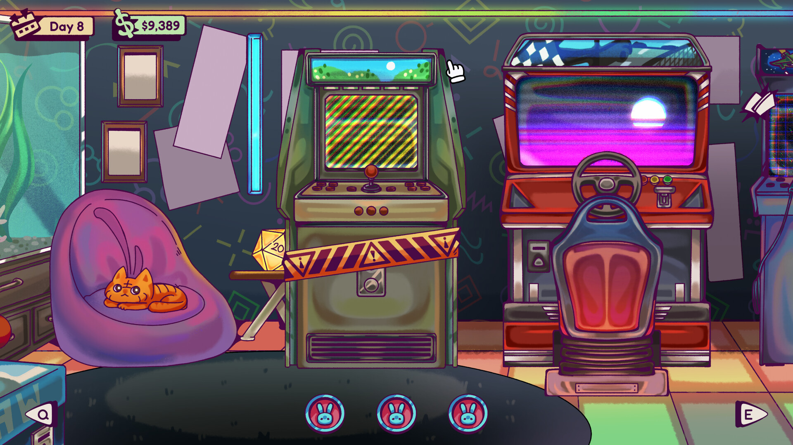

招牌翻到「营业中」这一面了——**《Replay Value: Second Hand Games》正式发售！** 一间堆满旧光盘、卡带和灰尘的 2000 年代二手游戏小店，从今天起归你管。别的模拟器让你当农场主、当餐厅老板，这款直接把你按在柜台后面：一边和顾客砍价，一边拿着螺丝刀给古董主机续命。

## 🎯 核心看点速览

- **正式版上线**：经过 Demo 阶段的大量试玩与反馈收集，游戏现已完整发售，内容从「试玩小样」升级为「完整货架」。
- **买卖议价闭环**：看行情、自己定价、决定是再压一手还是收钱落袋，全流程手动操作。
- **旧货复活玩法**：清洁光盘、修复卡带、测试疑似坏掉的游戏——那笔看起来像坑的便宜货，可能就是你的下一件镇店之宝。
- **硬件维修系统**：拆 PC、拆主机、拆掌机、拆复古硬件，除尘、补焊点、换损坏零件再原样装回去。
- **收集与装修**：把最好的收获带回家，冲击 100 款五星游戏收藏；解锁更多平台与品类、扩货架、换家具风格，把小店改成自己的样子。
- **店外生活**：Steven's Cafe 喝饮品拿每日加成、每周杂志挑战、抛硬币/掷骰子/石头剪刀布等特殊顾客小游戏，以及 Riley's Arcade 的三款街机摸鱼项目。

## 📌 重点深度解析

### 一间有味道的 2000 年代小店

这套美术走的是温和怀旧的路线：木质货架、泛黄的封面、堆到快塌的纸箱。它不靠夸张的特效抓人，而是靠「我小时候真进过这种店」的既视感留人。开局的店面很小，小到你会怀疑这生意能不能做下去——而这正是节奏设计的一部分：每一次进货、每一次成交都在往店里添一块砖。

### 交易是门手艺，不是点按钮

游戏把「买」和「卖」拆成了完整的判断链：先看市场价值，再自己定价格，然后在议价环节决定要不要再往上顶一手，还是干脆收钱开心成交。贪心压价可能直接把这单谈崩，急着出手又等于白送利润。它真正考验的是你对行情的记忆力和对顾客的耐心，而不是手速。

### 从清洁光盘到补焊点，全套手艺活

二手货的魅力在于「未知」。清洁光盘、修复卡带、测试那些状态可疑的游戏，是这套玩法的第一层；第二层直接进阶到硬件：拆开 PC、主机、掌机和各种复古设备，清灰、补焊裂开的焊点、替换损坏部件，最后完整装回。装错、漏件、忘装某一步，机器不会给你好脸色。喜欢折腾实机的玩家，光这一套就够玩很久。

### 收藏与店铺成长的双线目标

一条线是店：解锁更多平台和品类、扩货架、挑家具风格，让小店从「转身都困难」变成「逛一圈要看半天」。另一条线是家：把最得意的收藏带回去摆好，朝着 100 款五星游戏的目标推进，超出目标还能继续塞进家里的收纳箱。这个设计挺懂玩家——很多人开二手店，本来就是为了给自己一个合理囤货的借口。

### 柜台之外，才是生活的全貌

Steven's Cafe 的每日饮品加成值得当成日常仪式来跑；每周杂志挑战给了明确的短期目标，不至于开门就陷入「今天卖点什么好」的空转；特殊顾客带来的硬币、骰子、石头剪刀布小游戏，则把交易变成了带点赌博味儿的互动。累了就溜去 Riley's Arcade 打一把太空射击、打砖块或者 Sunset Drive，回家看看自己的收藏墙，顺手给猫补上欠它的注意力。

## 💡 玩家实操与上手建议

1. **先记住行情，再谈扩张**。开局资金紧张，别看到便宜货就扫货。优先熟悉几个常见品类的市场价区间，再决定进货结构；压货是新手最常见的翻车点。
2. **议价别上头**。对方已经给到接近心理价位时，果断成交。为了多挤一点利润把单子谈崩，等于自己给自己加难度。
3. **维修要先看清楚再动手**。拆机前留意部件位置和拆解顺序，装回去的时候少一颗螺丝都可能让整台机器白修。建议先拿便宜的坏件练手，熟练了再接贵重设备。
4. **每日加成和每周挑战当成固定日程**。咖啡馆的每日效果属于纯白给，杂志挑战往往能顺带清库存，别漏。
5. **五星收藏提前规划**。想凑齐 100 款五星，就得分清「拿来卖的」和「留着自己看的」，否则好货全被你在最缺钱的时候卖掉，回头再找就难了。
6. **配置与体验**：这是轻量级模拟经营，主流核显与老显卡基本都能应付，但建议装在 SSD 上减少加载等待；长时间连续经营的话，把窗口分辨率和帧率上限调到舒适档位，眼睛更舒服。
7. **购买建议**：本体已包含完整的经营、维修与收藏内容，直接入本体即可开玩。想省钱可以把游戏放进愿望单蹲一波折扣，同时关注社区里的玩家实测反馈，确认当前版本稳定性符合你的预期。

## 📢 官方 Telegram 频道推荐

想第一时间拿到 Steam 限免喜加一、史低特惠和发售情报？加入官方 Telegram 频道 **@steamhunterlink**，秒级推送直达手机，永久入库的机会一次都不错过。蹲折扣、蹲免费周末、蹲上线通知，一个频道全包。

## ❓ 常见问题 FAQ

**Q1：这是完整正式版还是抢先体验？现在入坑会不会内容不够？**
A：本次为正式发售版本，官方在公告中也专门感谢了 Demo 阶段参与试玩、反馈问题与加入愿望单的玩家。正式版包含完整的买卖议价、旧货修复、硬件维修、收藏与店铺装修玩法，以及咖啡馆、杂志挑战、街机厅等店外内容，属于可以直接长期游玩的状态。

**Q2：之前玩过 Demo，正式版需要重新开始吗？**
A：Demo 与正式版属于不同的产品条目，存档通常不互通，建议以正式版新建档体验。具体继承情况请以商店页面说明与 Steam 社区公告为准，遇到异常可以直接在 Steam 讨论区反馈。

**Q3：遇到 bug 或者想提建议，去哪里说最有效？**
A：官方明确表示欢迎在 Steam 讨论区或 Steam 评测中反馈，并提醒附上具体现象和你当前游玩的版本号，方便开发团队定位排查。想反馈硬件维修手感、议价难度、装修选项这类细节，也一并写清楚，制作组是真的在看。

> 你淘到的第一件宝贝、你最偏爱的那个顾客、还有那款死活舍不得卖的游戏——从今天起都可以在《Replay Value: Second Hand Games》里实现。下一件好东西，正在货架上等你。

商店页面：https://store.steampowered.com/app/3683940/
