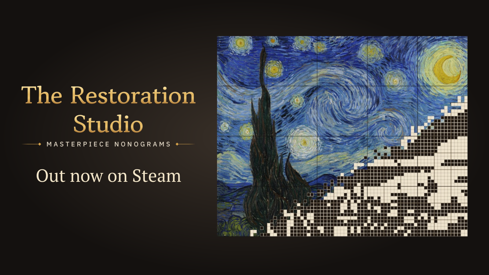

等了一阵子，JJJI STUDIO 终于把《The Restoration Studio: Masterpiece Nonograms》推上了 Steam 正式舞台。官方公告很短，但信息量够直接：试玩版没白玩，玩家反馈被认真听见，现在轮到我们进工作室，把一幅幅名画用数织逻辑“修”回来了。

## 🎯 核心看点速览

- **正式登陆 Steam**：游戏已从试玩阶段走到正式发售，商店页可直接查看售价、语言与配置需求。
- **名画修复 × 数织解谜**：核心玩法不是无脑填格，而是用数字线索还原图案，再把“修复”主题做出沉浸感。
- **试玩反馈被点名感谢**：官方特别向参与试玩并给出意见的玩家致谢，说明开发组在意社群声音。
- **适合慢节奏逻辑党**：喜欢 Nonogram、Picross、逻辑拼图与修复题材的玩家，可以重点关注。

## 📌 重点深度解析

### 1. 这不是“随便涂格子”，而是把数织做成修复工作

从官方给出的定位看，《The Restoration Studio: Masterpiece Nonograms》把数织解谜和名画修复绑在一起。玩家面对的不是冷冰冰的题库，而是一间有主题感的工作室：先读数字线索，再判断哪些格子该填、哪些该留白，最后让画面一点点显形。对老数织玩家来说，这种“从线索到图像”的反馈很上头；对休闲解谜玩家来说，名画修复的包装也比纯数字表格更有代入感。

### 2. 试玩版玩家的意见，官方没有装听不见

这次公告里最值得注意的一句，是 JJJI STUDIO 对试玩玩家和反馈的感谢。独立解谜游戏最怕闭门造车，数织尤其吃手感、标记逻辑、关卡难度曲线和界面可读性。官方愿意在发售节点专门致谢，至少说明试玩社群的声音被摆在了台面上。正式版实际体验是否把反馈吃透，建议大家进游戏后重点看三点：格子标记是否顺手、错误提示是否合理、后期大图会不会变成眼睛遭罪。

### 3. 谁适合入手，谁可以先观望

如果你喜欢《Picross》那套逻辑推演，或者享受“排除法 + 确定格 + 连锁打开局面”的爽感，这款游戏的题材和玩法是对味的。你要是只想找快节奏爆米花游戏，数织可能会让你在第三关就开始怀疑人生。更稳妥的做法是：先看商店页截图和玩家评价，确认界面、关卡量和难度曲线合自己胃口，再决定要不要第一时间入库。

## 💡 玩家实操与上手建议

**入库与查找**：在 Steam 搜索“The Restoration Studio: Masterpiece Nonograms”，或直接查 AppID **5354800**。打开商店页后先看售价、支持语言、系统需求和是否提供试玩/ Demo；如果暂时不想原价入，先加愿望单蹲折扣也不亏。

**数织开荒小技巧**：
1. 先找长数字串和边缘行列，确定格往往藏在这些地方。
2. 善用标记功能，把“确定填”“确定空”“待定”分开，别让大脑内存爆掉。
3. 遇到大图不要硬猜，卡住就换行、换列，或者退一步看整体节奏。
4. 连续失误时先停手，数织最怕上头，越急越容易把确定格点成空格。

**购买建议**：本次是正式发售消息，官方没有在公告里提到限免、喜加一或折扣活动。想省钱就盯商店折扣与捆绑包；想支持独立解谜开发组，原价入也说得过去。别被“名画修复”四个字骗去冲动消费，先确认自己真的喜欢 Nonogram 逻辑盘，再掏钱包。

## 📢 官方 Telegram 频道推荐

想第一时间收到 Steam 限免、喜加一、史低折扣和临时工价格？建议加入官方 Telegram 频道 **@steamhunterlink**。秒级推送比你自己刷商店页靠谱，尤其适合不想错过“永久入库”和免费周末的玩家。

## ❓ 常见问题 FAQ

**Q1：现在就能玩到《The Restoration Studio: Masterpiece Nonograms》吗？**
A：可以。官方已宣布游戏正式登陆 Steam，直接在商店搜索游戏名或 AppID 5354800 就能找到。具体能否购买/下载以你所在区服的商店页为准。

**Q2：这次有喜加一或免费领取吗？**
A：本次官方公告只确认正式发售，没有提到限免或喜加一。是否免费、是否打折，请以 Steam 商店页实时信息为准；想蹲福利可以关注 @steamhunterlink 的推送。

**Q3：试玩版进度会继承到正式版吗？**
A：官方这则发售公告没有说明存档继承规则。建议首次启动正式版时留意游戏内提示，或查看 Steam 社区公告；如果没有继承，就当作重新开一间修复工作室，反正数织重开也不亏。
