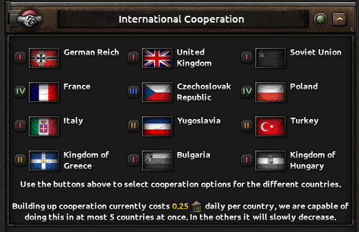
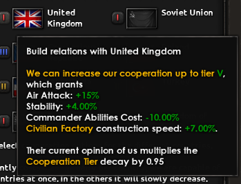
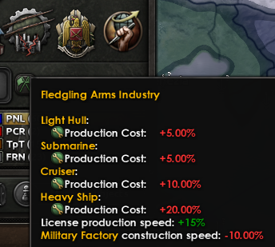
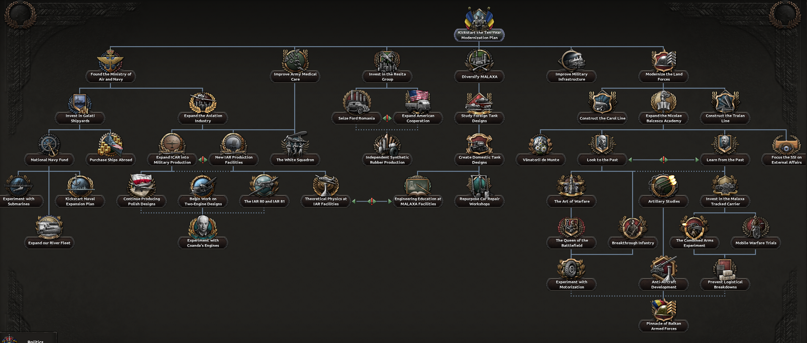

# 钢铁雄心4罗马尼亚日志：合作机制、军事树与共产路线前瞻

*Salut*, Generals！各位将军们好，我是你们的老朋友，本期继续蹲守 HOI4 的开发日志前线。这次由 ***marijn211*** 出镜，聊的是罗马尼亚焦点树里偏左的那一大块——按游戏内位置和政治光谱双重意义上的“左”。除了焦点树，他还把上次 Dev Corner 只露了个脸的**国家合作机制**掰开揉碎讲了一遍。废话不多说，巴尔干的火药味已经飘过来了。

## 🎯 核心看点速览

- **全新国家机制“合作”**：用政治点数投资列表内的国家，换取固定加成，玩法类似“便宜版工业关注度”，但前期启动费用不低。
- **关系决定门槛**：罗马尼亚和匈牙利、保加利亚的历史恩怨直接写进机制，不完成特定焦点或拉进同一阵营，连互动按钮都点不动。
- **军事分支完整拆解**：海军走加拉茨造船厂路线，空军围绕 IAR 80 展开，还塞了波兰旧设计续命和 Henri Coanda 喷气研究两条岔路；中央主打军工与坦克产业，右侧管陆军学说与编制。
- **共产主义分支有“心结”**：罗马尼亚民众对沙俄/苏联的历史阴影成了转向共产主义的主要阻力，1936 年苏联的最新挑衅就是开局背景之一。
- **国家精神会成长**：开局那个代表军工薄弱的负面精神，会随着军事焦点推进逐步升级，最终变成纯正面修正。

## 📌 重点深度解析

### 合作机制：政治点数的新去处

先说这次的重头戏。合作机制的核心思路很直白：列表里列出一批可以“经营关系”的国家，玩家花政治点数把关系层级往上顶，每提升一档就拿到预设好的加成。

从截图能看到，这个机制有明确的可用国家名单。有意思的是，罗马尼亚和匈牙利、保加利亚的关系实在算不上友好，所以在完成某些特定焦点、或者干脆和它们混进同一个阵营之前，这两家的互动是被锁死的。换句话说，你想靠政治点数把老邻居哄好，得先把历史账算清楚。

互动方式分两层：一是投政治点数提升层级，拿到那批固定的好处；二是层级还会影响挂在这个机制上的若干决议。按开发者的说法，每个国家都像是一个“便宜的工业关注度”——启动时要掏一笔不小的政治点数，之后维护成本就低下来了。对于政治点数常年吃紧的巴尔干小国来说，这是个需要精打细算的投资位，前期咬牙投进去，中后期才能回本。

### 军事分支：从“几乎没有”到十年现代化

1936 年的罗马尼亚军工产能基本可以用“查无此物”来形容，但二战前它扩张得相当快，背后是 1935 年由 *Ion Antonescu* 等军方人物提出的十年现代化计划。开局给的那个国家精神就是这段尴尬期的写照，不过它会随着军事焦点推进不断升级，最后变成纯正面修正——属于典型的“先苦后甜”设计。

**海军线**从加拉茨造船厂的历史投资起步，给罗马尼亚第一座干船坞，让它能造更大的船。后续扩张焦点属于“贴着历史走”的选项，比如扩编内河舰队。由于游戏里压根没有对应吨位的内河舰种，罗马尼亚转而拿到一个相当舒服的河流地形加成——这波属于用机制补偿现实，内河防御战爱好者可以期待一下。

**空军线**的终点是那架相当成功的 IAR 80 战斗机。中间给了两条岔路：一条是继续用罗马尼亚短暂装备过的波兰设计，性价比高但确实过时；另一条是请出 *Henri Coanda* 帮忙，直接往喷气发动机研究上砸资源。前者稳，后者赌，看你这一局想怎么玩。

**军事分支中央**聚焦军工产业建设，部分焦点专门盯着坦克生产启动。这里有个很实用的小设计：可以从其他国家小批量购买坦克，通过研究对方设计拿到科研加成。对小国来说，这等于花点钱买时间，省下自己从零摸索的研发周期。

**最右侧**则交给陆军学说与组织编制，属于正面战场硬实力的来源。

### 共产主义分支：历史心结不好解

想让罗马尼亚老百姓转头拥抱共产主义，难度不小。原因很现实：他们跟俄罗斯帝国、以及后来的苏联打交道时吃的亏太多，记忆犹新。1936 年苏联最新的那次挑衅，就是这条路线开局要面对的背景板。

日志在这里刚起了个头，后续怎么用焦点和事件化解这股民意阻力，还得等下一期继续揭晓。但可以确定的是，这条线不会是“点几下就变红”那么简单，大概率和合作机制、邻国关系会有一波联动。

## 💡 玩家实操与上手建议

1. **政治点数别乱撒**：合作机制的启动成本不低，建议先确定这局的核心战略方向，再决定投资哪几个国家。想走巴尔干小协约路线的，优先处理周边关系；想闷头发育的，把点数留给关键焦点。
2. **匈牙利和保加利亚先做功课**：想跟这两位互动，先翻焦点树找解锁条件，或者干脆规划好阵营路线。别等到开战了才发现外交界面还是灰的。
3. **坦克“买来主义”很划算**：前期自研坦克周期长，从国外小批量采购拿研究加成，能明显缩短你出成品的节拍。适合喜欢装甲流但工业底子薄的玩家。
4. **国家精神要盯紧**：那个军工薄弱精神会随焦点升级，越早推进军事树，负面期越短。开局别把国策点全砸在民用上。
5. **空军岔路按局势选**：周边压力大就走波兰旧设计的稳妥路线，想赌中期制空就用 Coanda 冲喷气。别两边都点，点数不够霍霍的。

## 📢 官方 Telegram 频道推荐

想第一时间收到 HOI4 新 DLC 上架、史低折扣和限免喜加一？建议加入官方 Telegram 频道 **@steamhunterlink**，秒级推送，不用天天刷商店页，也不怕错过临时工价。

## ❓ 常见问题 FAQ

**Q1：这个罗马尼亚内容什么时候能玩到？**
A：目前还是开发日志阶段，官方没有给出确切上线日期。按 HOI4 一贯节奏，从日志连载到 DLC 正式发售通常要经历数月的打磨，建议关注官方公告和频道推送。

**Q2：合作机制里的政治点数投入值得吗？**
A：看你怎么算账。启动费用高、维护费用低，属于长线投资。如果你这局打算熬到中后期，回本是没问题的；如果是速战速决的玩法，优先级可以往后放放。

**Q3：罗马尼亚走共产主义路线会不会很难？**
A：从日志描述看，确实有额外阻力，民众对苏联的历史记忆被做成了机制层面的障碍。具体要靠哪些焦点和事件化解，得等后续日志披露，但可以肯定不是一键转政体那么轻松。

**Q4：内河舰队那条线没有对应舰种，是不是废了？**
A：不废。开发者用河流地形加成做了替代补偿，对依托多瑙河防御的玩法反而是实打实的增益，具体数值等实装后再验证。
