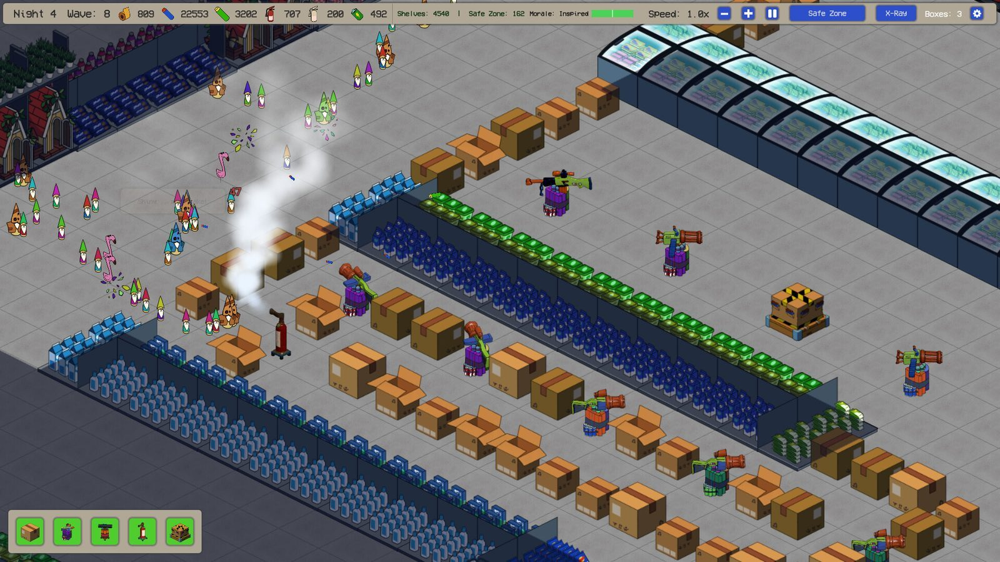
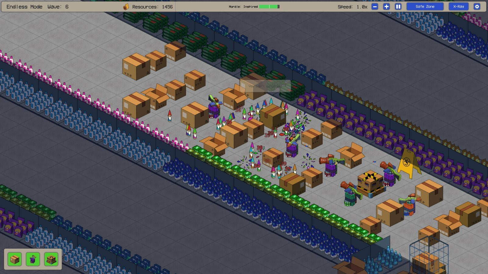

打烊铃一响，真正的战斗才刚开始。这周我在商店货架间蹲了一整晚，就为了看一眼《Clearance Defence》到底能把「清仓」这个题材玩出什么花样——结果它真没让我失望。

## 🎯 核心看点速览

- **正式发售**：《Clearance Defence》现已登陆 Steam，面向 Windows PC 平台，首发 **9 折（10% off）**，优惠一直持续到 **11 月 9 日**。
- **题材够邪门**：故事发生在一家闭店后的商店里，卖不掉的复活节滞销库存集体诈尸，为了争夺清仓货架，对新上架的夏季货品发起冲锋。你的任务只有一个——守到天亮，否则全部进垃圾箱（skip）。
- **完整战役 10 个夜晚**：从第 1 夜的新手教学，一路打到最终关「Final Clearance」，全部内容就是这条战役线，没有藏着掖着的付费墙。
- **无尽模式解锁条件**：通关第 4 夜，**Endless Mode** 自动开放。之后你可以任选已通关的夜晚重开，看看在敌潮永不结束的情况下，自己能撑多久。
- **试玩进度可继承**：如果你在同一台 Windows PC 上玩过 demo，第一次启动正式版时会提示把存档搬过来，不用从零再来。
- **Devlog #10 后的修复**：地精门口、掠夺者货架、清仓货架正前方的格子禁止建造；困难难度下，塔或墙等待升级材料时，蓝色的升级徽章不再遮挡材料计数。

## 📌 重点深度解析

### 一、把「超市闭店」做成塔防，这脑洞确实够味

市面上塔防一抓一大把，但把战场搬进打烊后的商店货架，再把「换季清仓」这种零售业日常翻译成敌我阵营，这个设定我确实服气。复活节的兔子、彩蛋、滞销杂货成了守方这边要死磕的老住户，夏季新货则是咄咄逼人的进攻方，双方隔着一条清仓过道互相拉扯，谁输了谁进垃圾箱。

这种设定不只是皮，它天然给关卡提供了叙事节奏：从第 1 夜的仓促上手，到后面逐步加码的波次压力，玩家推进的过程本身就是「一晚一晚熬过去」的过程，代入感比那些抽象塔防强得多。

### 二、10 晚战役 + 无尽模式，耐久度够

正式版内容即完整战役，十夜的难度曲线从教学关一直拉到最终清仓，关底自然也有 BOSS 坐镇——官方在另一篇开发日志里专门聊了最后两夜和它们的 BOSS 设计，想提前做功课的可以去看一眼那篇公告。

真正让游戏寿命翻倍的是无尽模式。通关第 4 夜后，你就能自由挑选任意已通关的夜晚开无尽，波次不再有终点，只看你能扛到第几波。这机制对喜欢抠塔位、抠数值的硬核玩家来说就是个时间黑洞，一晚上眨眼就没了。

### 三、这次更新修的两个点，都是真痛点

**入口格子不再被堵死。** 之前你可以在地精门口、掠夺者货架或清仓货架正前方那一格上直接盖塔盖墙，结果单位出不来，关卡直接卡住。现在这些格子被划为禁建区，建筑网格里用橙色高亮标出来，一眼就能认出哪些位置别碰。需要说明的是，老存档里已经立在那儿的墙或塔不会被自动拆掉，所以老存档玩家还是得自己动手清一下。

**困难难度的材料计数不再被遮。** 这个属于纯粹的 UI 体验问题：塔或墙在等 Construction Material 升级期间，蓝色升级徽章会盖住「还差多少材料」的数字。困难难度下材料本来就紧，看错一眼可能就是一整晚的节奏崩盘，修掉之后终于能安心数数字了。

### 四、反馈通道就在手边

如果你在游戏里遇到崩坏或者手感不对劲的地方，主菜单和暂停菜单里都有 **Report a bug** 按钮，反馈会直接送到开发者本人手里。这也解释了为什么这游戏从 playtest 到 demo 再到正式版，修 bug 的节奏一直挺快——愿意听玩家说话的小团队，我一向愿意多给点耐心。

## 💡 玩家实操与上手建议

**1. 入手时机别磨蹭。** 首发 9 折只到 11 月 9 日，之后大概率回原价。对这种体量的小团队塔防来说，首发折扣基本就是近期最划算的一档，谈不上什么背刺空间；真想等更低价，那得看后续有没有大版本或者节日促销了。

**2. demo 存档记得继承。** 前提是你在**同一台 Windows PC** 上玩过试玩版。首次启动正式版时游戏会主动询问是否导入进度，看到提示别手快点掉，直接确认就行。换机器、重装系统的情况就没这个福利了。

**3. 前四夜当成必修课。** 第 1 夜是教学，别急着跳；第 4 夜是解锁无尽的门票，无论如何先把它啃下来。这四晚基本会把塔与墙的搭配逻辑、材料经济、敌人类型给你过一遍，后面几夜的难度爬升全靠这套底子。

**4. 建造网格里的橙色格子当红灯看。** 那块区域永远别盖东西，单位出不来就是硬卡关。老存档如果发现某个入口被墙堵了，手动拆掉再继续。

**5. 无尽模式建议从你最熟的那一夜开。** 波次不会停，前期布局的经济效率直接决定你能走多远。先拿已经摸透地形的关卡练节奏，再挑战高难度夜晚，体验会顺很多。

**6. 报 bug 别嫌麻烦。** 主菜单和暂停菜单都能一键提交，附上当时的关卡和操作，比在讨论区发帖有用得多。

## 📢 官方 Telegram 频道推荐

想第一时间蹲到限免喜加一、临时工折扣和这类小团队新游的首发特价，建议直接加入我们的官方 Telegram 频道 **@steamhunterlink**。秒级推送，不用天天刷商店页刷到手酸，热门福利也不会因为睡了一觉就错过。

## ❓ 常见问题 FAQ

**Q1：首发 9 折值得现在买吗？之后会不会更便宜？**

A：优惠截止到 11 月 9 日，之后回到原价。按目前的信息看，正式版包含的是完整 10 夜战役加无尽模式，内容量对得起独立塔防的定位。急着玩就直接上；不急的话可以先加愿望单等节日促销，但短期内别指望出现比首发更狠的价。

**Q2：我玩过 demo，进度怎么带进正式版？**

A：在同一台 Windows PC 上首次启动正式版时，游戏会主动提示导入试玩进度，确认即可，不需要手动找存档文件。换了设备或者重装过系统的，就没法继承了。

**Q3：无尽模式怎么解锁？需要打通全战役吗？**

A：不需要。只要通关 **第 4 夜**，Endless Mode 就会开放。之后你可以任选任意一个已经通关的夜晚开启无尽挑战，看自己在无限波次下能撑多久。

**Q4：游戏支持哪些平台？**

A：目前发售的是 Windows PC 版本，通过 Steam 购买与下载，本体即完整战役内容，没有额外的 DLC 拆分。
