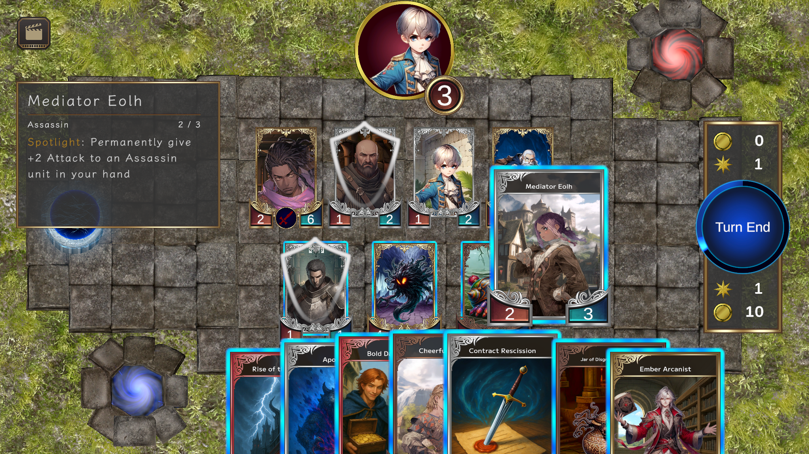
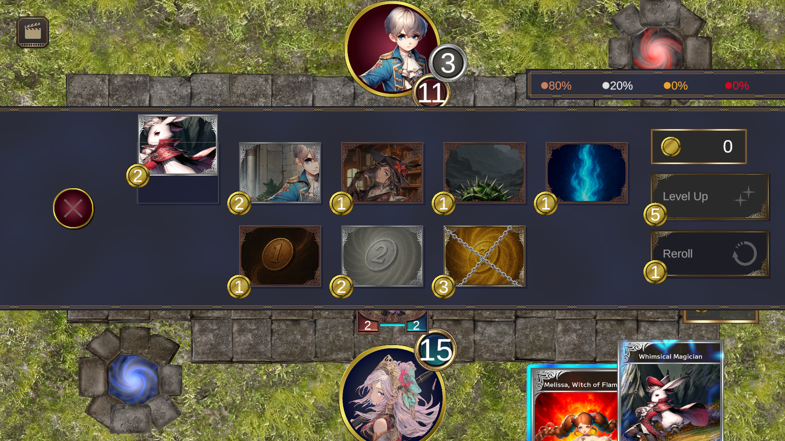

# Caldra正式发售：买卡卖卡的1v1对决来了，但服务器倒计时也亮了红灯

各位牌佬，今天这消息有点复杂：独立开发者Seido的1v1卡牌游戏《Caldra》终于按下Steam正式发售按钮，按常规剧本该开香槟；结果官方同日又丢出一颗雷——在线服务计划在近期关闭。香槟塞还没飞出去，服务器倒计时先亮了。我先把关键信息摆上桌，再聊这套玩法到底有什么钩子。

## 🎯 核心看点速览

- **正式发售**：《Caldra》已经结束抢先体验阶段，以完整版姿态登陆Steam。
- **核心玩法**：1v1竞技卡牌，最大特色是局内用金币**买卡、卖卡、现场组牌**，不是开局前锁死卡组那么简单。
- **三章赛制**：对局分三章推进，资源规划、心理博弈和翻盘窗口都拉得更长，不到最后一刻别急着敲GG。
- **职业混搭**：多种独特职业可组合，围绕职业特性拼出你的终极卡组，套路空间不小。
- **PVE彩蛋**：官方明确提到“你甚至能打龙”，卡牌游戏也得给龙留点面子。
- **重要提醒**：官方在发售同日公告，**在线服务计划于近期关闭**，具体时间与安排请以Steam公告为准。

## 📌 重点深度解析

### 1. 局内金币经济：你的牌组是“买”出来的

《Caldra》和传统CCG最不一样的地方，是它在对局中引入了金币买卖机制。你可以把金币理解成弹药和预算：什么时候补强曲线，什么时候卖掉暂时用不上的牌换节奏，什么时候憋一波大的，都很考验临场判断。

这套设计的好处是，对局不会一开局就写成死剧本。你以为对手在屯资源，他可能下一章直接掏出一套组合拳；你以为自己卡手了，结果卖两张牌换金币，反而把节奏盘活。说白了，这游戏不只考你“会不会打牌”，还考你“会不会做生意”。

### 2. 三章赛制：翻盘点藏在后半程

三章格式让对局有了明显的阶段感。前章铺路，中章争夺节奏，末章决胜，资源怎么跨章分配非常关键。很多卡牌游戏输在起手，但《Caldra》的三章结构给了更多“中场调整”的机会。当然，也给对手留了更多阴你的空间。

### 3. 职业组合与打龙：套路不止一条

官方强调可组合多种独特职业来打造终极卡组，这意味着牌池深度和职业搭配是长期研究的重点。至于打龙，别管是挑战还是彩蛋，卡牌游戏里看见龙，先别慌，先看看手里有没有解。

### 4. 发售与关服同日：最让人唏嘘的地方

根据官方公告，《Caldra》的在线服务计划在不久后关闭，详情见：

https://store.steampowered.com/news/app/4452480/view/714542561332562092

开发者Seido在后记里也把话说得很实在：这是他第二款游戏，灵感来自高中时期接触的《Shadowverse》，想做一款自己的卡牌游戏，梦想追了将近十年。由于是线上竞技游戏，他选择自建并维护游戏服务器，而每月服务器成本对个人开发者并不轻松；营销和商业化又不是他的强项，最终没找到能覆盖持续服务器成本的可持续方案，才决定在正式发售的同时公布关服。

这段后记读下来，确实有点“梦想刚上架，账单先到账”的苦涩。作为玩家，我能理解大家看到“发售即关服”时的错愕；但就目前公开信息看，最理性的做法不是盲目冲，也不是冷嘲热讽，而是先看清楚公告，再决定要不要为这段短暂的联机体验买单。

## 💡 玩家实操与上手建议

- **购买前先看公告**：本作不是喜加一，也不是限免，需要在Steam商店页购买入库。核心体验是1v1在线对战，而在线服务近期关闭，所以务必先确认关服时间和你能否接受这个时间窗口。
- **别把长期联机当投资**：如果你想要一款能稳定匹配好几年的竞技卡牌，现阶段要谨慎；如果只是想体验独特的局内买卖卡组机制，可以关注公告和社区动态后再做决定。
- **已入手玩家尽快开打**：匹配池可能随着时间推移变浅，想体验完整对局就趁早。找朋友约战、加入社区组织友谊赛，比干等随机匹配更稳。
- **经济系统别只囤大哥**：局内金币要流动起来，该卖就卖，该补曲线就补曲线；三章赛制下，跨章资源规划比单回合爆发更重要。
- **联机避坑**：保持网络稳定，优先和同地区玩家约战；关注Steam商店页和开发者公告，别被旧消息带节奏。安装与配置按Steam页面要求走，别信玄学优化。
- **想蹲Steam特惠与限免**：可以加入下方Telegram频道，秒级推送比你自己刷商店页省事。

## 📢 官方 Telegram 频道推荐

想第一时间蹲Steam限免、临时工价、特惠背刺和新游动态，建议加入官方Telegram频道 **@steamhunterlink**。尤其是这种“发售与关服同日”的特殊情况，公告变动快，有个秒级推送渠道能少走弯路。

## ❓ 常见问题 FAQ

**Q1：《Caldra》到底是什么类型的游戏？**

A：它是一款1v1竞技卡牌游戏，特色是局内用金币买卖卡牌来构建牌组，对局按三章推进，支持职业组合，官方还提到可以打龙。核心体验偏在线对战，不是纯单机卡牌。

**Q2：现在值得买吗？**

A：关键看你怎么定义“值”。如果你冲着独特买卖卡机制和短期体验去，先看Steam公告确认在线服务关闭安排，再决定是否入手；如果你想要长期稳定联机，现阶段必须谨慎，别把发售当成长期运营承诺。

**Q3：在线服务关闭后还能不能玩？**

A：就目前公开信息看，官方公告的是在线服务关闭，并未给出离线模式承诺。是否提供后续离线方案、具体关闭时间等，请以Steam商店页和官方公告为准，别自行脑补。

**Q4：这游戏有折扣或喜加一吗？**

A：本期情报没有提到折扣或限免活动，本作也不是喜加一类型。价格、折扣与入库方式请直接看Steam商店页；想蹲后续特惠，可以关注 **@steamhunterlink** 的推送。
