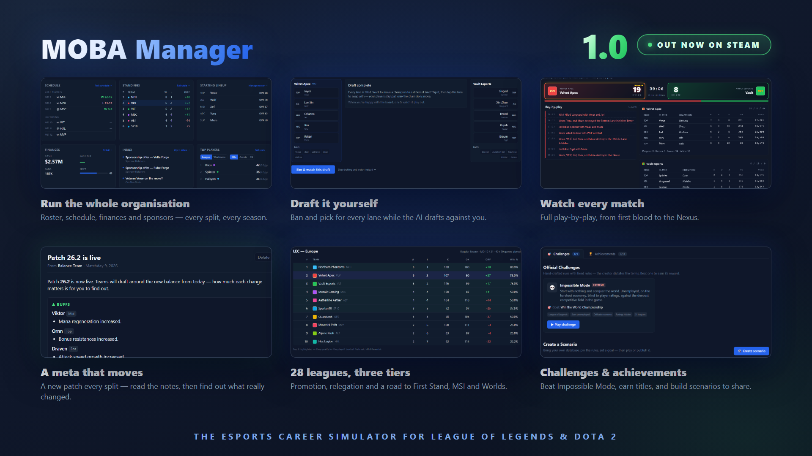

玩腻了在排位里被队友气到血压拉满？那不如换个活法：坐进经理办公室，把别人家的天才少年买过来，再亲手把对面教练的BP按在地上摩擦。**《MOBA Manager》1.0 正式版现已上线 Steam**，三个半月、六轮试玩更新、成堆玩家反馈之后，这款电竞经理模拟器终于从测试场杀进正赛。

## 🎯 核心看点速览

- **1.0 正式版落地**：结束 Playtest，内容量与完成度全面拉满。
- **两个游戏，两个世界**：一边是《League of Heroes》，28个联赛、三级体系、升降级与国际赛事全齐；另一边是《Ancient Defense 2》，六大赛区、全年巡回赛加国际大赛。
- **自己上手 BP**：每条路都能 ban/pick，AI 会跟你对着干；选完直接看比赛从一血打到推掉基地。
- **会流动的版本答案**：148位冠军与115位英雄，每个赛段都有新平衡补丁。补丁说明只告诉你改了什么，改得狠不狠，得你自己品。
- **真·职业生涯**：从失业开局，靠面试拿offer，哄好老板……或者被炒鱿鱼。
- **王朝不是一天建成的**：合同、自由市场、交易挂牌、外援规则、赞助商和财务，一个都别想跑。
- **自定义与社区**：14项成就、收藏称号、Impossible Mode，还能自己做数据库和挑战场景分享给社区。
- **编辑器与上帝模式**：想重建世界？自己捏队伍、捏选手，存档还能备份和迁移。
- **后续还有大动作**：训练与青训系统的大更新已经在路上。

## 📌 重点深度解析

### 双项目并行，经理人的幸福烦恼

《MOBA Manager》最讨喜的地方，是它没有只做一张皮。你可以扎根《League of Heroes》的28个联赛，从底层一路往上爬，体验升降级的刺激；也可以转战《Ancient Defense 2》的六大赛区，在全年巡回赛里刷积分、抢国际大赛门票。两边赛事结构不同，经营节奏也不同，换项目约等于换一种打工人生。

### BP 不是走过场，版本也不是摆设

很多经理游戏的通病是“比赛只是数字滚动”，但这里你需要在每条路上做 ban/pick，AI 对手会针对你的阵容下套。更妙的是动态 meta：每个赛段一次平衡补丁，148位冠军和115位英雄的强弱会变。官方只给补丁说明，不给你标准答案——这就有意思了，抄作业可以，但想一直抄，得先看懂版本。

### 从失业到王朝，经营才是硬仗

开局你没有豪门光环，先找工作、再谈合同。自由市场捡漏、交易挂牌换血、外援规则限制、赞助商谈判、财务健康度……每一步都像在刀尖上跳舞。老板开心了给你预算，老板不开心了让你卷铺盖。等你能把青训、阵容和账本同时玩明白，才算真正摸到王朝门槛。

### 自定义数据库，把电竞宇宙改成你的形状

Database Editor 和 God Mode 是这波1.0的加分项。你可以自己建队伍、造选手、改赛事，甚至做一套刁钻的挑战场景丢给社区受苦。14项成就、收藏称号和 Impossible Mode 也给硬核玩家留了足够长的进度条。

## 💡 玩家实操与上手建议

- **新手先选一个项目深耕**：别一上来就双线操作，先把一个赛区的转会窗、赛程和财务摸熟，再考虑换世界。
- **BP 别只盯版本答案**：AI 会针对你的绝活，留一两手反制位比无脑抄T0更稳。
- **合同细节要看清楚**：年限、买断、工资帽和外援规则，签错一笔可能卡你两三个赛季。
- **财务别梭哈**：赞助和成绩挂钩，前期留现金流，别为了一个明星选手把俱乐部未来抵押出去。
- **想折腾就开编辑器**：自定义数据库前先备份原档，上帝模式适合做实验，不适合第一次开荒。
- **觉得对味就留个 Steam 评测**：小体量作品，评测真的比什么都管用。

## 📢 官方 Telegram 频道推荐

想第一时间蹲 Steam 限免、喜加一、史低背刺和突发更新？加入官方 Telegram 频道 **@steamhunterlink**，秒级推送不迷路，手慢无的福利也能少错过几班车。

## ❓ 常见问题 FAQ

**Q1：1.0 是正式版吗？现在入手会不会还是“测试版”？**

A：是正式 1.0，已经结束 Playtest。官方也明确说 1.0 不是终点，后续还会继续更训练和青训内容，所以现在入坑既能玩到完整框架，也能赶上后续长线更新。

**Q2：没怎么玩过 MOBA，只喜欢模拟经营，能上手吗？**

A：能。核心是签人、谈合同、做BP、管财务和追成绩，MOBA 知识能帮你理解版本和阵容，但不懂英雄技能也能靠经营逻辑玩。建议先从低难度或自定义数据库熟悉流程。

**Q3：自定义数据库和存档怎么管理比较稳？**

A：动手改世界之前先备份存档；Database Editor 适合做长期自定义联赛，God Mode 更适合测试和整活。想分享给社区就打包场景，自己玩则建议保留一份原版数据库，免得改嗨了回不去。
