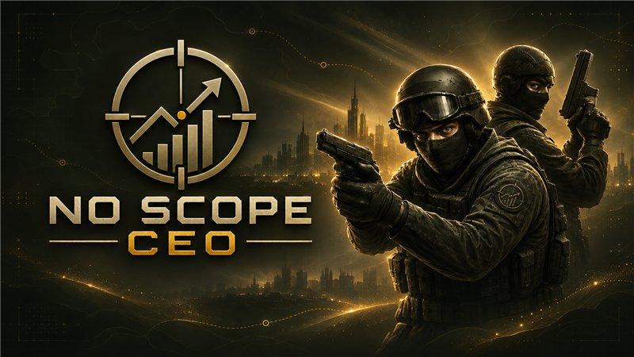

各位未来世界冠军的幕后老板，先把战术板擦干净——《No Scope CEO》已经正式在 Steam 上线。官方公告标题很朴实：No Scope CEO is out now — thank you！但这句话背后，是一个开发者一边上班、一边顾家，还把项目一路推到正式版的硬核现实。你可以把这理解成电竞经营版的“白天做老板，晚上做经理，梦里还在算工资帽”。

## 🎯 核心看点速览

- **正式发售**：《No Scope CEO》现已登陆 Steam，AppID 5210500。
- **完整版路线**：正式版让玩家继续越过 Open Circuit，把组织一路带到 World League。
- **Demo 同步更新**：试玩版已更新为当前机制与界面，之前玩过旧 Demo 的可以重新感受。
- **反馈闭环**：游戏内 bug reporting tool 继续收集问题、不清楚的地方、建议和你喜欢的部分。
- **个人开发致谢**：作者感谢所有试玩、提意见、报 bug 的玩家，并坦言开发与工作、家庭并行。

## 📌 重点深度解析

这次最值得关注的，不是“又一个经营游戏上架”，而是官方把 Demo 阶段的口碑直接带进了正式版。公告里明确感谢了试玩玩家：你们提的意见、报的错、吐槽的不清楚之处，都帮助游戏走到发售。对独立项目来说，这种反馈闭环比宣传片更有含金量。

内容层面，完整版的关键变化是路线延伸：Demo 之后的旅程不再断档，你可以继续从 Open Circuit 往上打，目标直指 World League。换句话说，正式版补上了“从地方赛区小老板到世界联赛幕后操盘手”的完整赛季幻想。至于具体能经营到什么深度，建议用更新后的 Demo 先摸一遍界面和机制，再决定要不要把俱乐部带进正式版。

另外，Demo 也同步了当前机制和界面，这点很良心。很多游戏发售时 Demo 还停在旧版本，玩家试完一圈以为买的是“复古体验服”；《No Scope CEO》至少让你在掏钱前看到接近正式版的样貌。作者也继续开放游戏内反馈通道，遇到问题别只在评论区喊“崩了”，把复现步骤、截图和版本信息交上去，才是有效助攻。

## 💡 玩家实操与上手建议

1. **先玩更新后的 Demo**：重点看三件事——界面信息是否清楚、赛季推进有没有目标感、经营决策是不是你的菜。喜欢足球经理、电竞俱乐部模拟这一挂的玩家，适配度会更高。
2. **购买前认清类型**：从官方描述看，本作核心是组织经营与赛季晋级，不是一局定胜负的刚枪游戏。冲着“No Scope”三个字来练枪法的朋友，先看商店页和 Demo，别买错方向。
3. **开局别急着梭哈**：先把赛季目标、资金规则和界面提示看明白，再决定投入方向。经营游戏最常见的翻车方式，就是把预算花在看起来很猛、实际不产出的地方。
4. **遇到问题用游戏内工具反馈**：官方明确推荐 in-game bug reporting tool。描述清楚“做了什么、发生了什么、能不能复现”，附截图或日志，比一句“有 bug”有用得多。
5. **下载与安装**：在 Steam 搜索 No Scope CEO，或认准 AppID 5210500。启动异常时先验证游戏文件完整性，配置门槛以商店页为准。

## 📢 官方 Telegram 频道推荐

想第一时间蹲 Steam 喜加一、限免福利、临时工折扣和正式版补丁？加入官方 Telegram 频道 **@steamhunterlink**，获取秒级限免与特惠推送。别等游戏在库里吃灰三个月，才发现自己错过了首发窗口。

## ❓ 常见问题 FAQ

**Q1：《No Scope CEO》正式版现在能玩到什么程度？**

A：正式版已经登陆 Steam，完整游戏允许你继续越过 Open Circuit，把组织带到 World League。Demo 也同步了当前机制和界面，适合先试后买。

**Q2：Demo 存档能继承到正式版吗？**

A：官方这次公告没有说明存档继承规则。稳妥起见，别默认旧 Demo 进度一定可用；入手前看商店页说明或游戏内提示，想省心就开新档。

**Q3：遇到 bug 或机制看不懂，去哪里反馈？**

A：用游戏内 bug reporting tool 提交。写清问题现象、复现步骤、版本信息和截图；如果是“看不懂”的建议，也可以直接说哪里不直观，官方公告明确表示会继续收集这类反馈。

祝各位老板第一赛季顺利，别在工资帽和战绩之间把自己先优化掉。
