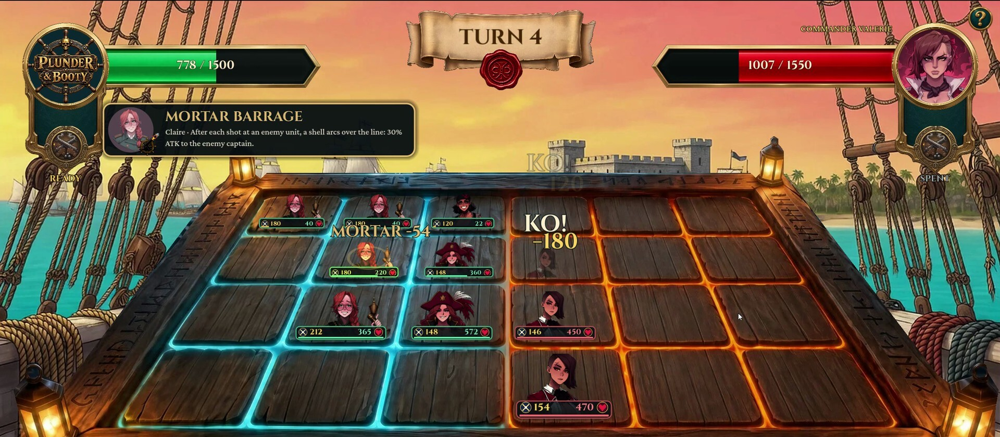

各位好，我是你们的老朋友、Steam 专栏主理人。今天这艘船不靠码头，直接靠 Steam 商店页——《Plunder & Booty: High Seas Harem》已经正式发售。官方这次放出的船志由大副 Morgana the Red 执笔，字里行间全是海盗的混不吝：离开 Smugglers' Bay 第一件事就是撕了海军警告，船长靠一手牌赢走整艘船，Bonnie 还非要开炮庆祝。换句话说，这游戏的气质从开场就摆明了：赌局、掠夺、全员入伙。

## 🎯 核心看点速览

- **已经发售**：Steam 商店页已上线，买断制入库，不是限免也不是免费周末。
- **每场战斗都是赌局**：用手牌铺路，关键回合把炮击当清场按钮。
- **败者签字入伙**：海盗女王、海军军官、海妖、幽灵船长，甚至海神都可能进船员名单。
- **船舱与画廊**：倒朗姆解锁动画场景，画廊保存并支持回放。
- **无微交易**：官方明确一口价，宝箱用海上掠夺来的金币购买；这点对讨厌内购的玩家很友好。

## 📌 重点深度解析

第一层看，这游戏是海盗壳子下的卡牌赌局。官方的说法很直白：他会用已经赢来的女人们组手牌，把她们派到路线上，然后捏着炮击等清场那一回合。说成玩家话就是——别只顾着铺场，炮击的时机才是翻盘点；手牌是资源，路线是战场，清场是胜负手。

第二层看，收集逻辑不是抽卡商城，而是“打赢就上船”。船志里列得很清楚：海盗女王、海军军官、海妖、幽灵船长，还有拿整个深渊下注的海神。你赢她，她就成船员。这个设定把卡牌战斗和角色收集绑在一起，输了是战败，赢了是扩编，很符合海盗船“能打就留下”的粗暴规矩。

第三层是船舱和画廊。官方提到倒朗姆可以解锁动画场景，画廊会保存每一次胜利，还能回放。这里我提醒一句：游戏包含后宫向和可解锁动画内容，购买前务必看商店页的内容说明与年龄提示，别在客厅大屏上社死。

最后是商业模型。官方明确写了“One price, no tricks”，没有微交易，宝箱靠海上掠夺的金币支付。对现在被各种通行证和抽卡礼包磨到没脾气的玩家来说，这种买断制加游戏内货币的写法确实省心。

## 💡 玩家实操与上手建议

**入库方法**：直接打开 Steam 商店页（https://store.steampowered.com/app/5414350/），登录账号后加入购物车购买即可永久入库。注意，这不是喜加一，也不是免费领取，别在评论区问“怎么白嫖”，船长会把你写进船志。

**开荒思路**：前期别急着把炮击当普攻甩，先看手牌能不能在路线上形成压力；炮击留给能一次清掉关键路线的回合。败者入伙是滚雪球，能赢的角色尽量收，船员池越深，后面组牌越从容。

**收集与回放**：船舱里记得倒朗姆解锁场景，画廊会保存胜利内容，想复盘就翻画廊。宝箱用海上掠夺的金币买，别拿现实货币找内购入口，官方说了没有。

**购买建议**：喜欢海盗题材、卡牌铺场、后宫向角色收集和买断制的玩家可以冲；对成人向内容敏感、或者只想玩纯策略卡牌的玩家，建议先看商店页截图和内容说明再决定。发售后如果遇到 bug，去官方 Discord 反馈（https://discord.gg/RERMUdhuAM）；觉得对胃口，顺手留个评测，官方在船志里也明说了，评测能帮更多水手找到这艘船。关注开发者页面（https://store.steampowered.com/developer/FleshForgeStudio/）还能第一时间听到下一趟航程。

## 📢 官方 Telegram 频道推荐

我这边会把 Steam 限免、史低特惠、新游发售和临时工价格同步到官方 Telegram 频道 **@steamhunterlink**。想第一时间收到秒级推送、少走弯路，建议现在就加入频道；尤其是这种刚发售、后续可能跟折扣和内容更新的游戏，蹲推送比反复刷商店页省事。

## ❓ 常见问题 FAQ

**Q1：《Plunder & Booty》是免费游戏吗？怎么入库？**
A：不是免费游戏，也没有喜加一活动。它是 Steam 买断制游戏，打开商店页购买后永久入库；官方明确无微交易，宝箱用游戏内掠夺金币购买。

**Q2：游戏包含成人向内容吗？购买前要注意什么？**
A：包含可解锁的动画场景和画廊回放，整体是后宫向海盗题材。购买前请留意 Steam 商店页的年龄提示与内容说明，介意这类内容的玩家建议谨慎入手。

**Q3：遇到 bug 或想给官方提建议去哪里？**
A：官方船志给了 Discord 反馈入口（https://discord.gg/RERMUdhuAM）。如果玩得开心，也别忘了在 Steam 留评测；官方说得很实在，评测就是让更多水手发现这艘船的方式。

——我是你们的主理人，这趟 Red Wake 已经离港。座位已经摆好，船员不等人；想上船，先去商店页把票补了。
