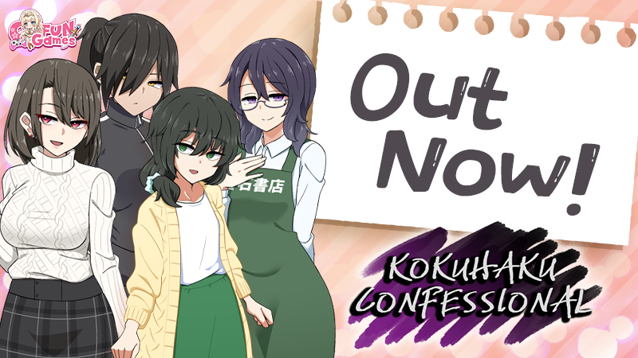

各位老伙计，今天这条消息属于“愿望单里躺了很久的那一位终于动了”系列——Shiravune 与 Co-FUN Games 联手推出的《Kokuhaku Confessional》已经正式在 Steam 上架开卖，AppID 3700350，不用蹲预售、不用等解锁倒计时，商店页点进去就能直接入库开玩。

## 🎯 核心看点速览

- **发售状态**：正式发售，非抢先体验、非预约登记，属于“现在就能玩”的完成品状态。
- **发行阵容**：Shiravune 发行 + Co-FUN Games 开发，日系视觉小说/ADV 赛道的老面孔组合。
- **官方喊话**：制作组在公告里直接明说——玩得开心的话，请务必留个好评，这对他们是实打实的续命资源。
- **全家桶联动**：公告顺手甩出一大串同厂兄弟作品的商店链接，从《Princessfall》到《Heavenly Island》《Cicada Communication》，摆明了欢迎你一口气打包入坑。
- **商店直达**：https://store.steampowered.com/app/3700350

## 📌 重点深度解析

### 一、这不是“又一款流水线 ADV”，而是发行商的招牌口味

熟悉这个圈子的朋友都清楚，Shiravune 这几年在 Steam 上基本就是“日系视觉小说搬运工”的代名词，从经典老作复活到新锐社团作品，选品眼光相对稳定。所以《Kokuhaku Confessional》的定位其实很清晰：**它不是要去跟 3A 抢流量，而是精准投喂给那批“每周都要啃一部新 ADV”的硬核读者**。

从标题的两个关键词“告白”与“忏悔”就能闻出味道——这类作品的戏剧张力往往不靠大场面，而是靠角色之间那点说不清道不明的心思拉扯。至于具体剧情架构、登场角色和分支数量，官方商店页写得很清楚，入手前建议花三分钟把页面从头拉到尾，比看任何二手介绍都靠谱。

### 二、为什么官方那句“求好评”值得被认真对待

公告里最真诚的一句，其实是那句“请考虑留下好评”。

对中小体量的视觉小说来说，Steam 的好评率几乎等于生死线：好评率过关，算法才愿意给推荐位，新玩家才敢点进来；好评率崩了，作品基本就沉底了。所以你会看到制作组在发售首日就主动开口——**这不是客套，是运营刚需**。

同样的逻辑反过来也成立：如果你玩下来确实觉得舒服，一条两三句话的评测，价值可能比你在群里安利十次都高。当然，觉得不合口味也照实写，这个圈子的玩家向来认的是真实体验，不是彩虹屁。

### 三、发售即巅峰？不，这类作品的寿命靠长尾

视觉小说有个很特别的地方：它不像服务型游戏那样靠赛季更新续命，一部作品的口碑曲线往往是**发售首周起步、随后靠玩家口口相传缓慢爬升**。所以你现在看到的“刚刚发售”，其实只是它长跑的第一公里。后续会不会追加内容、会不会有原声集或设定资料，都得以官方公告为准，别听信任何“据说”。

顺带一提，公告里列出的那串同厂作品链接（包括《Vivi and the Magical Island》《Kudos Kuppa》《Eye of the Incubus》等）其实是个很好用的“口味测试工具”：如果你玩完本作觉得对味，那这条产品线里大概率还有几款能戳中你，直接顺着发行商主页逛一圈，比盲目刷推荐流高效得多。

## 💡 玩家实操与上手建议

**1. 先核对语言支持，再点购买**
这是老生常谈但每次都有人踩的坑：视觉小说对文本依赖度极高，进商店页第一件事就是拉到语言列表，确认简体中文/繁体中文的支持情况。发行商不同作品的语言配置并不统一，别拿上一部的经验套这一部。

**2. 善用两小时退款窗口做“试读”**
ADV 的节奏和文风合不合胃口，往往开场一小时内就能感觉出来。Steam 的退款政策在这里就是免费的“试读章节”，不合适就退，别硬啃。

**3. 关注发行商主页 + 加愿望单**
想第一时间收到同厂新作消息，最省事的办法是把 Shiravune 的发行商页面关注一下，再把感兴趣的作品统统塞进愿望单——打折、更新、发售，Steam 会替你盯着。

**4. 认准 AppID，别被同名作品骗了**
这个品类里撞名、撞封面、撞标题的情况并不罕见。认准 **AppID 3700350**，比认封面图靠谱一万倍。

**5. 想开黑？这类游戏请自己慢慢品**
视觉小说没有联机要素，直播或和朋友一起看反而容易破坏体验。想分享就写评测、发截图，别剧透。

**6. 入库之后顺手做两件事**
一是给游戏打上自己的标签和评测，二是把它加进收藏夹分类——等你库里堆到四位数的时候，会感谢现在勤快的自己。

## 📢 官方 Telegram 频道推荐

想第一时间收到这类新作上架、限时免费、史低折扣的秒级推送？建议直接加入我们的官方 Telegram 频道 **@steamhunterlink**。Steam 商店页刷新有延迟、邮件通知经常慢半拍，而频道推送基本是“这边上架、那边弹窗”，尤其是喜加一这种手慢无的活动，早看十秒就是两个结局。

## ❓ 常见问题 FAQ

**Q1：《Kokuhaku Confessional》支持中文吗？**
A：请以 Steam 商店页的语言支持列表为唯一准绳。Shiravune 近年的发行作品多数带官方中文，但每部作品的配置并不完全一致，购买前务必在商店页确认，别凭印象下单。

**Q2：这是系列续作吗？需要先补前作吗？**
A：从官方公告的表述看，这是一部独立发售的新作，官方并未要求玩家先体验其他作品。公告中那一长串链接属于同厂其他作品推荐，不是剧情前置。

**Q3：首发有没有折扣？值不值得原价入手？**
A：具体价格与是否有首发优惠，请在商店页实时确认——这类信息变动快，二手转述容易过期。至于值不值：如果你是这个品类的常客，ADV 的性价比从来不按小时算，而是按“读完有没有后劲”算；如果你只是路过看看，建议先加愿望单，等一波折扣再上车，理性消费永远不亏。

**Q4：玩完想支持制作组，除了买游戏还能做什么？**
A：留一条真实好评、把作品分享给同好朋友、关注发行商主页并加愿望单，这三件事对中小体量作品的实际帮助，比你想的要大得多。
