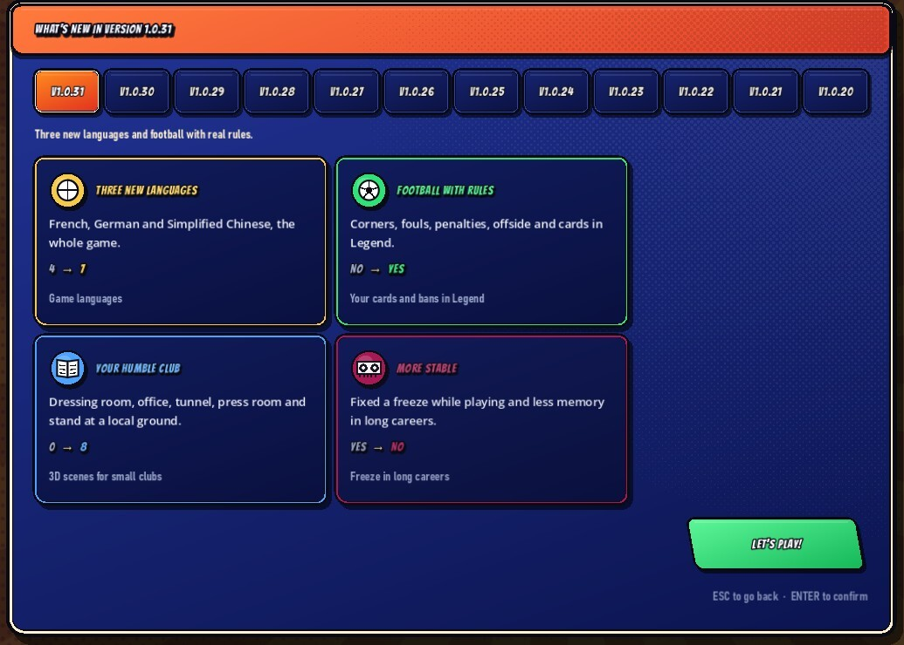

各位球友，主理人又来报到了。这次要聊的是一款在 Steam 上悄悄攒口碑的足球生涯模拟器——《Futbolero: Football Career Simulator》。它不搞华丽引擎，也不吹什么次世代画质，主打的就是一个“从青训小卒踢到镁光灯中心”的漫长人生。而这次 1.0.31 版本，对咱们中文玩家来说,算是等到了那句久违的“欢迎”。

## 🎯 核心看点速览

- **语种从四个扩到七个**：新增**法语、德语、简体中文**，而且是全量覆盖，从主菜单到最后一条小报标题，总计超过 **26000 行**文本完成语言适配。
- **切换方式极简**：Steam 客户端语言为这三者之一时，游戏自动跟随；想手动改也行，`设置（SETTINGS）→ 语言（Language）` 里七种随你挑。
- **传奇难度长牙了**：角球、犯规、点球、越位、红黄牌全部实装。吃红牌不是简单扣个数值，而是直接被按在替补席上看完比赛，赛后还得面对媒体和主帅的追问。
- **小球队终于不再“豪”**：执教或效力小球会时，更衣室、办公室、球员通道、新闻发布厅和看台都会换成社区球场的模样，不再是千篇一律的顶级球场布景。
- **稳定性补课**：修掉了比赛过程中的一处卡死问题，长档玩家的内存占用也降了一截。
- **上线节奏**：更新已在 **Demo 试玩版**与 **Playtest** 中生效，Mac 版过几天跟上；**正式版 11 月 5 日发售**。

## 📌 重点深度解析

### 一、这不是“挂个语言包”了事

官方在公告里特意强调了一点：每个语种都有自己的腔调。头版头条要写出各国体育媒体的味道，笑话要能落地——实在水土不服的段子，直接重写新的；模式名称也用当地玩家真正挂在嘴边的说法。对一款大量文本都靠“读”来推进的生涯模拟游戏来说，这件事的分量比想象中重得多。毕竟你踢的不只是球，还有赛后舆论、经纪人电话和队友八卦。

### 二、传奇难度：终于有人吹哨了

以前不少玩家吐槽，高难度只是数值更硬，比赛过程依旧是“你跑你的、我跑我的”。这次 1.0.31 给传奇难度补上了规则层：**角球、犯规、点球、越位、红黄牌**全部到位。

最狠的是红牌的连锁反应——**你被罚下，就等于被摁在替补席上眼睁睁看完全场**，然后发布会上媒体会问、主帅会问。这种“人不在场上但心里更累”的设计，恰恰是生涯模拟最该有的味道。对喜欢硬核沉浸感的玩家来说，这是本次更新里最值钱的一条。

### 三、小球队的“烟火气”

另一个容易被忽略但很讨喜的细节：场景分级。你在一支业余或低级别球队时，看到的不是那种能坐六万人的豪华球场，而是社区级别的更衣室、窄小的通道、朴素的发布厅。这种环境反差，会让“往上爬”的生涯主线更有实感——你确实是从泥地里起步的。

## 💡 玩家实操与上手建议

1. **怎么拿到中文版**：不用打补丁、不用装第三方汉化。先把 Steam 客户端语言设为简体中文，启动游戏即为中文；如果你的客户端是别的语言，直接进 `设置 → 语言` 手动选就行，随时可改，不影响存档。
2. **先试后买不亏**：这次更新同步推到了 **Demo** 和 **Playtest** 两个渠道，正式版 11 月 5 日才发售。想提前尝尝味道的，直接下 Demo 跑一个赛季，重点感受一下传奇难度下的判罚尺度和红牌后续事件链。
3. **开档建议从小球队起**：如果你直接开豪门档，那套社区球场的场景细节基本看不到；反过来，从低级别联赛往上爬，环境变化带来的反馈最爽。
4. **长档党记得清理旧档环境**：虽然官方优化了内存占用，但跨多个赛季的老存档建议在更新后先小跑几场确认稳定，再放心推进。
5. **遇到语病别忍着**：官方明说了会在 Steam 论坛和社媒上看每一条反馈。中文语境里发现有别扭的地方，直接提，这种规模的文本量，第一版有瑕疵很正常。

## 📢 官方 Telegram 频道推荐

限免、喜加一、临时折扣这类消息，最怕的就是慢半拍——等你刷到的时候,券已经领完了。主理人这边强烈建议关注官方 Telegram 频道 **@steamhunterlink**，秒级推送限免与特惠信息，永久入库的机会一次都不错过。想第一时间知道《Futbolero》正式版首发有没有折扣、试玩期有没有额外福利，蹲这个频道就够了。

## ❓ 常见问题 FAQ

**Q1：更新后游戏还是英文，中文在哪开？**
A：先确认 Steam 客户端本身的语言设置。客户端为简体中文时游戏会自动切到中文；否则进入游戏内 `SETTINGS → Language` 手动选择简体中文即可，七种语言随时可切换，不影响已开的存档。

**Q2：正式版什么时候能买？现在只能玩 Demo 吗？**
A：本次 1.0.31 已同步上线到 **Demo 试玩版**和 **Playtest**，Mac 版本会在几天内跟进。**完整版定于 11 月 5 日发售**，正式解锁后 Demo 存档是否可用，建议以发售当天的官方说明为准。

**Q3：传奇难度的红牌到底会影响什么？**
A：不止是少打一人。被红牌罚下后，你的角色会坐在替补席上看完剩余比赛，随后触发媒体与教练的质询环节，属于实打实的生涯事件，而不是单纯的数值惩罚。喜欢硬核体验的玩家可以直接开传奇难度开局。

球场上见。⚽
