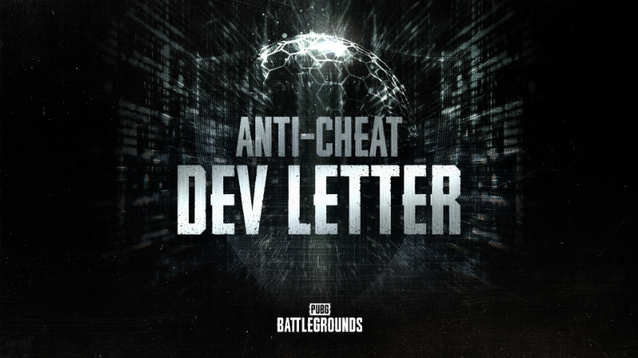

玩《绝地求生》的老兵都懂，一局游戏最让人血压飙升的从来不是被 98K 一枪带走，而是回放里那辆车飘着、准星黏着头、子弹穿墙而来的“神仙操作”。这回蓝洞终于把开发者信写到了点子上——不是再喊一遍“我们重视公平竞技”，而是把枪口抬向了外挂产业链的上游：**卖挂的人，和那些被封了还能换个号继续横行的“老熟人”**。

### (https://pubg.com/news/11346)

## 🎯 核心看点速览

- **打击重心转移**：从“发现一个封一个”的被动执法，升级为针对**外挂分销渠道**与**封禁规避（Ban Evasion）**的系统性治理。
- **封禁不再只是封号**：重点盯防“大号被端、小号重开”的循环，设备与行为特征层面的追踪被进一步强化。
- **源头追责**：对外挂开发者、经销商的法律手段与平台协作继续加码，不再只跟终端玩家较劲。
- **对普通玩家的直接影响**：举报反馈链路、对局内可疑行为识别、账号安全（防止被盗号拿去开挂）都将被更多人关注。
- **没有新地图、没有新枪械**：这是一封纯粹的**反作弊与生态治理**开发者信，别指望在里面看到 8.4 版本的平衡性改动。

## 📌 重点深度解析

### 一、为什么要盯“分销”，而不是只盯“开挂的那个人”

过去的反作弊逻辑很像小区抓小偷：巡逻队逮到一个处理一个，但墙外的“供货商”永远在补货。外挂分销链条的存在，让封号变成了一场成本极不对等的拉锯战——开发者要投入检测资源，玩家要忍受糟糕对局，而卖挂的只需要换个收款码。

这次开发者信明确把**分销环节**当作突破口，意味着执法思路从“终端封禁”走向“渠道压缩”。对普通玩家来说最直观的好处是：**外挂的获取门槛和存活周期会被拉长**，市面上那些“包更新、包过检测、封号包补”的灰色服务会越来越难维持。

### 二、封禁规避：换个号继续玩，这条路正在被堵死

“封禁规避”是 PUBG 社区里最老生常谈的痛点之一。一个账号被处理，作弊者转头就能用新号重返战场，甚至把被封当成某种“成本项”。这封开发者信把封禁规避单独拎出来讲，释放的信号很明确：**处罚对象从“账号”扩展到“人”与“设备/行为特征”**。

这意味着几件事值得我们留意：

1. **关联识别会更狠**：同一设备、同一网络环境、高度相似的行为模式，都可能成为串并处罚的依据；
2. **连坐风险上升**：出借账号、代练、共享小号这类“擦边操作”，误伤与连带处理的可能性同步变大；
3. **申诉更需要证据**：一旦被判定为规避封禁，单纯一句“我刚买的号”恐怕很难说服客服。

### 三、真正的长期解药：检测能力 + 生态共治

反作弊从来不是一场能“宣布胜利”的战争，它是持续的军备竞赛。开发者信的价值不在于某一项技术名词有多唬人，而在于**是否形成了闭环**：检测发现 → 快速封禁 → 阻断重开 → 追查来源 → 反馈玩家。任何一个环节掉链子，玩家的体感都会立刻回到“遍地神仙”。

对我们这些老老实实跳伞、搜房、决赛圈趴草的玩家来说，能做的就是两件事：**认真举报**，以及**不给作弊生态提供任何便利**。举报不是“打小报告”，而是这套闭环里最便宜、最有效的一环数据来源。

## 💡 玩家实操与上手建议

**1. 举报要“精准”，别只按一下就跑**
死亡回放、观战视角里如果出现明显的穿墙预瞄、无后座扫射、载具瞬移，记得在对局结算或回放界面完成举报，并尽量勾选具体作弊类型。信息越具体，人工复核的效率越高。

**2. 账号安全就是反作弊的第一道防线**
开启 Steam 令牌双重验证，别在网吧或陌生设备上长期保持登录，别点来路不明的“免费皮肤”“内部辅助”链接。你的号被盗去开挂，被封的是你自己的号，申诉周期以周计算。

**3. 远离一切“第三方增强”**
包括但不限于画质增强插件、鼠标宏、压枪脚本、所谓的“官方认证辅助”。哪怕是“只改准星颜色”的小工具，也可能触碰检测红线，得不偿失。

**4. 别碰共享号、代练号**
在封禁规避被重点治理的阶段，账号出借的风险显著提高——轻则被判定关联处罚，重则整号报废，连带影响同设备下的其他账号。

**5. 遇到疑似作弊，冷静保存证据**
录屏、截图、记下对局时间与对手 ID，如果后续需要申诉或补充举报，这些都是硬通货。

**6. 优化你的游戏环境**
稳定的网络与帧数是反作弊体验的基础。掉线、卡顿频繁的对局往往更容易被误判为异常行为，建议使用正规加速器并保持游戏客户端为最新版本。

## 📢 官方 Telegram 频道推荐

公平竞技靠官方，省钱入库靠自己。想第一时间收到 Steam 限免喜加一、史低特惠、临时免费周末的秒级推送，欢迎加入我们的 Telegram 频道 **@steamhunterlink**。永久入库的机会往往只在那几个小时里，错过就只能拍大腿了。

## ❓ 常见问题 FAQ

**Q1：这次反作弊更新会不会影响正常玩家的帧数或性能？**
A：反作弊属于后台保障层面的调整，不涉及游戏内玩法与画面渲染逻辑，正常对局的性能表现不受影响。如果你最近感觉卡顿，优先排查驱动版本、后台进程和网络环境。

**Q2：我被误封了怎么办？“封禁规避”判定会不会扩大误伤？**
A：任何自动化判定都存在误判概率。建议第一时间通过官方客服渠道提交申诉，附上账号使用记录、登录设备信息与对局录像等材料。同时检查账号是否曾被盗用——这是误封案例中最常见的原因。

**Q3：举报了作弊玩家，会有反馈吗？**
A：官方会在核实处理后通过游戏内通知告知结果，但出于隐私保护，通常不会披露具体处罚细节。看到“已处理”的提示就说明你的举报起了作用，继续举报是对整个生态最实在的贡献。

**Q4：这封开发者信是否意味着近期会有版本更新或平衡性调整？**
A：这是一封专注反作弊体系与生态治理的开发者信，与玩法内容更新是两条线。想看新地图、枪械数值与平衡性调整，还得等常规的版本更新公告。
