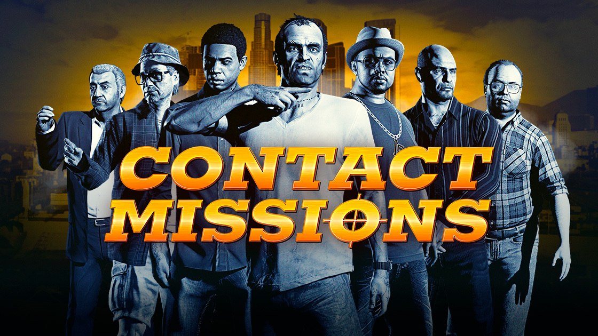

🎯 核心看点速览

- **科茨中心抢劫迎来首个活动周**：参与 The Kortz Center Heist，队伍保底获得此前仅有 Fine Art Collector 计划 Elitist 身份玩家才能拿到的 The Outcome of Endeavour。
- **三大抢劫首通双倍**：完成所有 Original Heists、The Doomsday Heist、The Diamond Casino Heist 的首次通关，可拿双倍首次完成奖励。
- **登录就送墙面艺术**：11 月 11 日前登录 GTA Online，可获 The Great Circle Back，挂进豪宅墙面。
- **佩里科岛豹神雕像保底**：本周首次接近 El Rubio 的 Cayo Perico 主目标，场内保证出现 Panther Statue。
- **限时倍率排期**：11 月 5 日至 11 日 KnoWay Out 首通 2X GTA$；11 月 12 日至 12 月 2 日联系人任务 2X GTA$ 和 RP，Freemode Challenges 4X，Stunt Race Series 3X，Sumo (Remix) 2X，Community Series 3X。

📌 重点深度解析

这周 GTA Online 的抢劫活动，不是简单把老抢劫再刷一遍，而是把“首通价值”拉满。先把账算清楚：Original Heists、The Doomsday Heist、The Diamond Casino Heist 的首次完成奖励翻倍，对还没拿过首通奖励的账号来说，这就是最肥的一口。别急着随便进野队，先确认自己和队友的进度，把首通留给活动周，收益更舒服。

本期 C 位是 The Kortz Center Heist。作为它的首个 Heist Event，参与活动即可让队伍保底拿到 The Outcome of Endeavour。这件艺术品此前只发给今年夏天 Fine Art Collector 计划中达到 Elitist 身份的玩家，现在普通玩家也有机会补票，收藏党别错过。

The Great Circle Back 则是登录福利：11 月 11 日前任意时间进入 GTA Online 就能拿，用来装点豪宅墙面，属于上线点一下就不亏的类型。佩里科岛玩家也有福，本周首次接近 El Rubio 的 fortified compound，主目标保证是 Panther Statue。单刷上岛的朋友可以优先侦查主目标，别被次要目标带偏路线。

11 月 5 日至 11 日，KnoWay Out 首次完成给 2X GTA$。11 月 12 日至 12 月 2 日则是联系人任务狂欢：Madrazo’s Dispatch Services、Gerald’s Last Play、Premium Deluxe Repo Work、Lowriders 等 Contact Missions 全部双倍 GTA$ 和 RP。同期 Freemode Challenges 4X，Stunt Race Series 3X，Sumo (Remix) 双倍，Community Series 三倍。独狼、竞速党、社交开黑党都能找到自己的刷法。

💡 玩家实操与上手建议

- **先领登录奖励再开工**：11 月 11 日前启动 GTA5 进入 GTA Online，确认 The Great Circle Back 到账。别等最后一天，线上模式偶尔抽风，提前领更稳。
- **首通顺序按收益排**：未拿过首通奖励的账号，优先把 Original Heists、Doomsday Heist、Diamond Casino Heist 的首通安排在活动周；Kortz Center Heist 则尽量组固定队，沟通路线和分红。
- **科茨中心开黑分工**：提前约定黑客、司机、火力手，进场后别恋战，抢劫核心是“拿完就走”。野队容易翻车，建议邀请战局或好友局。
- **佩里科岛先看主目标**：本周首次接近必出豹神雕像，侦查时优先确认主目标，再规划撤离路线；单人上岛可走潜行路线，组队则分配拿次要目标和望风。
- **11 月 12 日后刷联系人任务**：双倍 GTA$ 和 RP 适合稳定刷钱，搭配 Freemode Challenges 的 4X 奖励，碎片时间也能薅。竞速玩家记得跑 Stunt Race Series，3X 收益不低。
- **联机避坑**：公开战局环境复杂，做抢劫和出货尽量开邀请战局；网络不稳先检查 NAT 和加速器节点，游戏文件异常可在 Steam 里验证完整性。
- **购买建议**：还没入坑的玩家，GTA5 本体即可体验 GTA Online，不必一上来就冲鲨鱼卡；先把本周保底奖励和双倍任务吃满，再考虑后续消费。

📢 官方 Telegram 频道推荐

想第一时间蹲 Steam 限免、史低和活动节点？加入官方 Telegram 频道 **@steamhunterlink**。我这边会把秒级限免与特惠推送丢进频道，适合没空天天刷商店的玩家；GTA Online 这类限时倍率活动，也会提醒你别错过领取窗口。

❓ 常见问题 FAQ

**Q1：三大抢劫的双倍奖励，是重复刷都双倍吗？**

A：这次重点在“首次完成奖励”翻倍，针对所有 Original Heists、The Doomsday Heist、The Diamond Casino Heist 的首次通关。重复刷是否享受普通收益，以游戏内结算为准；想拿满收益，先把没首通的号安排上。

**Q2：The Outcome of Endeavour 和 The Great Circle Back 怎么拿？**

A：The Outcome of Endeavour 通过参与本周 The Kortz Center Heist 活动保底获得；The Great Circle Back 只需在 11 月 11 日前登录 GTA Online。两件都是线上模式奖励，记得进入 GTA Online 而不是只开单机。

**Q3：佩里科岛的豹神雕像每次都有吗？**

A：本周规则是首次接近 El Rubio 的 compound 时保证出现 Panther Statue，不是每次重开都必刷。建议第一次上岛就优先主目标，别先跑去拿次要物资。

**Q4：联系人任务双倍从什么时候开始？**

A：11 月 12 日至 12 月 2 日，Contact Missions 双倍 GTA$ 和 RP；11 月 5 日至 11 日则是 KnoWay Out 首通 2X GTA$。按日期切换刷法，收益更顺。
