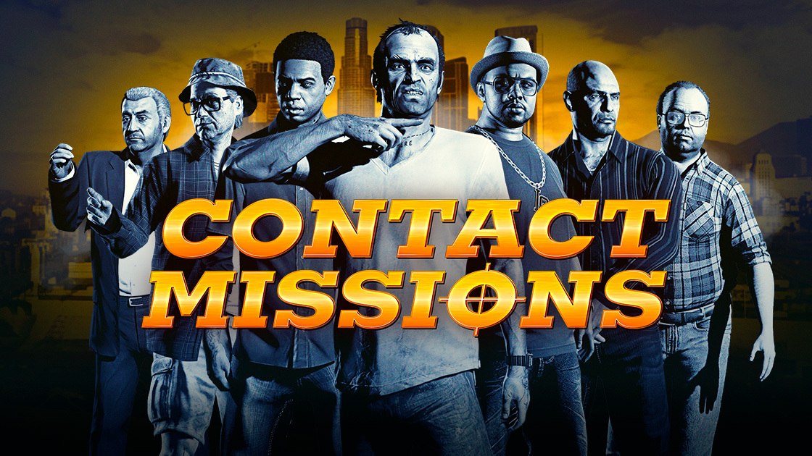

## 🎯 核心看点速览

洛圣都又到了最适合开黑的日子。Rockstar 这周把「抢劫」两个字打在了公屏上，从老牌五连到末日豪劫、钻石赌场，再到刚开张的科尔兹中心，一条龙给你安排得明明白白。先把重点摆出来：

- **抢劫首通双倍**：完成全部原版抢劫（Original Heists）、末日豪劫（The Doomsday Heist）、钻石赌场豪劫（The Diamond Casino Heist）的首次通关奖励，直接翻倍结算。
- **科尔兹中心抢劫活动首秀**：为纪念这次活动，你和同伙必定获得此前只有今夏「艺术收藏家」计划中冲到 Elitist 段位的大佬才配拥有的《The Outcome of Endeavour》。
- **白嫖豪宅挂画**：即日起至 11 月 11 日，任意时间进入 GTA 线上模式，就能把中世纪的现实主义巨作《The Great Circle Back》挂上你家别墅的墙。
- **黑豹雕像保底**：本周飞卡约佩里科岛撬金库，首次接近目标时必定刷出最稀有的黑豹雕像。
- **11 月 5 日–11 日**：KnoWay Out 首次完成给双倍 GTA 游戏币。
- **11 月 12 日–12 月 2 日**：全部联系人任务双倍奖励（GTA+ 会员叠到四倍），自由模式挑战四倍、特技竞速三倍、Sumo（Remix）双倍、社区系列三倍。

## 📌 重点深度解析

### 一、首通双倍：奖励只发一次，别当成常驻低保

先把最容易踩坑的点说清楚——这波双倍针对的是**首次完成奖励**，也就是你账号第一次把某个抢劫打完时结算的那笔额外奖金，不是重复刷就永远双倍。

所以千万别刚启动就随便拉野队莽进太平洋银行，结果反复翻车把首通次数浪费掉。正确流程是：先把三条主线（原版抢劫 / 末日豪劫 / 钻石赌场豪劫）里自己还没通关的分支列个清单，然后优先安排车队、练路线、备载具，一次性干净利落地吃下这一份翻倍。

原版抢劫那套经典五连，从全福银行到太平洋银行，老玩家闭着眼睛都能过，新号拿来开荒最划算；末日豪劫难度高但报酬本来就肥，翻倍之后性价比直接拉满；钻石赌场则是路线自由度最高的一档，侦查做足、潜入或强攻二选一，双倍收益相当可观。

### 二、科尔兹中心抢劫：白送的艺术珍品，比钱更值钱

本周真正的主角是科尔兹中心抢劫（The Kortz Center Heist）。为了纪念它的首次抢劫活动，只要你跟同伙把这活儿干完，就必定获得《The Outcome of Endeavour》——这玩意儿此前是今夏「艺术收藏家」计划里 Elitist 段位玩家的专属收藏，属于那种挂在墙上、朋友进别墅一眼就看见、然后开始问你「这哪来的」的身份象征。

换句话说，这是一次纯纯的**绝版收藏品复刻福利**。就算你对美术一窍不通，也建议抽空把这趟抢劫跑完，毕竟现金天天能赚，段位限定艺术品可不是天天有。顺手提醒一句，11 月 11 日前登录还能额外领《The Great Circle Back》，一幅中世纪现实主义大作，免费送、不领白不领，别墅墙面就那么大，先占了再说。

### 三、黑豹雕像保底：佩里科岛本周就是提款机

玩过卡约佩里科岛的朋友都懂，主目标里最馋人的就是黑豹雕像，平日的掉落全看脸。本周官方直接给你保底：飞过去第一次接近目标时必定刷出黑豹雕像。

这意味着一次成功的单人潜入，收益足以顶平时好几趟。建议提前把侦查路线、排水管道入口、保险柜位置摸熟，噪音控制住、别惊动守卫，把这一趟打成一笔干净漂亮的买卖。对于刚回归、装备不全的玩家来说，这是本周回血最快的一条路。

### 四、第二周接力：联系人任务四倍狂欢

11 月 12 日到 12 月 2 日，GTA 线上模式要为那些陪伴我们多年的配角们开一场庆功宴。全部联系人任务——包括马达拉佐的派遣服务、杰拉德的 Last Play、Premium Deluxe 收车业务、以及 Lowriders 系列——统统双倍奖励，GTA+ 会员还能叠加到**四倍**。

同一时间段里，自由模式挑战四倍 GTA 游戏币与声望值，特技竞速系列三倍，Sumo（Remix）双倍，社区系列三倍。这已经不是「有没有的赚」的问题了，是「你今天肝了几个小时」的问题。

## 💡 玩家实操与上手建议

**1. 优先级排序，先掐时间窗口**

本周是限时的，第二周的狂欢虽然更长但也有截止日。我的建议是：先啃抢劫首通双倍（一次性、额度大、错过不补），再顺手把科尔兹中心的艺术品和登录挂画收下，最后把佩里科岛的黑豹雕像刷掉。等 12 号联系人任务开启后，再切回日常刷钱模式。

**2. 组队比野排香得多**

抢劫类任务翻车成本极高，尤其是末日豪劫和钻石赌场。拉三个固定队友，语音开起来，分工提前说死：谁开车、谁拆监控、谁背钱袋。野队不是不能打，但你得做好「首通额度被队友的骚操作吃掉」的心理准备。

**3. GTA+ 会员这周的价值被放大了**

联系人任务四倍、部分活动叠加倍率，如果你本来就打算在 11 月 12 日到 12 月 2 日之间猛刷一波，会员的性价比比平时高不少。当然，纯白嫖党也别慌，双倍本身已经够甜了。

**4. 增强版玩家的配置小贴士**

GTA V 增强版在画质和加载上比传承版舒服很多，但抢劫时的帧数稳定性直接影响射击手感。开打前把垂直同步关掉、把云层和反射相关的画质选项降一档，优先保帧数，别在银行门口因为掉帧被人一枪带走。另外开黑记得挂加速器，抢劫中途掉线不仅白打，还可能把队友气到退游。

**5. 别忽略那些「顺手能赚」的小活**

自由模式挑战四倍、社区系列三倍这些看着不起眼，但架不住次数多、门槛低。等队友上线的空档，随手做几个，收益积少成多，说不定比你正经打一把抢劫还划算。

## 📢 官方 Telegram 频道推荐

洛圣都的折扣和限免从来都是说没就没，等你刷到消息的时候黄花菜都凉了。想要第一时间抓到限时福利、Steam 特惠、喜加一活动，建议直接加入我们的官方 Telegram 频道 **@steamhunterlink**，秒级推送、不绕弯子，限免开抢前先收到通知，比盯着商店页面刷新靠谱得多。

## ❓ 常见问题 FAQ

**Q1：抢劫首通双倍是重复刷也双倍吗？**

不是。本次翻倍针对的是「首次完成奖励」，即账号第一次通关对应抢劫时结算的那笔额外奖金。重复通关仍按常规结算，所以务必珍惜首通机会，别浪费在翻车的野队上。

**Q2：科尔兹中心抢劫的《The Outcome of Endeavour》是每人必得还是随机掉落？**

按官方说法，为纪念本次抢劫活动，你和同伙是**必定获得**该艺术品的，不存在抽奖成分。建议在活动期内尽早完成，避免活动结束后渠道关闭。

**Q3：黑豹雕像保底需要什么前置条件？**

需要在卡约佩里科岛抢劫中首次接近主要目标时触发，属于本周的活动性保底。具体结算与刷新规则以游戏内实际显示为准，建议先完成侦查、确认目标后再决定强攻还是潜入，别一上来就把守卫全惊动了。
