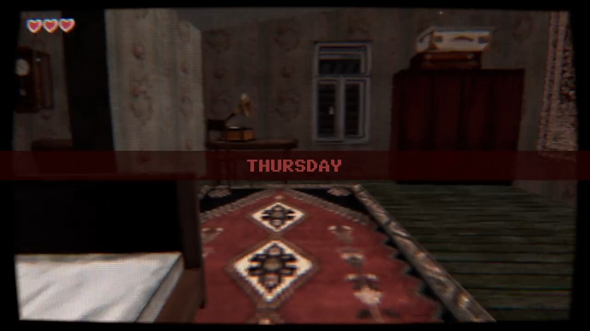
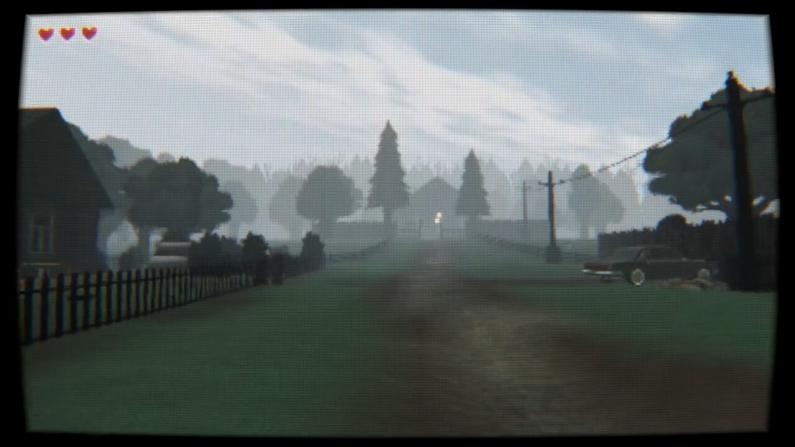
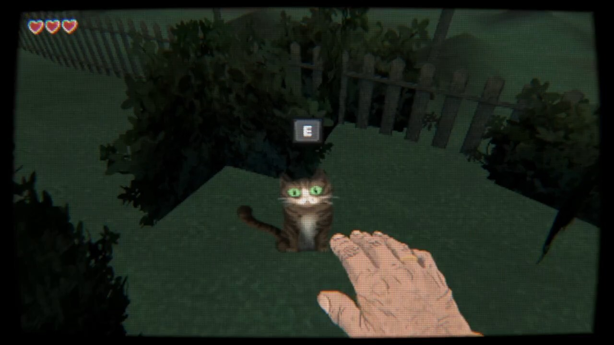
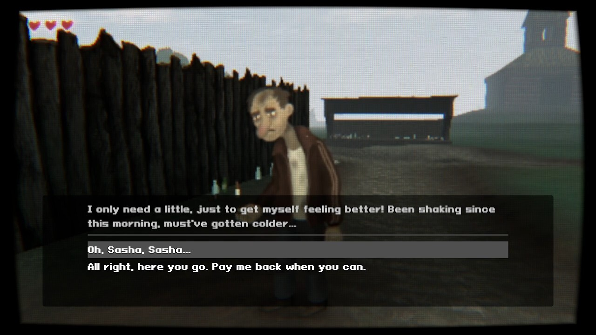
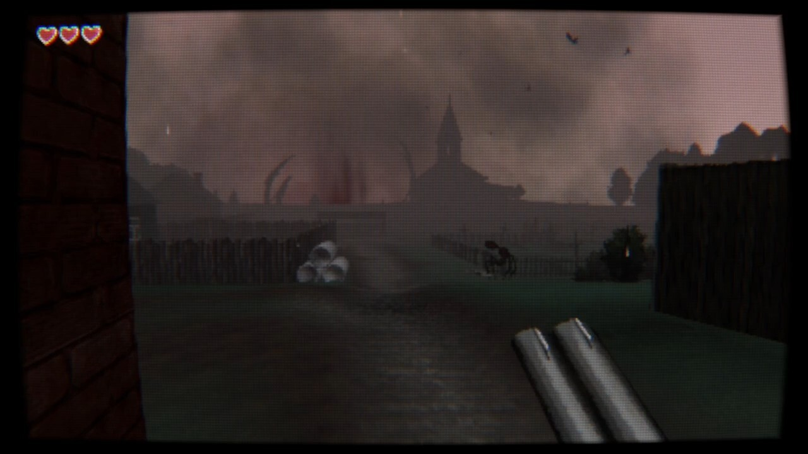

## 🎯 核心看点速览

- **愿望单成绩翻倍达标**：《Leviathan: Rhino》愿望单数量正式突破 **20,000**，是团队原定 10,000 目标的两倍，官方发文致谢玩家。
- **发售进入读秒阶段**：距离正式解锁只剩 **24 小时**，游戏确定于 **11 月 6 日** 上线 Steam。
- **定位明确**：这是一款叙事向恐怖步行模拟（narrative horror walking sim），采用风格化低多边形（low-poly）美术。
- **团队里程碑**：本作是 Solarsuit Games 与 Amortiz Games 以发行商身份推出的**第一款游戏**，官方直言“有点紧张”。
- **福利放送**：为表感谢，官方一次性放出多张此前从未公开的游戏截图。

> Leviathan: Rhino just passed **20,000 wishlists**. That's double our 10,000 goal. Thank you!

## 📌 重点深度解析

### 一、2 万愿望单意味着什么

对一支体量不大的独立团队来说，Steam 愿望单就是发售前最真实的人气体温计。10,000 已经是很多小团队给自己定下的“及格线”，而《Leviathan: Rhino》直接翻倍跑到 20,000，说明它在恐怖游戏圈子里已经攒下了相当扎实的口碑基础。官方的措辞也很实在——不是狂欢，而是感谢，顺带承认自己“现在有点紧张”。这种坦诚，反而比通稿式的自夸更让人觉得可信。

### 二、玩法气质：叙事恐怖 + 步行模拟

从官方自述来看，本作不走突脸跳吓（jump scare）的廉价路线，而是把重点押在**叙事与氛围**上。步行模拟这一类型天生适合慢节奏的心理压迫：你需要在一段段场景里走走停停，读环境、听声音、拼线索，把故事一点点抠出来。配上低多边形的视觉风格，画面不会追求写实，而是用几何化的造型和打光营造“不对劲”的疏离感——这类美术在恐怖题材里往往格外好用，因为它天然带着一种梦境般的失真。

### 三、新截图透露的信息

官方这次放出的几张新图，基本延续了此前预告的调性：空旷、静谧、光线克制，画面里的主体尺度感被刻意放大，呼应标题里的“Leviathan（利维坦）”所暗示的庞然巨物意象。

### 四、独立发行的第一步

值得单独拎出来说的是，这是团队第一次以发行商身份推游戏。发行和开发是两套完全不同的活儿——上架节奏、商店页打磨、社群维护、媒体对接，全是新课题。愿望单破 2 万，某种意义上也是市场对这套“新手发行”投出的信任票。

“See you at launch tomorrow, November 6. Let's find out together just how giant our Leviathan turned out to be!”

## 💡 玩家实操与上手建议

1. **先加愿望单再等解锁**：距 11 月 6 日上线只剩一天，现在去商店页把游戏加进愿望单，解锁瞬间 Steam 会推送提醒，避免错过首发。
2. **关注首发折扣窗口**：独立恐怖新作常见做法是发售后一到两周给个小幅首发优惠，预算敏感的玩家可以蹲一下首周价格再下手。
3. **别当动作游戏玩**：步行模拟的核心是探索与解谜，遇到“走不出去”的地方先回头看环境细节，而不是急着找怪打。
4. **戴耳机、关灯、别开弹幕**：这类靠音效铺气氛的作品，耳机带来的沉浸感是外放完全比不了的，音量别开太满，留点余量给突然的动态变化。
5. **怕吓又想玩？** 建议和朋友连麦同屏“云陪玩”，一人操作一人吐槽，恐怖值直降一半，体验反而更欢乐。
6. **低配党放心**：低多边形美术通常对显卡相当友好，老机器大概率也能跑得动，具体配置以商店页标注为准，进游戏后优先把帧率稳定在一档，再动画质选项。

## 📢 官方 Telegram 频道推荐

想第一时间拿到限免喜加一、史低背刺和发售秒杀提醒？加入我们的官方 Telegram 频道 **@steamhunterlink**，特惠与限免信息秒级推送，不用天天盯着商店页刷新，好价自己送上门。

## ❓ 常见问题 FAQ

**Q1：《Leviathan: Rhino》什么时候能玩到？**
A：官方确认将于 **11 月 6 日** 正式发售，发文时距离解锁还有 24 小时。具体解锁时刻以 Steam 商店页显示的倒计时为准。

**Q2：这游戏是纯走路看剧情，还是会有战斗？**
A：官方把它定义为叙事向恐怖步行模拟，重心在氛围、叙事与探索解谜，而不是动作对抗。如果你喜欢慢热、靠环境讲故事的恐怖体验，这部很对味；如果你要的是爽快射击，那可能会觉得节奏偏慢。

**Q3：愿望单破 2 万有送什么福利吗？**
A：这次官方是以放出多张未公开截图的方式致谢，目前没有公布额外的游戏内奖励或免费赠送活动。后续是否有首发优惠，建议盯紧商店页与我们的推送。
