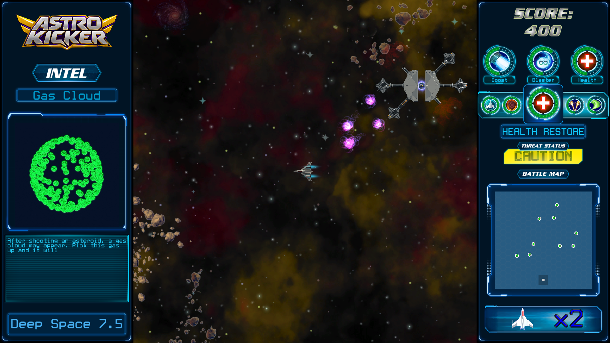
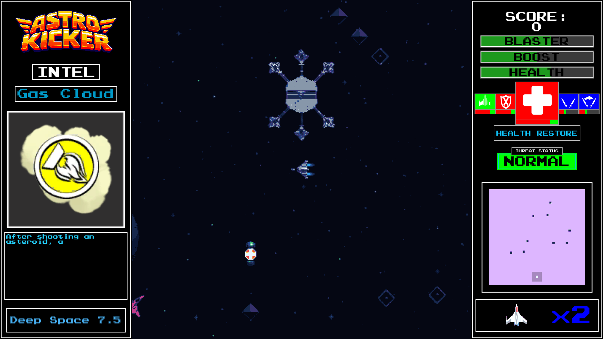

大家好，我是你们的老朋友，专门盯着 Steam 新品与版本动静的硬核主理人。这次轮到《Astrokicker》——一款把太空舱、星站攻坚和街机手感揉在一起的狠角色。开发组刚刚放出 1.0 版本前瞻，抢先体验阶段即将收尾，战斗规则却先来了一轮大改。别急着喊“背刺”，这波改动更像是把星站从“莽就完事”推向“动脑拆解”。

## 🎯 核心看点速览

- **结束抢先体验倒计时**：开发组正在检查 1.0 发行构建，具体日期还没拍板，但方向已经很清楚——要把完整版端上桌。
- **星站攻坚不再一条路**：现在可以选择拆掉武器炮塔，也可以打掉中继器，等核心舱门打开再灌伤害。
- **防御手段更立体**：飞行中的导弹可以被击落，地雷链只要引爆位置够近，也能替你做掉一部分攻坚工作。
- **Retro 模式同步升级**：八向转向、像素演出，街机味更冲；最后六个关卡会把前面学到的技巧组合起来考你。
- **Modern 与 Retro 双 cockpit 选择**：开发组直接问玩家——最终关卡你坐进哪一边？这问题本身就很有味道。

## 📌 重点深度解析

### 星站攻坚：从“拆炮台”到“拆系统”

现代模式里，星站核心不再是铁乌龟。你可以先处理武器炮塔，降低正面压力；也可以换个思路，敲掉中继器，逼核心开门，再抓住窗口期输出。听起来像给了两条路，实际打起来更像一道临场选择题：是先拆牙，还是先拆锁？

更妙的是，导弹现在能在飞行途中被击落。以前看到弹幕飞来，第一反应是躲；现在你可以选择抬手点掉，尤其是那些慢速但恶心人的大家伙。地雷链也成了战术资源，只要引爆距离够近，能顺手带走一片麻烦。

*Modern. The station core is open and its turrets are still firing.*

注意看图里这个状态：核心门开了，但炮塔还在吐火。也就是说，开门不等于安全，窗口期输出之前最好先想清楚哪边炮塔还能忍、哪边必须立刻拔掉。硬吃伤害换输出，在 1.0 里大概率会被教做人。

### Retro 模式：八向转向，像素味拉满

复古模式这次不是简单换个皮。转向会吸附到八个方向，动作演出也换成像素风。习惯自由瞄准的玩家一上手，可能会觉得像穿了双硬底靴——转身有台阶，瞄准有棱角。但打多了反而更讲究提前量、走位预判和节奏感，街机味一下就上来了。

*Retro. A mine pocket beside a station on Level 36.*

这张 Level 36 的截图信息量不小：星站旁边有雷区口袋，意味着你可以把敌人往雷上引，也可以主动引爆地雷链清场。八向转向配上这种地形，走位就不能太随性，得提前想好下一步落在哪个方向。

### 最后六个关卡：把技巧串起来考

开发组说得很明白，最后六个关卡会把前面练的东西组合起来。一个关卡要求你从弹幕缝隙里穿过去，另一个给你空间放 Nova 或者引爆地雷链。翻译成人话就是：别指望一招鲜吃遍天，前面偷懒没练的机制，终盘都会回来找你。

## 💡 玩家实操与上手建议

- **先加愿望单，别等错过通知**：1.0 日期还没公布，最稳的操作就是去 Steam 商店页加愿望单，等定档通知直接弹脸。
- **星站别急着莽核心**：进门先看炮塔分布。炮塔压力大就先拆炮塔；想抢时间就打中继器，等核心开门再集中输出。核心开门时炮塔还可能继续 firing，别把窗口期当成无敌帧。
- **导弹能点就点**：飞行中的导弹可以击落，尤其是那些速度不快但封走位的，优先处理能让你少掉一大截血。
- **地雷链要算距离**：地雷链不是按了就完事，引爆位置够近才能替你做掉攻坚工作。引怪、封路、补伤害，三件事可以一起干。
- **Retro 模式先练转向**：八向吸附会让微调变粗，建议先低压力关卡熟悉“提前转”的手感，别在弹幕里硬拧方向。
- **购买建议**：目前 1.0 还没定档，想稳一手可以等正式版；想参与反馈、提前熟悉机制，关注抢先体验阶段的更新节奏也不亏。配置需求以 Steam 商店页为准，别信来路不明的“优化神器”。

## 📢 官方 Telegram 频道推荐

想第一时间收到《Astrokicker》1.0 定档、限免喜加一和特惠折扣消息，来 Telegram 频道 **@steamhunterlink**。我这边会把秒级限免与特惠推送丢进频道，省得你天天刷商店页，错过史低还拍大腿。

## ❓ 常见问题 FAQ

**Q1：《Astrokicker》1.0 具体什么时候上线？**

A：开发组目前还在检查发行构建，日期尚未公布。最靠谱的做法是加愿望单，等 1.0 通知；也可以关注官方社区动态，别被“已经定档”的小道消息带节奏。

**Q2：星站核心到底怎么打开？打炮塔还是打中继器？**

A：两条路都行。拆武器炮塔能降低正面压力；打掉中继器可以等核心开门，再抓窗口输出。实战里建议看炮塔威胁和自身血量临场选，别一套流程用到黑。导弹能击落，地雷链也能借力，别只盯着核心猛灌。

**Q3：Modern 和 Retro 该选哪个？**

A：想要自由瞄准和现代演出，选 Modern；想要八向转向、像素街机和更硬的节奏感，选 Retro。最后六个关卡会把两边学到的技巧组合起来，老玩家建议都跑一跑，别到终盘才发现自己只会一种驾驶舱。
