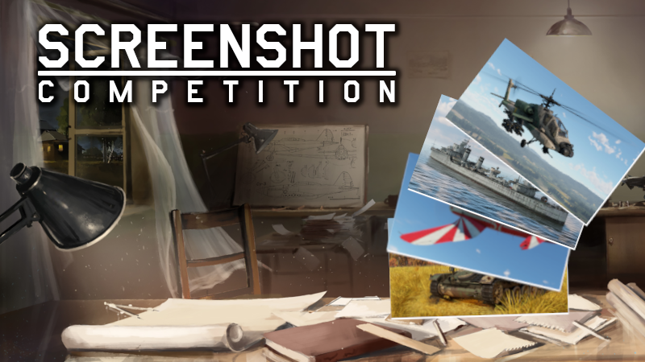

各位车长、舰长、飞行员们好，我是你们的老朋友，那个常年在机库和车库之间来回横跳的专栏主理人。这周 War Thunder 官方又整活了——第 249 期 Steam 截图大赛正式开闸，主题回到大家最熟悉也最容易出神图的元素：**水**。

## 🎯 核心看点速览

- **赛事主题**：A World of Blue——只要画面里出现水体 + 你的载具，就算合格。海战、湖泊、河流、两栖登陆、水上迫降，统统欢迎。
- **投稿时间**：即日起至 **11 月 13 日**截止，逾期不候。
- **投稿方式**：在 War Thunder Steam 社区中心发布截图，标题只放 **#WTscreen249** 这一个标签，不要加别的文字。
- **奖励设置**：共 6 名获奖者，社区投票前 3 名 + 官方评委精选 3 名，每人 **300 金鹰（GE）**。
- **上期回顾**：第 248 期主题“Beyond Repair”的获奖名单已同步放出，文末附上作品链接。

简单说，这是一场零门槛、纯拼审美和构图眼光的福利活动。不需要你场场 15 杀，也不需要你把坦克开到对面家里，只要你会按 F12。

## 📌 重点深度解析

### 水，为什么是最好拍的主题？

老玩家都懂，War Thunder 的画面引擎在渲染水体时是真的有点东西。海浪的反射、螺旋桨搅出的尾迹、炮弹落水炸起的水柱、两栖坦克冲滩时溅起的白浪——这些都是天然的“动态构图素材”。

本期官方给出的方向很宽松：

- 你可以开着战列舰在开阔海域和对面互相对轰，抓一发主炮齐射的瞬间；
- 也可以驾驶两栖载具搞偷袭，拍下履带刚离开水面、车身还在滴水的画面；
- 甚至可以让飞机贴着湖面低空掠过去，用机翼切开水雾。

官方的原话是：**只要你的截图里有水体就行**。所以别自己给自己设限，创意分往往比画质分更吃香。

### 规则红线，别踩

这部分是重点，每年都有玩家因为细节问题被刷掉，属实可惜：

1. 截图必须包含**水体**和**玩家载具**，缺一不可；
2. 必须添加 **#WTscreen249** 标签，且**标题里不能出现任何其他文字**；
3. 人气投票奖每位作者**每四期只能拿一次**，防止常驻霸榜；
4. 截图必须符合 War Thunder 社区规则，内容得体；
5. 必须是你本人原创，不能盗图；
6. 必须是**全新截图**，此前发布过或参加过其他比赛的旧图不算数；
7. 只接受**游戏原生截图**，不允许使用任何后期修图软件或外部视觉增强（比如 Nvidia Ansel 滤镜）；
8. 可以使用 War Thunder **游戏内置**的滤镜与画面设置；
9. 可以调用游戏内置的**回放功能**来取景——这一点对想拍大场面的玩家非常友好；
10. 奖励将在获奖作者账号内于 **14 个工作日内**发放。

> 划重点：内置滤镜能用，外部滤镜不能用。回放取景能用，PS 抠图不能用。这条线官方卡得很死。

### 上期“Beyond Repair”获奖名单

第 248 期的主题是“无法修复”，画风普遍偏悲壮，残骸、冒烟的坦克、断翼的飞机是主旋律。获奖作品如下：

**社区投票选出：**

- https://steamcommunity.com/sharedfiles/filedetails/?id=3832357834
- https://steamcommunity.com/sharedfiles/filedetails/?id=3830698632
- https://steamcommunity.com/sharedfiles/filedetails/?id=3832938579

**官方评委选出：**

- https://steamcommunity.com/sharedfiles/filedetails/?id=3832344726
- https://steamcommunity.com/sharedfiles/filedetails/?id=3832104590
- https://steamcommunity.com/sharedfiles/filedetails/?id=3831662523

以上六位每人到手 300GE，恭喜恭喜。想参考构图思路的兄弟可以点进去看看，尤其是光影和取景角度，非常值得抄作业。

(https://steamcommunity.com/sharedfiles/filedetails/?id=3439537726 style=button)

## 💡 玩家实操与上手建议

### 怎么投稿最稳

1. 进游戏，选一张带水的图——海战图、有河流的陆战图、或者带湖泊的混合图都行；
2. 打完一局后进**回放**，把时间轴拖到你想要的那一帧，用自由视角慢慢调机位；
3. 用 Steam 的 F12 截图，或者游戏内截图快捷键；
4. 打开 Steam 社区中心 → War Thunder → 发布截图；
5. **标题栏只填 #WTscreen249**，一个字都别多加，标签也记得挂上；
6. 提交后可以顺手把链接甩给队友，让他们帮忙点个赞——社区投票奖就是这么来的。

### 出片小技巧

- **低机位贴水面**：把相机压到接近水面的高度，利用前景水波做虚化，纵深一下就出来了；
- **抓住瞬时动作**：主炮开火的水柱、鱼雷入水的白痕、飞机掠水的激波，这些瞬间比静态摆拍更有冲击力；
- **善用内置时间与天气**：黄昏逆光、暴雨海面、晨雾湖面，氛围感直接拉满；
- **别贪多**：画面元素越杂越难出彩，一艘船 + 一片海 + 一道光，往往比满屏爆炸更高级；
- **回放里可以暂停**：想拍慢门效果就靠这个，不用担心手速跟不上。

### 顺手能薅的其它羊毛

截图大赛的 300GE 虽然不多，但胜在零成本。对于还在纠结要不要买高级载具或者开高级账号的兄弟来说，攒一攒也是肉。另外提醒一句，War Thunder 的限免和折扣活动节奏一向很快，本体免费、DLC 和礼包经常搞限时特惠，想入坑或者补票的朋友，建议先把推送渠道铺好，别等背刺完了才后知后觉。

## 📢 官方 Telegram 频道推荐

想第一时间蹲到 Steam 喜加一、限免周末、史低折扣和 War Thunder 这类活动的开奖提醒？强烈建议加入我们的官方 Telegram 频道：**@steamhunterlink**。

秒级推送、不漏福利、不刷屏，喜加一党必备。毕竟金鹰要攒，免费游戏更要薅，两手都要抓。

## ❓ 常见问题 FAQ

**Q1：我可以用 Nvidia Ansel 或者后期软件修图吗？**

不行。官方明确只接受游戏原生截图，任何外部修图软件和视觉增强工具（包括 Nvidia Ansel 滤镜）都禁止使用。但 War Thunder **游戏内置**的滤镜、画面设置以及内置回放功能是允许的，放心用。

**Q2：投稿标题需要写什么内容？**

标题里**只能有 #WTscreen249** 这一个标签，不能附加任何其他文字。这是最容易翻车的地方，很多玩家习惯性写个“我的海战截图”就被判无效了。

**Q3：我能连续多期都拿奖吗？**

人气投票奖有限制：每位作者**每四期截图大赛只能通过社区投票获奖一次**。不过官方评委精选奖不受这个限制，作品够硬照样有机会。

**Q4：300GE 奖励什么时候到账？**

官方说明是在获奖名单公布后 **14 个工作日内**发放到作者账号，耐心等等就好，不用反复催。

---

好了，本期情报就到这里。11 月 13 日截止，时间不算宽裕，想冲的兄弟今晚就可以进回放里找素材了。祝各位都能拍出让自己满意的“蓝色世界”，咱们下期开奖见。
