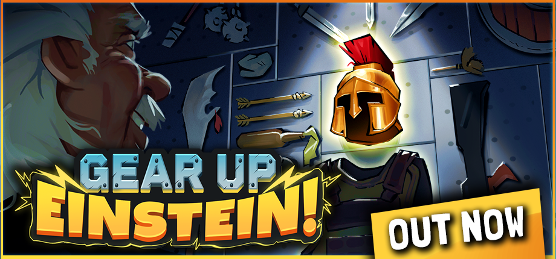
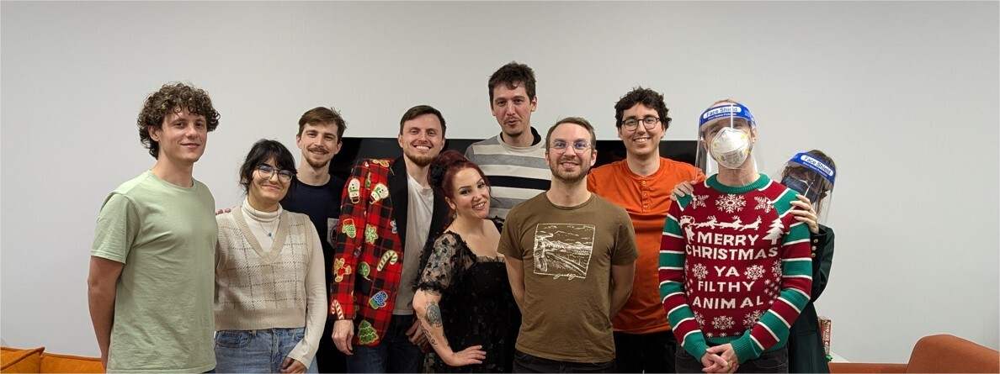

## 🎯 核心看点速览

各位指挥官，好消息来了！《Gear Up Einstein!》现已正式登陆 Steam 抢先体验，首发还带 **15% 折扣**，想入手的兄弟别犹豫，这波早买早享受。本次上线版本内容量相当扎实：全新 **古代纪元** 带着专属视觉、装备和十字路口登场，还有一堆新特工、新装置、新敌人等你解锁。难度 4 和 5 以及所有 Divergence 等级也在完整版中开放，排行榜已经重置，竞技大佬们可以重新冲分了。

另外，免费 Demo 也同步到了相同版本，这意味着你可以和买了完整版的朋友直接联机，先白嫖试玩再决定要不要掏钱，这波操作很良心。

## 📌 重点深度解析

### 新纪元、新特工、新玩具

这次更新的重头戏是 **古代纪元**——完成特殊任务即可解锁，自带一套全新的视觉风格、装备体系和十字路口事件。特工阵容也扩充了，具体是谁先卖个关子，进游戏自己抽卡解锁更有惊喜。战术装置方面新增了多种工具，让你在战场上多了不少阴人……哦不，是智取的手段。敌人也添了新面孔，任务里遇到别慌，先看看它技能说明再决定集火顺序。

完整版玩家还能体验到大量新升级和研究项目，以及所有纪元新增的十字路口事件。难度 4 和 5 加上全部 Divergence 等级解锁，硬核玩家终于可以挑战极限了。

### 玩法与平衡性调整

任务控制台现在有了专门的 UI 界面，设置任务参数更顺手。视觉方面不少模型和特效重做，整体观感提升明显。小怪平衡性做了一轮全面调整，尤其照顾了支援单位——之前某些支援怪太恶心，现在应该会舒服一些。装备也进行了大量微调、平衡和重做，手感变了别惊讶，官方等着你们反馈。

音效方面新增了不少，战斗反馈更带感。结算界面和个人资料页能看到更多统计数据，方便复盘。**排行榜已重置**，各位竞速大佬同一起跑线，是时候展现真正的技术了。

### 体验优化与修复

战斗修饰器增加了公告提示，战斗速度可以开 **x2** 并且能永久锁定，刷图效率直接翻倍。还能关闭关卡过渡动画和血腥效果，照顾不同口味的玩家。装置同时触发两个时的行为修复了不少，各种视觉 glitch 也清理了一波。性能与稳定性提升，排行榜名称过滤加强，15 种语言本地化全面翻新。仇恨机制调整：单位现在只会在中立单位挡路时攻击它们，联机时回退金币不再重复发放，战斗生成也不会再把障碍或敌人放在你的起始格上了。

### 开发者寄语

开发组特别感谢了所有陪伴他们走到今天的玩家，强调抢先体验只是开始，后续会持续加内容、调平衡、打磨细节。他们也放出了一张团队合照（虽然有些人没入镜），所有参与者的名字都在制作名单里。

> “Early Access 只是起点，我们会继续和你们一起添加新内容、平衡和打磨，所以请继续砸反馈过来！”

## 💡 玩家实操与上手建议

**购买建议**：首发 15% 折扣是实打实的优惠，想入完整版的直接冲。如果你还在观望，先下载免费 Demo 试试水，反正 Demo 已经和正式版同版本，还能和买了游戏的朋友联机，白嫖开黑两不误。

**联机避坑**：Demo 玩家和完整版玩家可以互相邀请，但注意部分内容（比如新升级、难度 4/5）是完整版专属，Demo 只能体验基础部分。开黑前确认大家版本一致，避免出现“你进不去我房间”的尴尬。

**冲分提醒**：排行榜已重置，想抢前排的赶紧研究新纪元和新装备的 combo。建议先把难度 4 摸熟，再挑战 Divergence 等级，别一上来就头铁。

**性能优化**：如果觉得战斗动画太长，直接在设置里开 x2 速度并锁定，刷材料效率翻倍。晕血腥的玩家可以关掉 gore 效果，不影响核心玩法。

## 📢 官方 Telegram 频道推荐

想第一时间拿到 Steam 限免、史低特惠和更新推送？加入官方 Telegram 频道 **@steamhunterlink**，秒级通知不迷路，喜加一和背刺信息一网打尽。

## ❓ 常见问题 FAQ

**Q1：抢先体验版内容够玩吗？**
A：目前已有完整纪元体系、多难度、排行榜和联机合作，内容量足够肝一阵子。开发组承诺持续更新，早买早享受。

**Q2：免费 Demo 和完整版有什么区别？**
A：Demo 可以体验基础内容和联机，但新升级、研究、难度 4/5 及部分特工装置是完整版专属。Demo 版本已同步，和完整版好友联机没问题。

**Q3：15% 首发折扣持续多久？**
A： Steam 首发折扣通常持续一到两周，具体截止时间以商店页面为准。建议先加愿望单，收到打折提醒直接入手。
