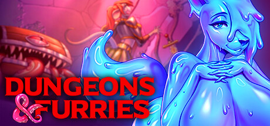
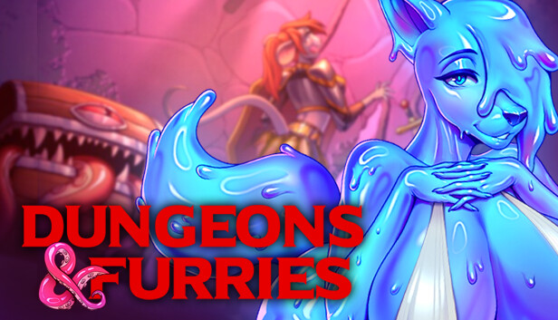

## 🎯 核心看点速览

- **正式发售，不用再等愿望单倒计时**：《Dungeons & Furry》现已登陆 Steam，AppID 2953170，四条故事线全部开放，角色设定与路线选择都能按自己的口味来。
- **内容量管饱**：超过 **85,000 字**剧情、9 位主要角色与更多配角，场景从村庄一路铺到城堡，浪漫过场和热辣插画都安排上了。
- **路线自由度高**：支持纯直、纯弯、百合、无性等多种游玩取向；角色生理设定会实际影响亲密场景演出，不是摆设。
- **偏好向角色也有覆盖**：futa 与 femboy 角色登场，制作组显然很清楚受众想看什么。
- **不是纯看字**：内置氛围感三消小游戏，而且选择和路线挂钩，手滑和手速都可能影响你的剧情走向。
- **配音与DLC**：对话包含部分英文配音；同步推出含动画、原声、美术图和美术集的 DLC。
- **首发优惠**：Deluxe Edition 享 **15% 首发折扣**，还有捆绑包折扣，想支持制作组的可以一步到位。

## 📌 重点深度解析

先说结论：这不是那种“点开、看完、卸载”三分钟走完流程的甜品级小品。《Dungeons & Furry》最狠的地方在于，它把兽人幻想、视觉小说和多路线选择揉成了一整条完整流程，而且制作组明确表示——这是他们目前规模最大的一作。

**第一，故事量真的上来了。** 四条故事线、8.5 万字打底，9 位主要角色各有戏份。你可以把它理解成一本能自己选走向的奇幻小说，村庄、城堡、角色关系、浪漫桥段都写在里面。制作组还特意提到，这次不光是场景数量增加，美术内容也明显加码，从浪漫过场到热辣插画都有覆盖。

**第二，路线设计不是摆设。** 游戏支持纯直、纯弯、百合、无性等不同取向，角色生理设定还会影响亲密场景的表现。换句话说，你在角色创建和路线选择阶段做的决定，后面真的会在演出里体现出来。对这类作品来说，这种“选择有反馈”的设计比单纯堆文本更难得。

**第三，三消小游戏不是外挂装饰。** 官方说法是“氛围感三消”，并且允许玩家选择自己的道路。实际体验时别只顾着消消乐，分支提示和路线选择才是重点。把它当成剧情推进的一部分，而不是纯打发时间的插件，体验会更顺。

**第四，DLC 走的是收藏路线。** 同步上架的 DLC 包含动画、原声、美术图和美术集，属于“喜欢就支持，不买也不影响本体完整体验”的类型。制作组也说了，买 DLC 可以补看错过的场景，顺便拿魔法风美术图装点桌面。

**第五，首发折扣别错过。** Deluxe Edition 有 15% 首发折扣，还有捆绑包优惠。对于这种内容量偏大的视觉小说来说，首发窗口通常是最划算的入手点之一，等等党可以等，但早买早享受，晚买也不一定更便宜。

## 💡 玩家实操与上手建议

**1. 入库认准 AppID 和发行商。** 在 Steam 搜索英文名《Dungeons & Furry》，或者直接认 AppID **2953170**，发行商是 Furlough Games。别被同名或相似封面带偏，买错游戏可比三消卡关更难受。

**2. 购买顺序建议：本体优先，DLC 看厨力。** 想完整体验故事，先拿本体就够了；如果你对动画、原声、美术集有收藏癖，再考虑 DLC 或 Deluxe Edition。首发 15% 折扣和捆绑包折扣可以叠加对比一下，别闭眼直接单买。

**3. 一周目别急着全路线收集。** 这类多路线作品最忌讳“攻略式扫图”。第一周目按自己喜好选，体验会更自然；等通关后再开二周目补分支，反而更有新鲜感。

**4. 三消别当挂机游戏。** 内置三消和剧情分支有关联，看到路线提示时慢一点，别手快把关键选项点过去。实在卡关就重开小游戏，别硬凹。

**5. 注意内容分级与使用场景。** 本作包含成人向内容，建议在合适的环境下体验，公共场合记得戴耳机。游戏以单人体验为主，没有联机避坑环节，社恐玩家可以放心。

**6. 语言与配音先看商店页。** 对话包含部分英文配音，文本语言支持情况以 Steam 商店页标注为准。购买前建议先确认自己需要的语言是否在列表里，避免进游戏才发现要啃生肉。

## 📢 官方 Telegram 频道推荐

想第一时间蹲 Steam 喜加一、限免周末、史低折扣和“刚买就背刺”预警，建议加入官方 Telegram 频道 **@steamhunterlink**。限免与特惠推送按秒级更新，临时工价格和永久入库情报都不容易漏。

也别忘了关注制作组官方渠道，后续更新、DLC 动向和下一款新作消息都会在那里发布：

- 官方 Telegram：https://t.me/furlough_games
- 官方 X：https://x.com/furlough_games
- 官方 Bluesky：https://bsky.app/profile/furlough-games.bsky.social
- 官方 Discord：https://discord.com/invite/PZJfRpRRqR

## ❓ 常见问题 FAQ

**Q1：现在是正式版还是抢先体验？**

A：本次是正式发售，四条故事线都可以完整体验。后续是否追加内容、更新路线或优化细节，以制作组官方公告为准。

**Q2：DLC 必须买吗？不买会不会少剧情？**

A：不必须。DLC 主要是动画、原声、美术图和美术集，偏收藏与补完性质；本体已经包含完整故事体验。预算有限先入本体，喜欢再补 DLC 完全没问题。

**Q3：这游戏能联机吗？语言支持怎么样？**

A：本作以单人剧情体验为主，没有联机内容。语言支持与配音信息请以 Steam 商店页为准，购买前看清楚自己需要的语言标注，别等下载完才发现要边查词典边玩。
