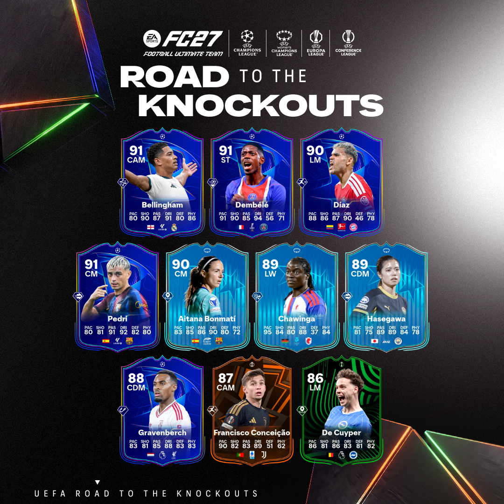
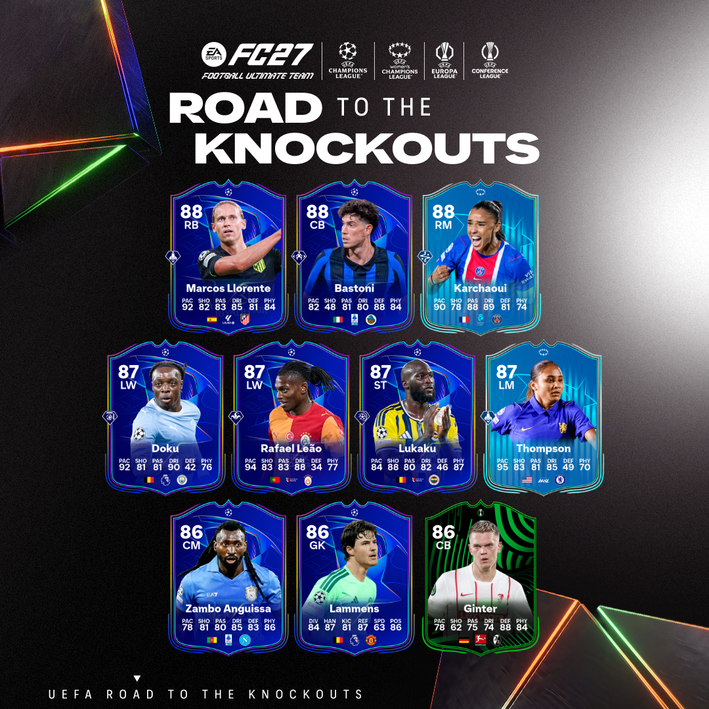
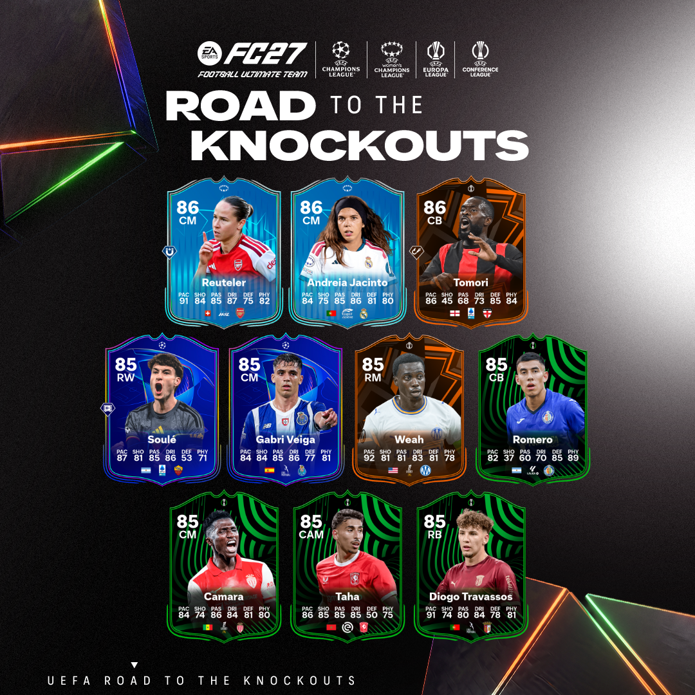

说句掏心窝子的话，Ultimate Team 最让人上头的瞬间从来不是开包那一道金光，而是你阵容里那张卡，会跟着现实世界的球员一起「长个子」。今天 EA 官方放出的 UEFA Road to the Knockouts 消息，就是把这套逻辑又往深处推了一格——**Every match matters**，每一场比赛都算数。

## 🎯 核心看点速览

- **活动名称**：UEFA Road to the Knockouts（欧冠淘汰赛之路），落地于 Football Ultimate Team™。
- **核心机制**：现实欧冠赛场上的**每粒进球、每个积分、每个联赛排名**，都会为对应的 RTK 球员卡累积进度，推动「实时升级」（Live Upgrades）。
- **覆盖对象**：欧洲顶级俱乐部的参赛球员，越往淘汰赛深处走，可升级的想象空间越大。
- **活动基调**：官方给的一句话很直白——欧洲豪门的每一球、每一分、每一个排名，都在把他们推向奖杯，也把你的卡推向更高总评。
- **对玩家的意义**：这不是一发入魂的抽卡活动，而是一场跨越数周的「现实赛果预测 + 阵容运营」长线博弈。

## 📌 重点深度解析

### 一、RTK 和普通活动卡的本质区别

传统活动卡的属性是「出厂即封顶」，发下来那天多少总评，赛季结束还是多少总评，唯一变量只有化学反应和你的手感。RTK 完全换了一套底层逻辑：**卡片是一张活的东西**，它的成长曲线不写在代码里，写在现实的欧冠赛程表里。

这意味着你在阵容里放的不只是一个球员，而是一支球队在欧冠里的**前景**。押对了，卡会自己往上爬；押错了，它就会在替补席上安静地生锈。

### 二、三条升级主线：进球、积分、排名

官方这次把升级触发点拆得很清楚，理解成三条并行的进度条就行：

1. **进球线**——球员在欧冠比赛中的实际进球，是最直接、最即时的升级推力；
2. **积分线**——球队在赛事中拿到的每一个积分，属于「团队贡献型」进度，哪怕球员本人没进球，只要球队赢球拿分，卡面同样受益；
3. **排名线**——联赛/赛事阶段的排名位次，是长线维度，越往后走权重越大，也最考验你对分组形势的判断。

三条线叠在一起，就构成了「每一场比赛都算数」这句话的真实含义：不是只有豪门大腿才有戏，一支能稳定拿分的球队里的角色球员，同样可能一路水涨船高。

### 三、时间窗口：卡价的高潮永远在「下一场」之前

玩 UT 年头久一点的朋友都懂一个规律——**动态卡最贵的时刻，往往不是升级到顶之后，而是「看起来马上要升级」的那几天**。RTK 这种挂钩现实赛程的设计，天然自带节奏感：赛程公布、首发名单出炉、比赛进行中、赛后结算，每一个节点都是一次预期的重定价。

所以别把 RTK 当成纯粹的收藏品。它更像一支跟着欧冠赛程波动的「小盘股」，你要做的是读懂赛程，而不是死守卡面。

### 四、谁最值得关注

从机制上看，RTK 的收益结构更偏向两类人：

- **铁打主力型**：出场时间稳定、定位球主罚权在手、球队进攻重心所在，进球线和积分线双保险；
- **强队轮换型**：所在球队实力足够深，即便个人数据一般，也能靠球队积分和排名稳步吃进度。

反过来，最需要警惕的是「豪门边缘人」——球队赢得再漂亮，替补席上坐 90 分钟也蹭不到多少进度，还占着你的阵容位和预算。

## 💡 玩家实操与上手建议

- **先做一张自己的赛程表**：把 RTK 球员所属球队的后续对手拉出来，强弱顺序一目了然。硬仗多、赛程密的球队，升级节奏天然更颠簸。
- **盯首发名单，别盯集锦**：比赛前一两小时的首发公布，是判断这张卡「这轮能不能吃到进度」最有效的信号。名单里没有他，再华丽的历史数据也白搭。
- **避开轮换大户与伤停风险**：密集赛程期，主教练的轮换是动态卡最大的敌人。有伤病史、刚踢满全场的球员，慎重加仓。
- **关注定位球主罚权**：点球、任意球的第一主罚人，在「进球线」上的期望值远高于同位置队友，这是被很多玩家忽略的细节。
- **别在峰值前急着出手**：如果某个球员所在球队即将迎来一场纸面优势明显的比赛，耐心等一等，往往比立刻兑现更划算。
- **阵容搭配留出弹性**：RTK 球员的属性会变，化学反应和阵型适配也可能跟着变。建议保留一到两个可替换位，别把整套阵容锁死在一张还在地板上的卡上。
- **网络与客户端别掉链子**：UT 对局对延迟敏感，开打前确认已更新到最新版本、关闭后台下载，联机模式优先有线连接，别让技术问题毁掉一场关键排位。

## 📢 官方 Telegram 频道推荐

欧冠赛程密集期，活动公告、卡池刷新、限时特惠和喜加一往往是**半夜掉落、白天结束**的节奏。想第一时间拿到秒级推送，建议加入官方 Telegram 频道 **@steamhunterlink**——限免、史低、大版本更新通知都会同步推送，不用再靠手动刷商店页面碰运气。

## ❓ 常见问题 FAQ

**Q1：RTK 球员卡的升级是永久的吗？活动结束后会回落吗？**
A：按官方口径，RTK 属于 Live Upgrades 体系，升级依托现实赛事进程推动。具体是否永久固化、何时结算，以游戏内公告和卡面进度提示为准。建议在每轮赛事结算后进游戏确认一次卡面状态，别只信外部流传的说法。

**Q2：我只玩生涯模式和俱乐部模式，这个活动跟我有关系吗？**
A：RTK 是 Football Ultimate Team 的专属活动，核心玩法在 UT 内。如果你平时不碰 UT，这次更新对你的直接影响有限，但现实赛果驱动的这套设计思路，值得留意后续是否延伸到其他模式。

**Q3：升级进度什么时候能看到？比赛一结束就变吗？**
A：官方描述是随比赛进程推动的实时升级，实际刷新节点通常与赛事结算挂钩。稳妥的做法是：比赛结束后返回 UT 查看卡面进度标识，若未更新，稍等片刻再重新进入模式即可。

**Q4：现在入坑 UT 还来得及吗？**
A：来得及，但要有心理准备——RTK 是长线活动，早入场的人已经攒了几轮进度。新玩家建议先用低成本卡组摸清节奏，再考虑在关键赛程前针对性补强，别一上来就重仓押注。

(https://store.steampowered.com/app/4080220/EA_SPORTS_FC_27/)
