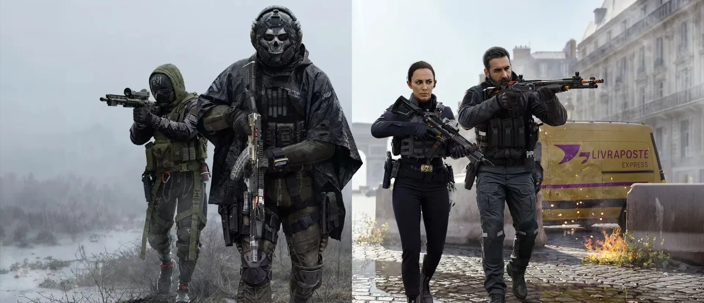

# 《使命召唤：现代战争4》韩国战场大乱斗：战役回归与多人革新全解析

十年了。《使命召唤》对我来说一直是每年秋天的固定节目——像换季一样准时，像爆米花大片一样管饱。可当概念一年一换、主创工作室轮番上阵之后，剧情战役渐渐沦为多人模式的附庸，成了“买多人送的那段过场”。到了《现代战争3》，我彻底心灰意冷，干脆给自己放了个三年长假。直到 **Call of Duty: Modern Warfare 4** 正式上线，这个假期才算画上句号。

Steam 商店页直达：https://store.steampowered.com/app/4435490/

## 🎯 核心看点速览

- **舞台换血**：主战场从熟悉的沙漠与东欧街区，搬到了朝鲜半岛。城市巷战、山地哨所、港口集装箱区三套地图语言混着来，节奏明显比前几代更“贴身肉搏”。
- **战役加码**：这一代的单人剧情不再是“顺手做的教程关”，叙事密度和关卡设计都往前推了一大步，算是给老玩家的一个交代。
- **多人重做**：移动手感、滑铲与攀爬判定、枪匠配件槽位全部重新调过，老玩家的肌肉记忆需要重新校准。
- **枪感回归**：后坐力反馈更“实”，TTK（击杀所需时间）整体偏中等，拼枪法多过拼配件。
- **上线状态**：本体已在 Steam 上架，AppID 4435490，支持简体中文界面与字幕。

## 📌 重点深度解析

### 一、小半岛，大乱斗

把战场放在朝鲜半岛，是个相当聪明的选择。地图尺度被刻意压小，街区之间的连接通道变多，绕后路线变得极其丰富。以前那种“一条主路对枪、两条侧路偷人”的经典三线结构，在这代被拆成了更碎的网格——你永远不知道下一个拐角后面蹲着的是队友还是敌人。

对喜欢冲锋的玩家来说，这是天堂；对习惯架点卡线的狙击手来说，这是修行。

### 二、战役终于不是“附庸”了

过去几年，系列的剧情战役一直在被压缩预算和工期。这次明显能感觉到资源回补：关卡不再是“走一段、打一波、看一段过场”的流水线，而是加入了更多可选择的推进路线和小队指令环节。叙事上也不再是纯粹的个人英雄主义，小队成员之间的互动比重上升，观感更像一部群像战争片。

当然，指望它回到初代《现代战争》那种震撼程度并不现实，但至少这一次，我愿意把战役从头打到尾，而不是中途跳出去开多人。

### 三、多人：老手感与新机制的拉扯

这代多人最直观的变化有三个：

1. **移动节奏变“重”**：滑铲距离缩短，跳跃射击的精度惩罚加大，无脑飞扑流被明显削弱，走位意识重新成为核心。
2. **枪匠系统精简**：配件槽位减少但每条属性影响更直观，不再需要为了“最优解”去背一整套数值表，对回坑玩家非常友好。
3. **地图动线重构**：重生点逻辑调整，被压制的一方更容易找到翻盘路线，滚雪球的情况有所缓解。

一句话总结：**它更像老《现代战争》了，但又没完全回到过去。**

## 💡 玩家实操与上手建议

- **购买建议**：先确认自己是想玩战役还是多人。如果只冲单人剧情，可以等一波折扣；如果是长期开黑党，本体入手不亏，后续赛季内容通常跟随更新。
- **开黑配置**：四人小队建议“两冲一守一支援”，这代地图拐角多，纯狙击阵容容易被贴脸。
- **新手避坑**：别一上来就堆满后坐力配件，先把默认枪打熟，感受一下基础弹道再动刀。
- **配置优化**：帧数优先于画质。这代场景细节密度高，把阴影和体积雾降一档，能换来相当可观的帧数提升，对拼枪帮助巨大。
- **下载安装**：Steam 库内搜索 AppID 4435490 或直接搜游戏名，注意预留足够的硬盘空间，多人包和战役包可以按需勾选下载。

## 📢 官方 Telegram 频道推荐

想第一时间拿到 Steam 限免喜加一、史低折扣和版本更新提醒？建议加入我们的官方 Telegram 频道 **@steamhunterlink**。秒级推送、永久入库信息、临时免费周末一个不漏，再也不用担心错过背刺价。

## ❓ 常见问题 FAQ

**Q1：这代《现代战争4》和《现代战争3》是同一个世界观吗？**
A：属于同一系列脉络的延续，但剧情上做了相对独立的处理，没有玩过前作也能看懂主线，老玩家则会收获一些熟悉的彩蛋。

**Q2：现在入手本体，后续 DLC 会不会再收一次钱？**
A：按系列惯例，本体包含完整战役与多人核心内容，后续赛季通行证和外观类内容属于可选项，不影响正常对战平衡。

**Q3：配置要求高吗？老显卡能跑吗？**
A：整体优化属于中上水平，中端显卡在 1080P 下开中等画质可以稳定流畅。建议优先关闭体积雾与高精度阴影，帧数收益最明显。

**Q4：单人战役值得单独为它买单吗？**
A：如果你是三年前被战役劝退的老玩家，这一代确实值得回来看看；但如果只想要一段十小时的剧情，建议等折扣再入。
