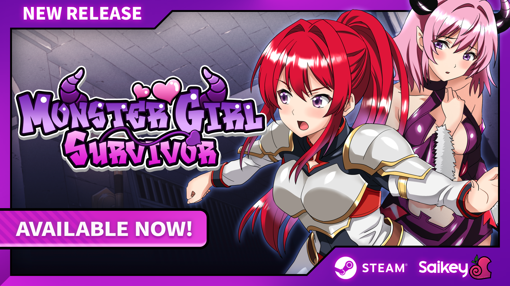

各位老哥好，这里是你们的老朋友——Steam 专栏主理人。今天带来一条刚出锅的发售情报：由 Ruhut Soft 开发、Saikey Studios 发行的生存建造新作 **《Monster Girl Survivor》** 已经正式在 Steam 上架开卖，首发直接给到 **20% 折扣**，属于典型的“早买早享受、晚买等骨折”节奏。想第一时间入库的，直接戳下面这个链接：

https://store.steampowered.com/app/5055990/Monster_Girl_Survivor/

## 🎯 核心看点速览

- **发售状态**：已正式发售，不是抢先体验（Early Access），买到的就是完整版；
- **首发福利**：上线即享 20% OFF 折扣，属于新游首发期的常规甜点价；
- **游戏类型**：生存 + 资源采集 + 基地升级 + 反击战斗，带剧情分支与角色羁绊养成；
- **核心角色**：被魅魔群体放逐的少女 Lily，会一路与你并肩作战，关系走向由玩家选择决定；
- **剧情悬念**：能否彻底逃出生天？Lily 会不会一直留在你身边？结局由你的每一次抉择累积而成；
- **Steam AppID**：5055990，搜索时认准这个号，别买到同名换皮。

## 📌 重点深度解析

**1. 世界设定：魅魔占领下的废土求生**

游戏把舞台放在一个被 Succubi（魅魔）全面占据的世界。你要做的不是无脑砍杀，而是先活下来：外出探索、搜刮资源、把破破烂烂的据点一步步升级成能扛住压力的基地，再攒出反攻的资本。这套“采集—建造—防守—反推”的循环，是生存类玩家非常熟悉的味道，但配上魅魔题材，气氛就完全不一样了。

**2. 角色羁绊：Lily 这条线才是灵魂**

本作最抓人的设计，是与被族群放逐的魅魔少女 Lily 之间的关系养成。她不是单纯的 NPC 工具人，而是会随着你的选择产生不同走向的关键角色。官方明确提到“你的选择将决定结局”——也就是说，本作存在多结局与关系分支，Lily 最终是并肩到底还是分道扬镳，取决于你这一路怎么对待她。喜欢剧情向生存的玩家，建议第一次通关别查攻略，凭直觉走一遍。

**3. 玩法结构：生存压力与情感线并行**

白天出门搜物资、清威胁、铺基建，晚上回基地推进剧情与角色互动，节奏上张弛有度。基地升级带来的不只是数值提升，也会解锁新的剧情与互动内容，属于“建设驱动叙事”的路子。

**4. 厂商背景**

Ruhut Soft 负责开发，Saikey Studios 负责发行与品牌运营。后者在 Steam 上已经有一整条产品线，题材偏好相当统一，老玩家一看就懂。

## 💡 玩家实操与上手建议

**购买入库方式**

1. 打开 Steam 客户端或网页版商店，搜索 `Monster Girl Survivor`，或直接访问上面的商店链接；
2. 认准 AppID **5055990**，确认开发商为 Ruhut Soft；
3. 首发 20% 折扣为限时活动，想省钱的别拖太久；
4. 加入愿望单，可以第一时间收到后续折扣与更新推送。

**开荒小贴士**

- **别急着刚正面**：前期资源紧张，优先保证食物与基础材料，遇到高强度敌人该跑就跑；
- **基地升级优先级**：先补产能与存储，再考虑防御工事，不然囤不下资源等于白跑；
- **多和 Lily 互动**：剧情推进与关系变化往往藏在日常对话里，漏掉可能影响结局分支；
- **善用存档**：想体验不同结局的，关键节点前手动备份存档，比二周目重打省事得多；
- **配置与优化**：这类独立生存作品通常对硬件友好，中低配机器也能跑，进游戏后先把画质预设调到自己帧数稳定的档位再开荒。

**购买建议**

首发 20% 折扣属于“想玩就现在买”的合理区间；如果你对题材无感、只想等骨折，加愿望单蹲后续大促即可。喜欢《Succubus Crisis》《Magical Princess Lily》这类同门作品的玩家，本作基本可以放心入。

**同厂商其他作品：**

- https://store.steampowered.com/app/3606750/Succubus_Crisis/
- https://store.steampowered.com/app/3070610/Magical_Princess_Lily/
- https://store.steampowered.com/app/3304760/Ethereal_Sunder/
- https://store.steampowered.com/app/3070600/Senpai_and_the_Mysterious_Island/

**官方渠道：**

- https://store.steampowered.com/franchise/Saikey
- https://steamcommunity.com/groups/saikey
- https://saikeystudios.com/
- https://twitter.com/SaikeyStudios
- https://discord.com/invite/EaqZEsP3pV
- https://www.youtube.com/@SaikeyStudios

## 📢 官方 Telegram 频道推荐

Steam 上的限免、喜加一和闪促往往来得快去得也快，等你刷到的时候黄花菜都凉了。建议大家加入我们的 Telegram 频道 **@steamhunterlink**，秒级推送限免喜加一、史低特惠与版本更新情报，让你永远比朋友早一步永久入库。

## ❓ 常见问题 FAQ

**Q1：这游戏现在是正式版还是抢先体验？**

A：已经是正式发售的完整版本，购买即可体验全部内容，不是 Early Access 阶段。

**Q2：首发 20% 折扣会持续多久？**

A：官方目前公布的是上线首发折扣，属于限时活动，具体结束时间以 Steam 商店页面倒计时为准。想省这 20% 的建议尽早下单。

**Q3：没玩过同厂商的其他作品，直接上手会有障碍吗？**

A：不会。本作是独立世界观与独立剧情，没有前置门槛，新玩家可以直接从这一作开始。
