各位经理注意，Project Moon 又把“瓦尔普吉斯之夜”这盘冷饭炒出了新香味——第10届来了。官方公告已上线，英/日文文本也完成了校对修正，公告图同步更新。下面把活动看点、抽卡规划、刷取代币和避坑点一次讲清。

## 🎯 核心看点速览

- **第10届瓦尔普吉斯之夜开启**：限定活动卡池、新人格/新E.G.O、活动关卡与兑换商店一并登场（具体以游戏内公告为准）。
- **官方公告文本修正**：英/日文公告中的文本问题已校对完成，公告配图也已更新，不影响实际奖励与卡池内容。
- **资源规划警告**：限定池向来是“狂气蒸发器”，建议先看技能组再决定是否下井。
- **活动代币别乱花**：优先换限定人格/E.G.O、抽卡券，再考虑养成素材。

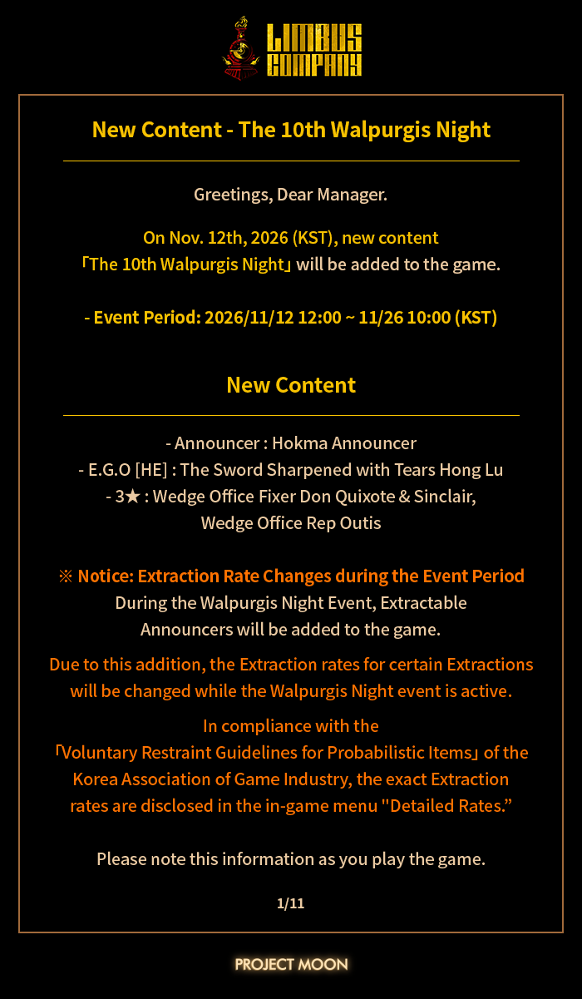
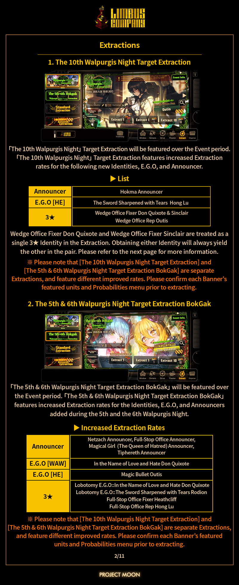
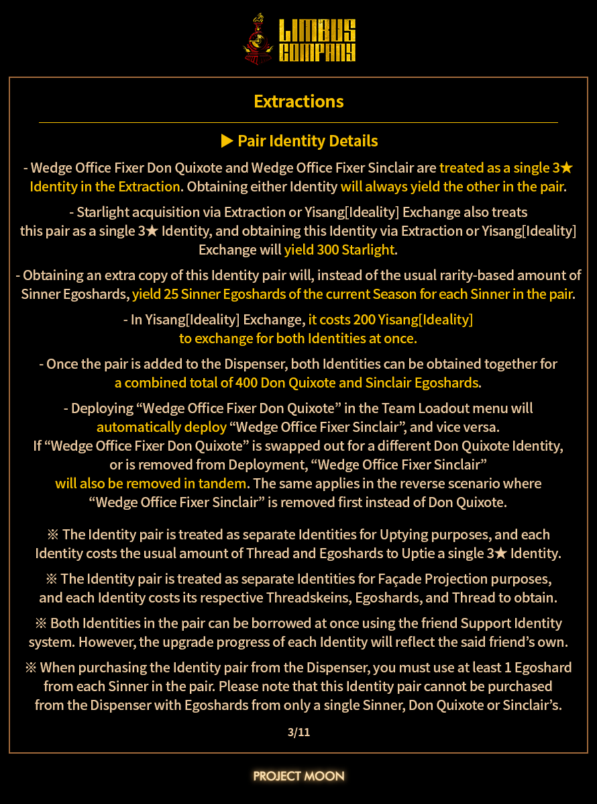

## 📌 重点深度解析

瓦尔普吉斯之夜是《边狱公司》的周期性限定活动，通常伴随特殊主题人格、E.G.O、活动故事与代币商店。第10届意味着活动模板已经非常成熟：关卡机制、兑换列表和卡池深度都不会太“白给”，对新手来说是一次补强box的好机会，对老玩家来说则是资源规划大考。

本次官方公告的核心信息是活动开启与相关卡池/内容上线。公告里还特别提到英/日文公告存在文本问题并已修正，公告图也同步更新——这种细节说明官方还在持续维护公告准确性，经理们以游戏内实际文本为准即可。

从实战角度看，新人格/E.G.O的强度要看被动、技能硬币数和资源循环，不要只看立绘就冲。活动关卡一般会抬一手当期主题阵容，但并不意味着没有下位替代；借好友人格、合理搭配罪种抗性，照样能把握主要奖励搬空。

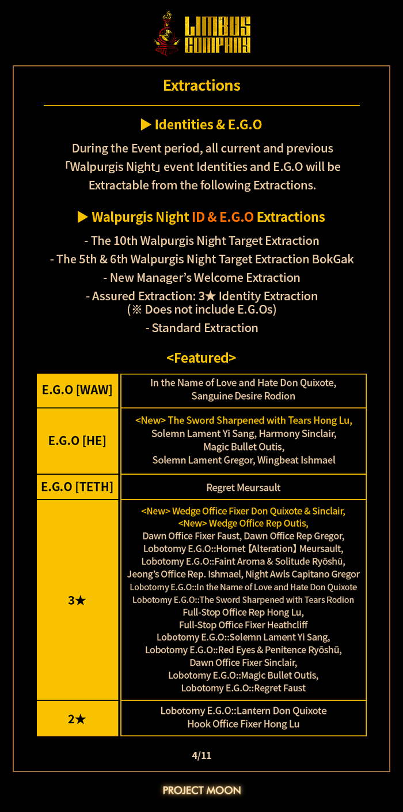
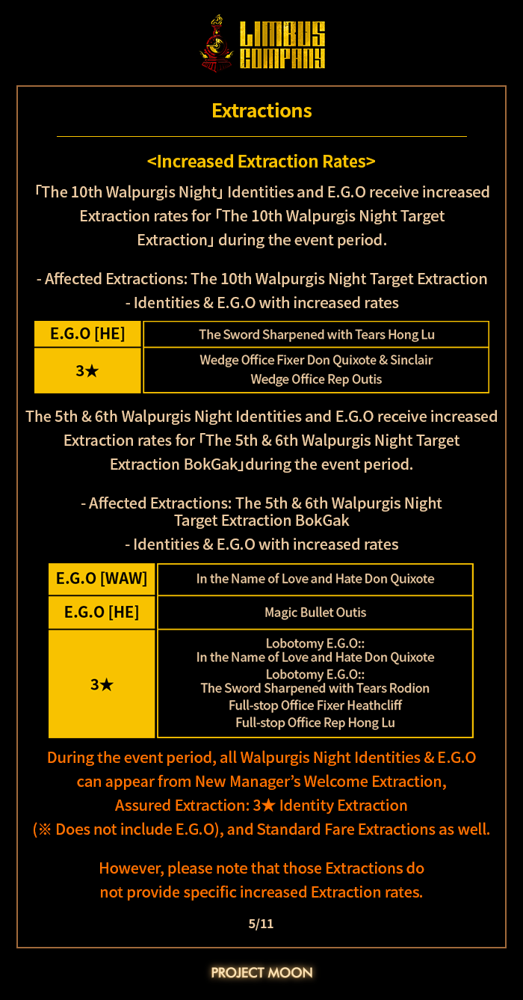
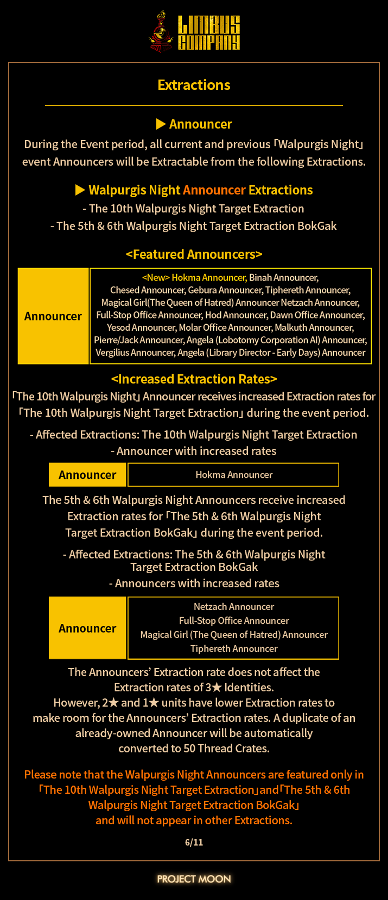
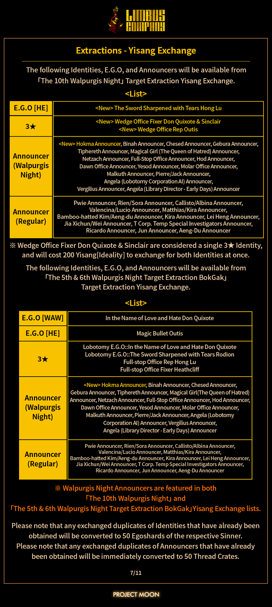
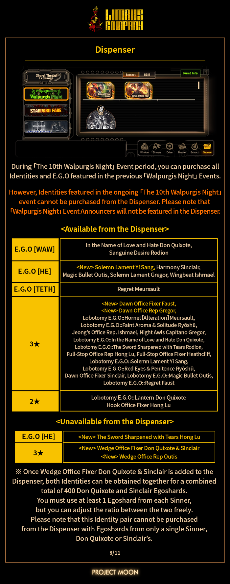

## 💡 玩家实操与上手建议

### 1. 抽取建议：先看测评，再摸卡池

- 新人格/新E.G.O上线后，先看技能组、被动触发条件和队伍适配度；限定不等于必抽，尤其对box不全的新手，补齐通用强力人格更划算。
- 预留好狂气与抽取券，别在活动第一天就把资源梭哈；等社区实战测评出来再决定是否补井。
- 如果只打算轻氪，优先考虑性价比高的月卡/通行证类内容，别被限定池的“错过等一年”氛围绑架。

### 2. 刷取建议：先推图，后搬商店

- 活动第一天优先推进活动关卡，解锁最高效率的代币本；每日任务和自然体力记得清，别让体力溢出。
- 代币兑换优先级：限定人格/E.G.O > 抽卡券 > 核心养成素材 > 金币/经验类边角料。搬空商店量力而行，别为了最后几块材料碎了大量狂气。
- 新手打不过高难本时，优先借好友的高练度人格，搭配抗性合适的队伍；活动商店里能拿的核心奖励先拿，高难挑战可以后补。

### 3. 配置与运行：Steam版稳字当头

- Steam版《边狱公司》对配置要求不高，老笔记本也能跑；如果出现卡顿，优先窗口化、关闭后台占用，并检查显卡驱动。
- 本作偏单机体验，不需要联机加速；但活动更新当天可能出现下载拥挤，错峰更新更省心。
- 多语言文本以游戏内为准，公告图仅供速览；遇到文本差异别慌，奖励发放看实际系统。

### 4. 购买与氪金避坑

- 先确认自己是否长期玩：Limbus Company的卡池深度和养成周期都不短，冲动氪金容易变成“狂气黑洞”。
- 限定活动期间礼包较多，买之前算一下单价与所需资源，别为了凑井买一堆用不上的捆绑包。
- 如果你是剧情党，活动故事记得看；如果你是强度党，优先把资源投给能进多套队伍的泛用人格。

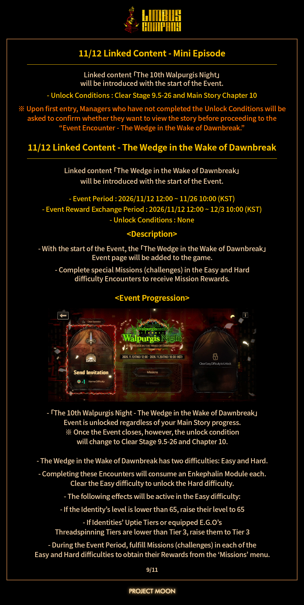
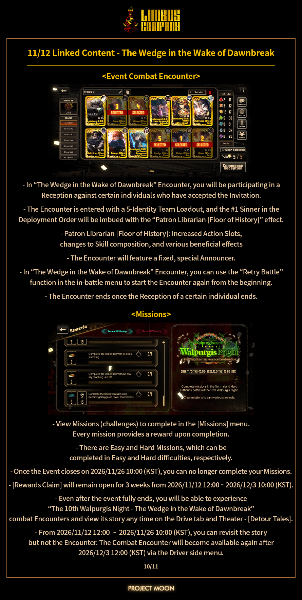
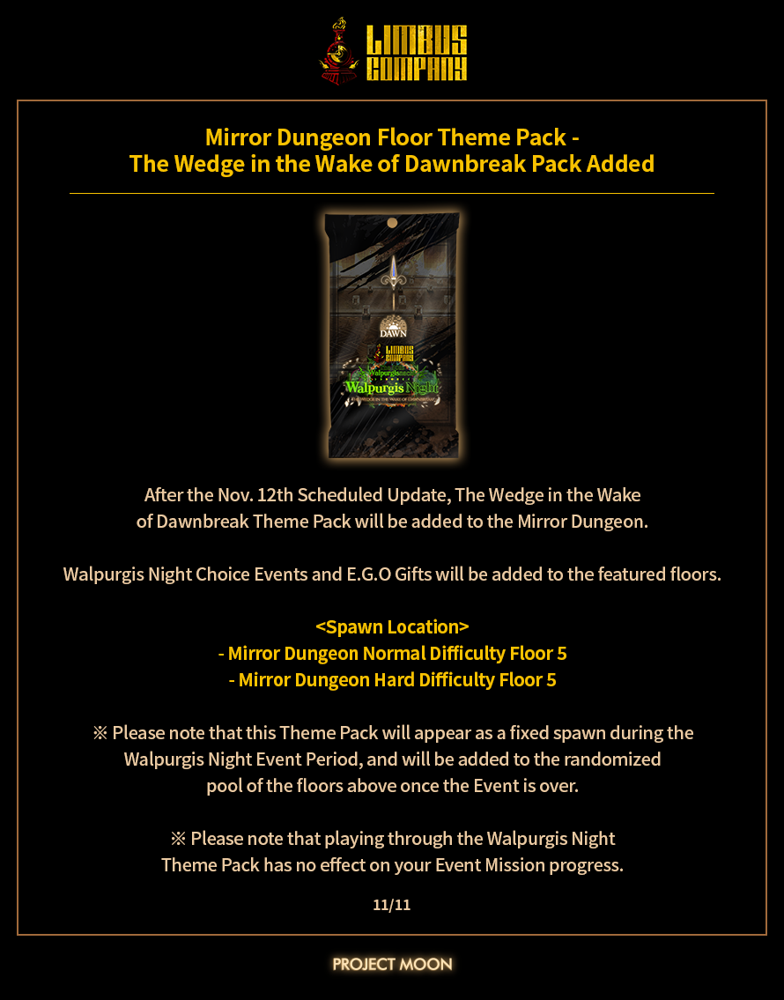

## 📢 官方 Telegram 频道推荐

想第一时间收到 Steam 限免、史低特惠和热门更新提醒？加入官方 Telegram 频道 **@steamhunterlink**，秒级推送不迷路。虽然这次是《边狱公司》活动资讯，但频道会同步各类 Steam 动态，喜加一和背刺信息都能第一时间看到。

## ❓ 常见问题 FAQ

**Q1：第10届瓦尔普吉斯之夜持续多久？**

A：具体结束时间以游戏内公告为准，通常活动会持续数周。建议每天清任务和体力，避免最后一天突击。

**Q2：新手能拿满活动奖励吗？**

A：大部分核心奖励可以。优先推活动本、借好友高练人格，代币先换限定人格/E.G.O和抽卡券；高难挑战打不过可以先放，别硬碎狂气。

**Q3：公告里提到的英/日文文本修正会影响奖励吗？**

A：不会。官方只是对公告文本和公告图做了校对更新，游戏内奖励、卡池和活动规则以实际系统为准。
