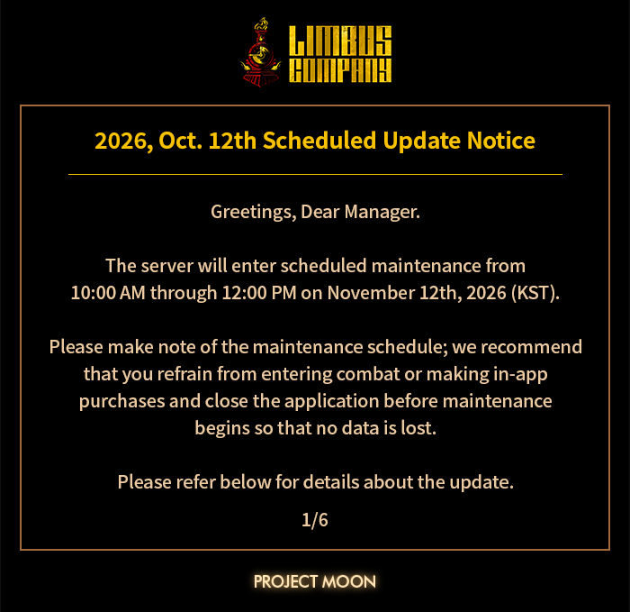
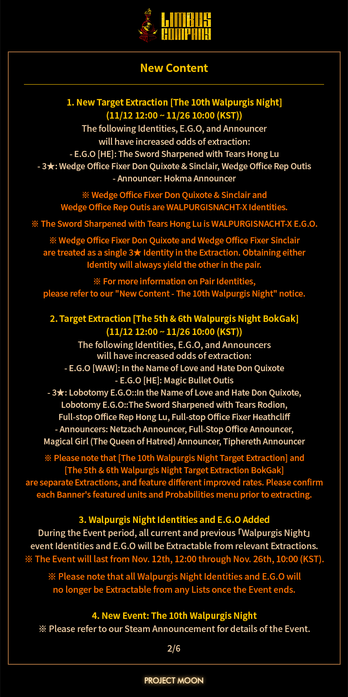
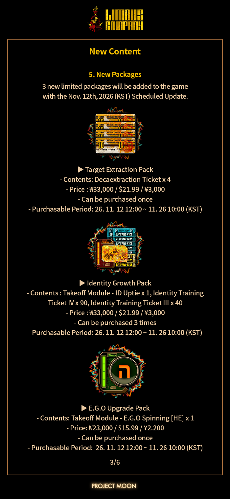
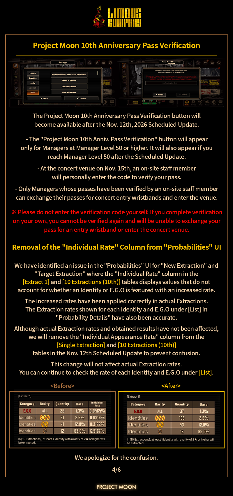
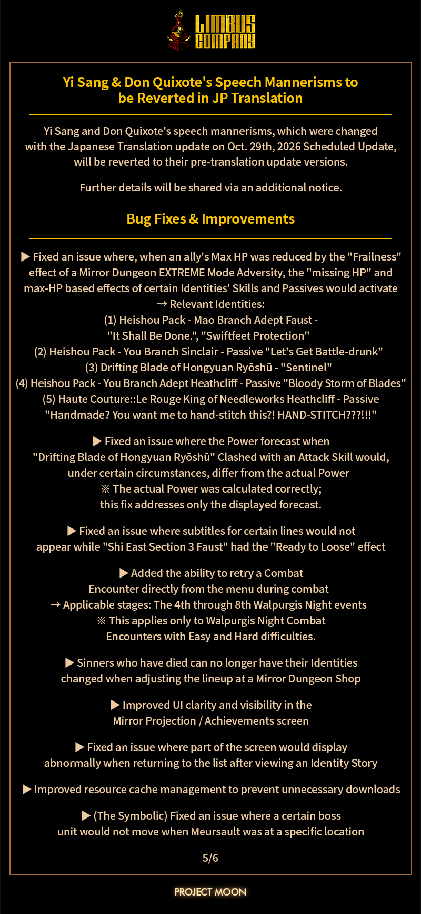
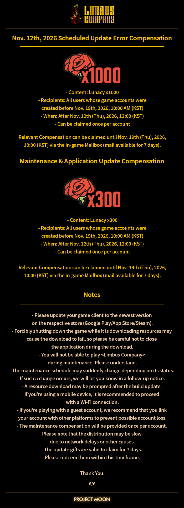

都市里的钟表又开始滴答作响——11月12日的例行更新公告已经挂上 Steam 公告栏。这次官方还挺讲究，公告发出来之后又回头补了一刀：EN/JP 版本里几处错别字被揪出来修好，20:00 校对完成，公告配图也一并重新上传。作为每周蹲点等维护、靠脑啡肽模块过日子的钟表头，我先替各位把这份排期捋顺，省得你更新完一脸茫然。

## 🎯 核心看点速览

- **例行停机维护**：11月12日按官方排期进行版本更新，维护期间无法登录，账上的脑啡肽模块、未结算的镜像地牢进度记得提前处理掉。
- **卡池轮换**：随版本同步调整的抽取窗口，老一期下架、新一期顶上，UP 对象与兑换线一律以游戏内公告为准。
- **内容更新**：新的剧情/活动段落与配套任务链上线，剧情党这次有得啃。
- **平衡性与体验优化**：人格与 E.G.O 的数值、手感微调，加上一批底层 Bug 修复。
- **公告本地化校对**：EN/JP 公告错别字已修正，配图同步更新——官方这波属于自己给自己打补丁。
- **维护补偿**：照例的狂气补偿，维护结束后登录即领，别让它躺在邮箱里过期。

## 📌 重点深度解析

### 一、卡池：这期到底该不该下池

Limbus 的抽取逻辑老玩家都懂：平时靠日常和周常慢慢攒狂气，真到关键卡池再一口气砸下去。版本更新带来的轮换，本质上是把「你要不要为这一期掏空钱包」这个问题重新摆到你面前。

我的建议很朴素：**先看人格能不能补你队伍的短板，再看它是不是限定。** 如果你手上还缺一个能稳定提供 debuff 或回合外输出的位置，那这期值得考虑；如果只是「看起来很强」，而你的主力队已经能推完当前进度的内容，那不如把狂气留着等更离谱的东西。兑换线历来是几百抽的量级，具体数字和规则以游戏内公告为准，别凭记忆冲。

另外提醒一句：限定池结束后的处理方式，官方公告里写得比任何攻略都准，抽之前花三十秒读一遍，比事后在群里哀嚎有用得多。

### 二、平衡性调整：谁被抬了一手，谁被削了锐气

每次更新公告里最容易被跳过的就是数值段，但它恰恰是最影响你下周打铁道（折射铁道）体验的部分。人格与 E.G.O 的调整通常会牵动两件事：一是某些原本「能上但不够强」的角色终于有了出场理由；二是你熟悉的那套固定轴可能要重排出手顺序。

我个人的习惯是：更新后先别急着冲高难，拿镜像地牢当试验场，把调整过的角色塞进去跑两轮，看伤害曲线和 buff 覆盖是不是还顺手。真打不过再回头看公告，往往能发现「哦，原来这里改了」。

### 三、剧情与活动：别急着跳过对话

Project Moon 这家公司的文本密度，玩过前作的都清楚。新上线的剧情段落和活动任务，除了推进都市那条主线，往往还塞着下个版本的伏笔。跳过对话虽然省时间，但你会损失掉理解后续角色动机的关键信息，也会错过一些藏在对话选项里的首通奖励。

我的建议是：**更新后第一件事，先把新剧情跑完拿首通狂气，再决定要不要抽卡。** 顺序反了很容易出现「抽完了才发现首通奖励还够一发十连」的尴尬。

### 四、官方给公告打补丁这件事

这次公告最有趣的地方，是官方自己承认 EN/JP 版本里有错别字，然后 20:00 完成校对、连配图都重传了一遍。对一款文本量爆炸的游戏来说，这种「发现问题立刻回炉」的态度值得点个赞，同时也说明这一版的内容量确实不小——赶工的地方被玩家一眼看出来，官方也只好当场返工。

## 💡 玩家实操与上手建议

**维护前（别浪费）**

1. 把脑啡肽模块清空，别让体力在维护期间自然溢出；
2. 镜像地牢的每周加成次数尽量打完，这是战令经验和资源的大头；
3. 未领取的邮件奖励、周常任务、日常签到全部结算掉；
4. 想冲铁道排名的，把当前轮次的成绩截图留档，免得更新后记录对不上。

**维护后（按这个顺序走）**

1. 登录先领维护补偿，再看一眼邮件有没有限时附件；
2. 跑新剧情/活动任务，拿首通狂气；
3. 拿镜像地牢试调整后的角色手感，确认配队不用改；
4. 最后再动卡池——顺序对了，能省下不少真金白银。

**开黑与联机避坑**

Limbus 本体是单人回合制，谈不上联机，但群聊里交流配队是刚需。避坑要点只有一个：**别拿别人的满配阵容硬套自己的角色池**，人格和 E.G.O 的持有情况差一环，整套轴的输出窗口就崩了。多看看自己手里有什么，比抄作业管用。

**下载与配置优化**

Steam 版体积不算夸张，更新时留出足够空间即可。这游戏对显卡要求极低，真正拖后腿的是长时间挂机导致的笔记本降频——自动战斗刷素材时把电源模式切到高性能、垫高散热，比换硬件有用。手机端的跨平台账号记得绑定好，换设备前先确认存档同步，别一觉醒来发现进度归零。

## 📢 官方 Telegram 频道推荐

更新公告、卡池排期、维护补偿这类信息，官方往往同时发好几个渠道，等你在 Steam 公告栏刷到，群里已经聊完三轮了。想第一时间拿到秒级推送，建议加入官方 Telegram 频道 **@steamhunterlink**——限免喜加一、史低特惠、版本维护提醒都会即时弹出，手机一震就知道该不该开电脑，省心。

## ❓ 常见问题 FAQ

**Q1：这次维护要停多久？补偿怎么领？**

A：按公告排期执行，具体起止时间以游戏内和 Steam 公告栏显示为准。维护结束后直接用原有账号登录，补偿一般通过邮箱发放，登录后第一时间查收，注意附件有效期，别等到过期才想起来。

**Q2：现在入坑还来得及吗？需要先补前作吗？**

A：来得及，而且这款是免费游玩，试错成本极低。前作《Lobotomy Corporation》和《Library of Ruina》能补足世界观，但不是必需——游戏内会把关键设定讲清楚。真要从头补，建议按发售顺序来，观感更连贯。

**Q3：卡池轮换后，之前攒的兑换点数会清空吗？**

A：不同类型卡池的继承规则不一样，限定池与常驻池的处理方式也有区别。这类规则官方每次公告都会写明，抽卡前务必在游戏内抽取界面确认当前池子的兑换与保底说明，别靠群里的口口相传做决定。

**Q4：更新后进不去游戏怎么办？**

A：先确认维护是否已经结束，其次在 Steam 里校验一次文件完整性，再检查网络环境。如果是账号绑定相关的报错，重新登录账号同步一次存档通常能解决。
