各位牢友晚上好，我是你们那个每次新卡池一开就喊着“这次绝对不抽”然后准时把狂气清空的主理人。今天要聊的是《Limbus Company》玩家圈里最近讨论度最高的一档事——第十届瓦尔普吉斯之夜（Walpurgis Night）的全新人格与E.G.O预览正式公开了。

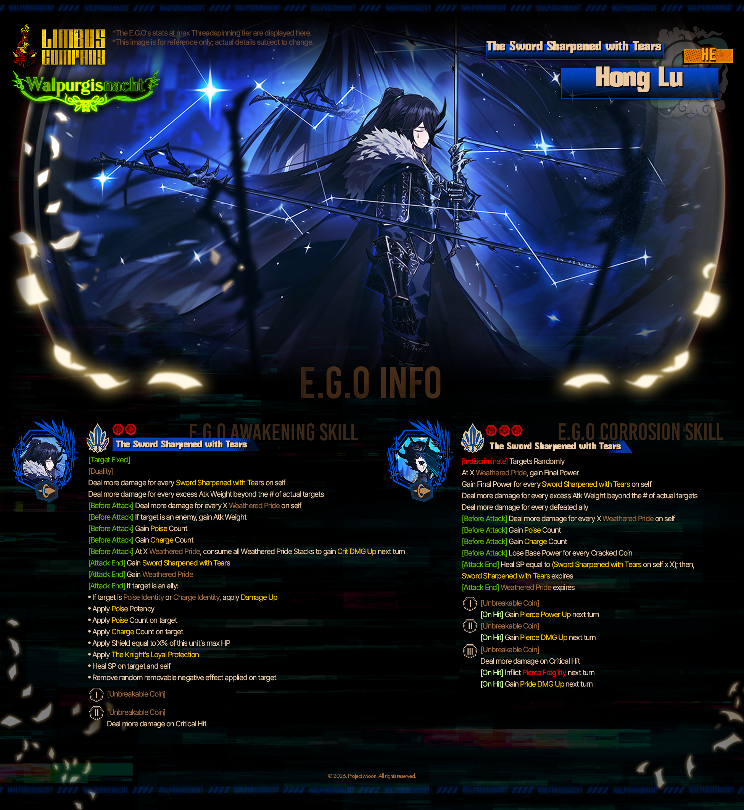

## 🎯 核心看点速览

本次官方放出的情报属于典型的“图先到、数值后补”式预告，核心信息量集中在两块：

- **第十届瓦尔普吉斯之夜活动新内容**：一批全新人格（Identities）与E.G.O同步登场，活动主题延续该系列一贯的诡异 carnival 氛围，视觉规格依旧在线。
- **技能演出优化**：官方明确提到，楔形办公室代表（Wedge Office Rep）Outis 的游戏内技能演出（Skill cinematics）将迎来改进。这句看起来不起眼，但对天天拿Outis推图的玩家来说，是实打实的手感与观感双重升级。

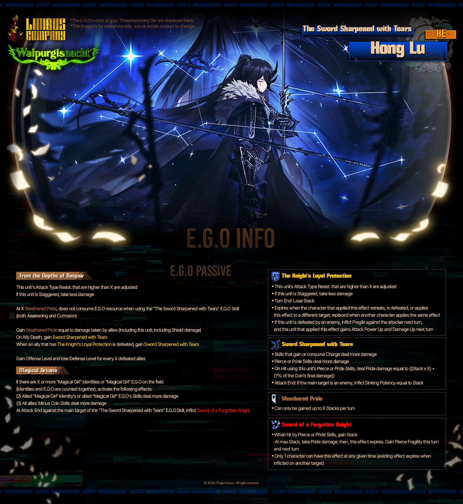

需要先泼一盆冷水：目前公开的是预览级别的物料，具体技能数值、同调效果、E.G.O被动触发条件等都还没有完整公布。按照Limbus Company一贯的节奏，真正的完整技能说明通常会在活动临近上线时才补齐。所以现在任何“这人格是T0”的结论都还太早，先把狂气攥紧。

## 📌 重点深度解析

### 瓦尔普吉斯之夜：这个系列的含金量

老玩家都懂，瓦尔普吉斯之夜不是普通的小活动，而是Project Moon给《Limbus Company》安排的重头戏之一。每一届都会带来主题高度统一的人格与E.G.O组合，美术风格往往是“猎奇+仪式感”拉满，配上该系列特有的剧情氛围，属于那种抽到之后光看立绘和技能动画就不亏的类型。

第十届走到这个节点，玩家社区对它的期待值其实已经被前几届拉得很高。从这次放出的多张预览图来看，角色造型与E.G.O的视觉设计依然维持了高完成度，仪式感与压迫感兼具，属于截图发群里能立刻引发一串问号的水平。

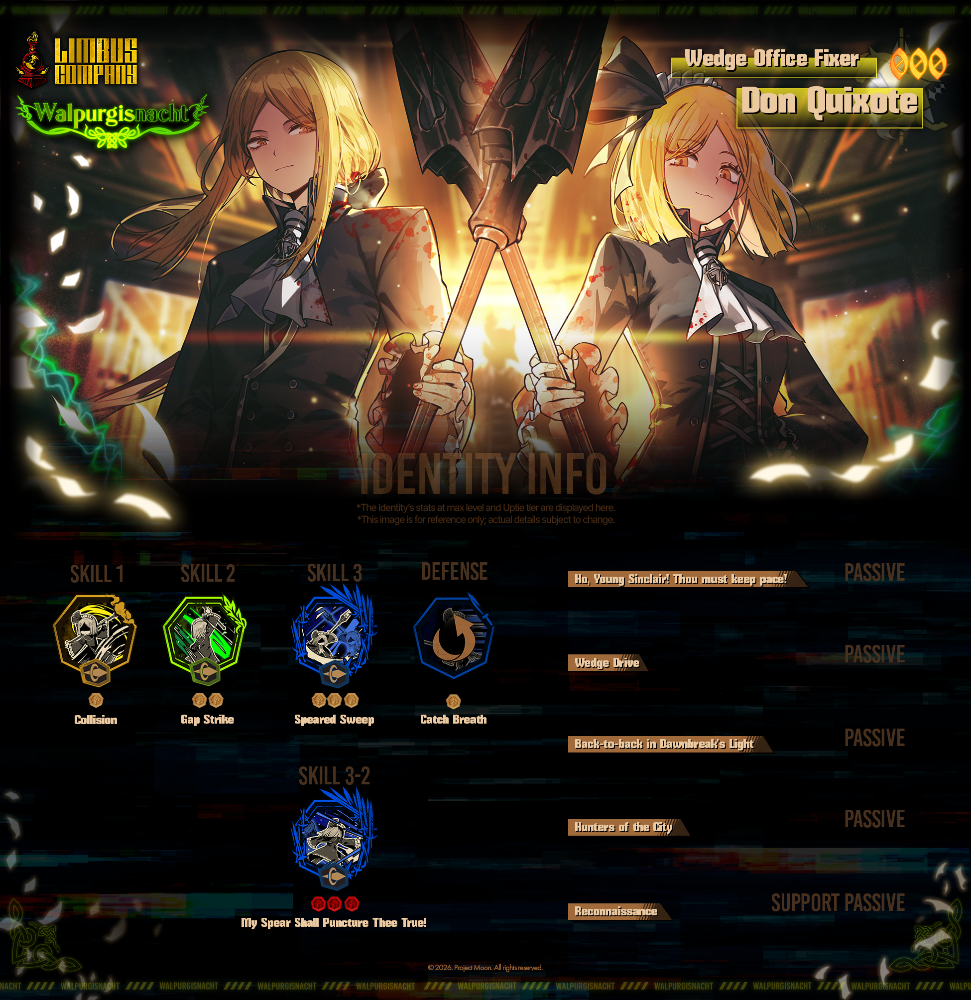

### Outis技能演出改进：别小看这一句

官方这次单独拎出来说“楔形办公室代表Outis的技能演出将迎来改进”，这个信息值得单独拆开讲。在《Limbus Company》里，技能演出不只是观赏性问题，它直接影响推图时的节奏感和反馈清晰度。尤其是Outis这类在队伍里承担特定职能的角色，技能动画的流畅度、命中反馈的清晰程度，都会影响玩家对战斗节奏的判断。

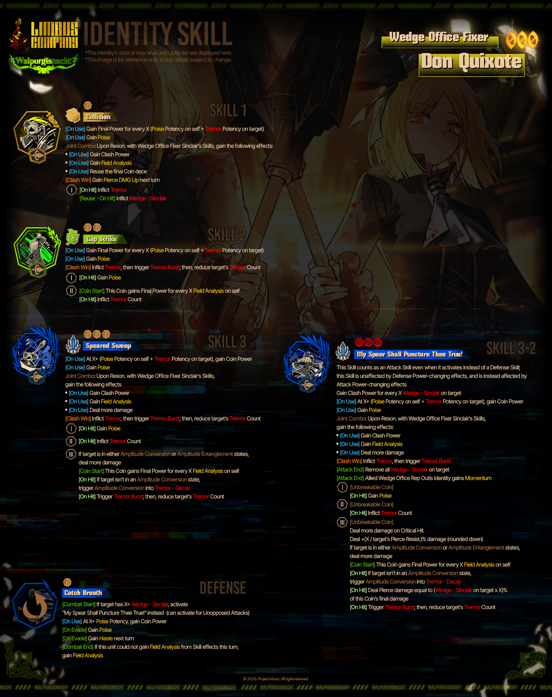

从社区反馈来看，这个改动大概率是针对现有演出中不够顺滑的部分做打磨。对天天用Outis的玩家来说，这属于“官方听到了”级别的回应。虽然不涉及数值，但手感和观感提升在长线刷本里是真实可感的。

### 新人格与E.G.O的抽取预期

由于完整技能组尚未公开，这里不给具体强弱结论，只聊判断框架：

- 瓦尔普吉斯之夜系列的人格通常带有较强的主题机制，和常规卡池人格在设计思路上有明显区分，抽取价值要看它是否能补上你现有队伍的机制缺口。
- E.G.O方面，重点看被动触发条件与同调需求。瓦尔普吉斯之夜系列的E.G.O往往在特定队伍构成下才能发挥完整实力，盲目all in容易变成仓库管理员。
- 资源有限的玩家，建议等活动完整技能说明公布后再决定优先级，别被预览图的视觉冲击冲昏头脑——这话也是对我自己说的。

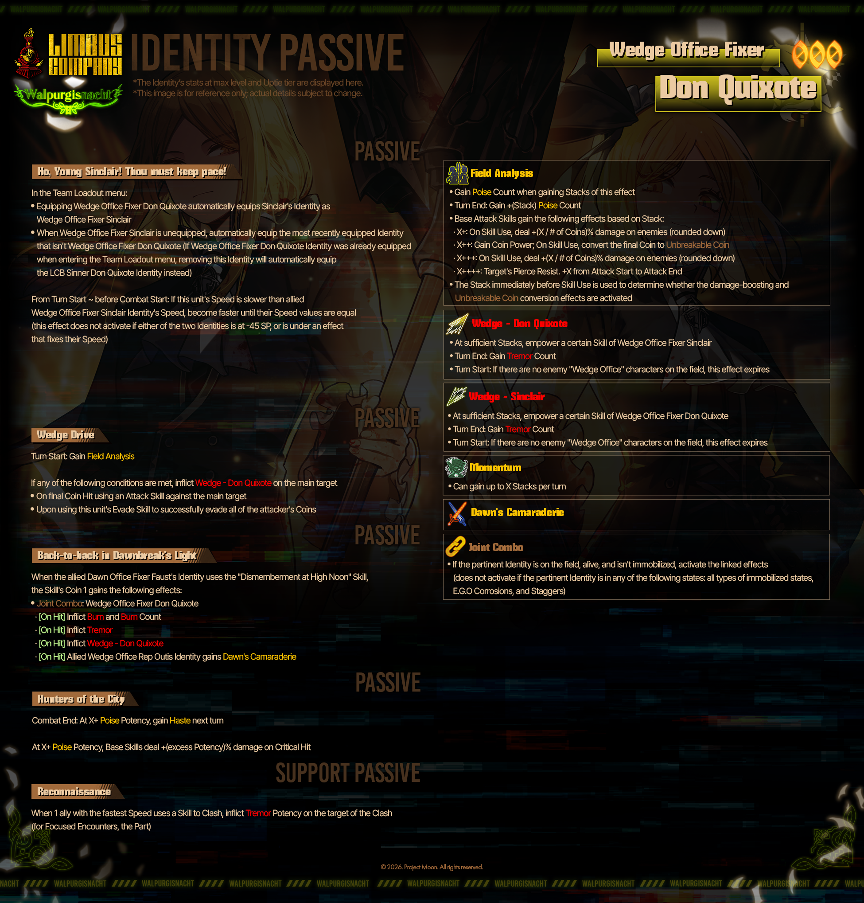

## 💡 玩家实操与上手建议

**资源规划先行**：瓦尔普吉斯之夜历来是狂气消耗大户。现在距离活动上线还有时间，建议先把日常任务和镜牢收益稳住，别提前在其他卡池里把资源梭哈干净。

**关注完整技能说明的公布节点**：预览图只是开胃菜，真正决定抽不抽的是完整技能组与同调效果。建议把官方公告设为关注重点，技能说明一出立刻对照自己队伍配置做判断。

**Outis玩家可以先期待手感变化**：如果你主玩Outis，这次技能演出改进是纯收益，等更新上线后进图实际感受一下动画节奏有没有更顺，再决定是否调整推图阵容。

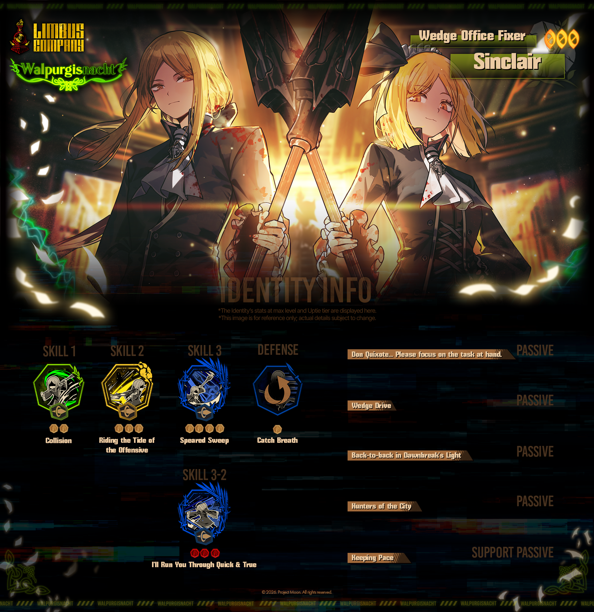

**下载与更新提醒**：Steam端玩家记得提前清理磁盘空间，活动更新包体通常不小。移动端玩家注意账号绑定与跨平台进度同步，避免更新后出现进度焦虑。

**别急着第一时间抽卡**：活动上线初期社区会出现大量实测数据，等一两天看看实际表现再动手，能有效降低“抽完就后悔”的概率。这条建议每年都写，每年都有人不听，包括我。

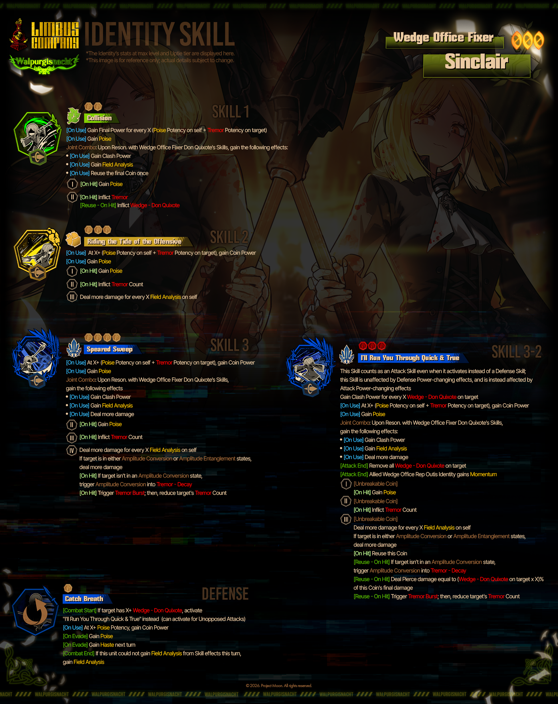

## 📢 官方 Telegram 频道推荐

想第一时间拿到《Limbus Company》这类活动的更新提醒、卡池开放通知和限时福利推送，建议加入我们的 Telegram 频道 **@steamhunterlink**。瓦尔普吉斯之夜这种活动，晚一天知道就可能错过首日资源规划窗口，频道推送能做到秒级提醒，省得你天天手动刷公告。

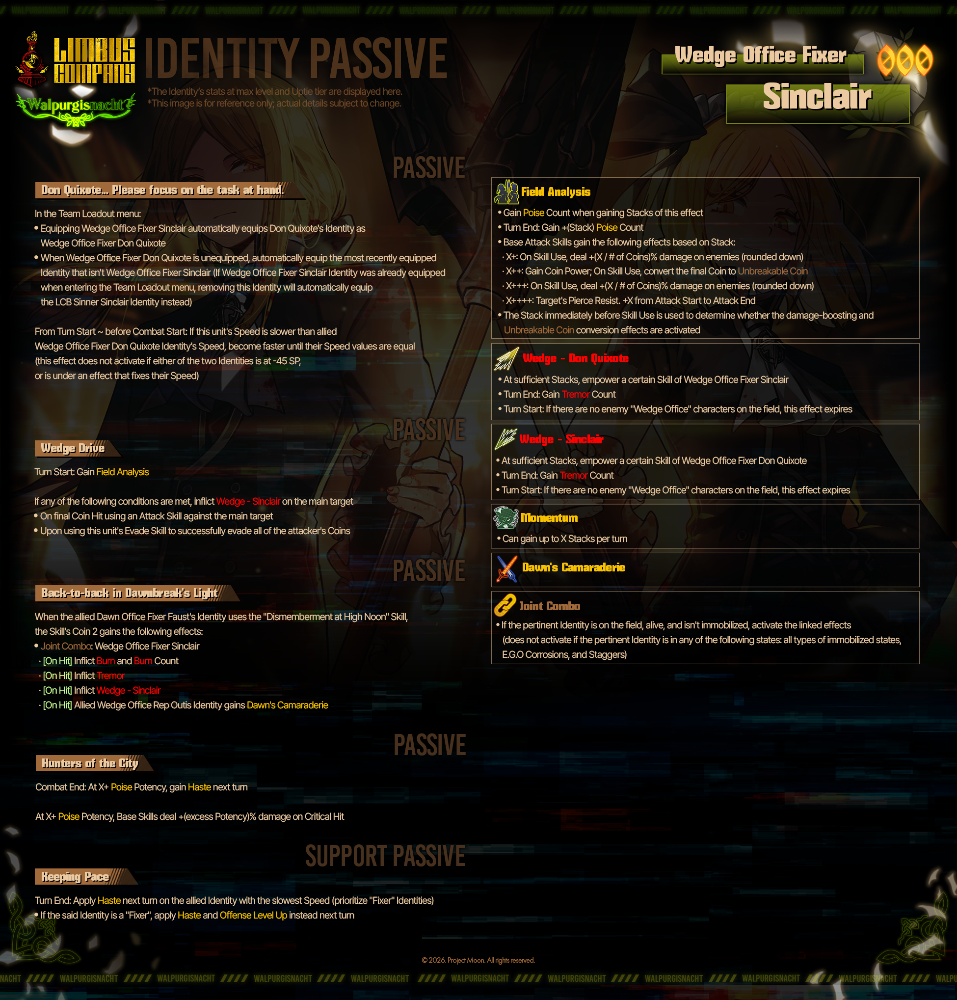

## ❓ 常见问题 FAQ

**Q1：这次第十届瓦尔普吉斯之夜的新人格和E.G.O什么时候正式上线？**
A：官方目前公布的是预览情报，完整上线时间与技能说明需要等后续公告。建议关注官方渠道与我们的 Telegram 频道推送，活动临近时会有明确时间节点。

**Q2：Outis的技能演出改进会影响角色强度吗？**
A：从官方表述看，这次改进针对的是游戏内技能演出表现，属于观感与手感层面的优化，不涉及数值调整。具体效果等更新上线后进图实测最直观。

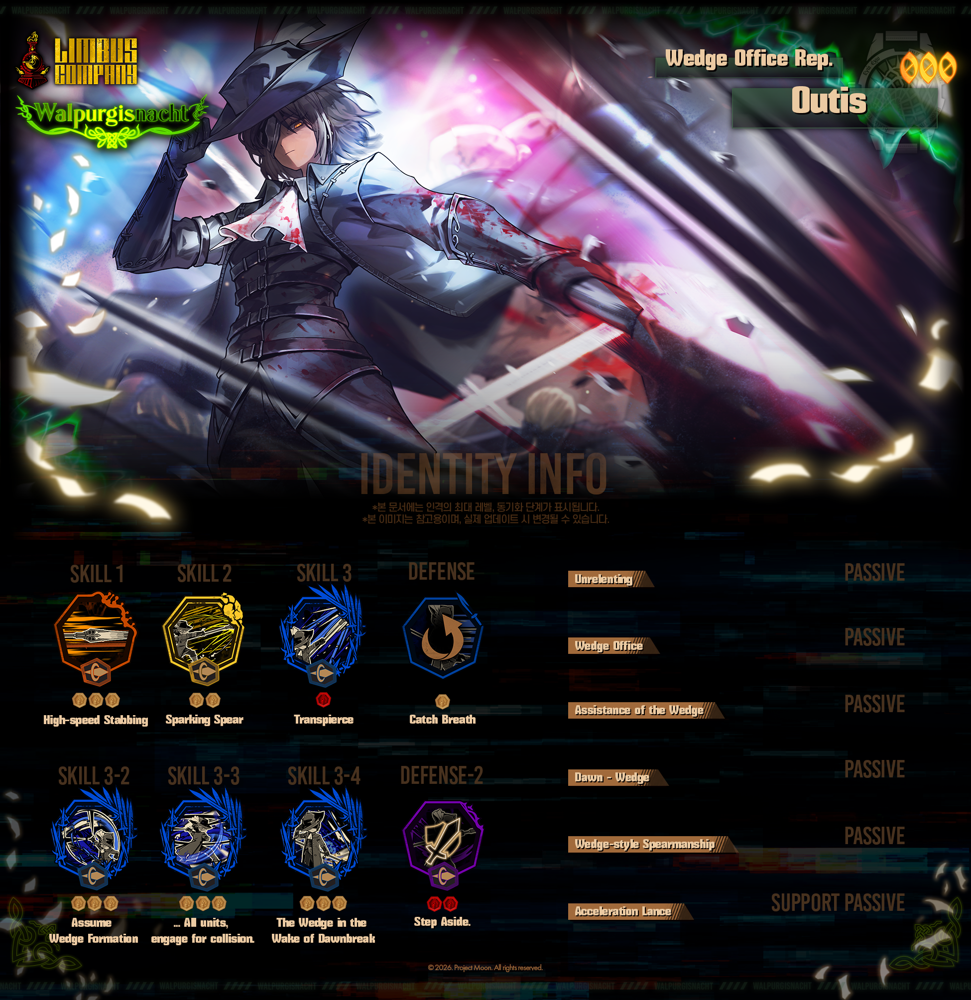

**Q3：现在应该提前囤狂气吗？**
A：瓦尔普吉斯之夜系列历来是资源消耗重点，提前稳住日常收益、避免在其他卡池过度消耗是合理策略。但具体抽不抽，建议等完整技能组公布后再做判断，别只凭预览图下结论。

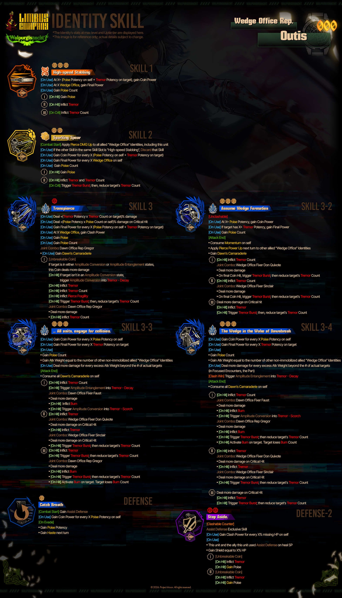

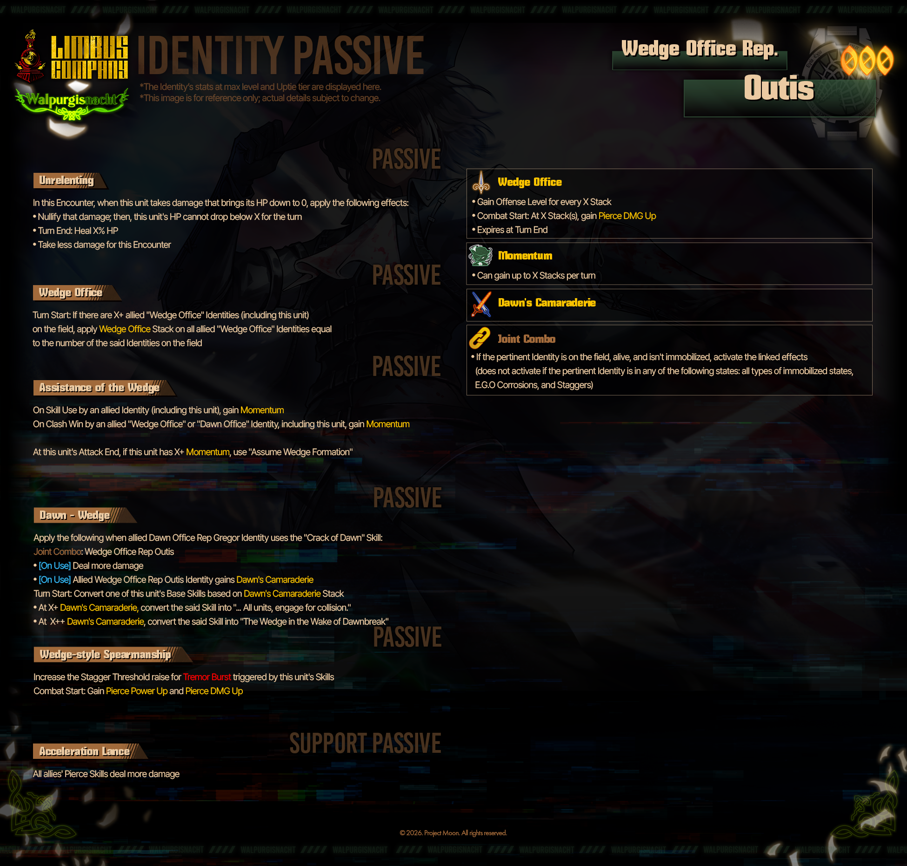

以上就是本次第十届瓦尔普吉斯之夜预览情报的全部拆解。新内容的具体表现如何，等完整技能说明和实测数据出来，我再给大家补一篇深度评测。在那之前，狂气捂紧，日常别断，我们活动上线见。
