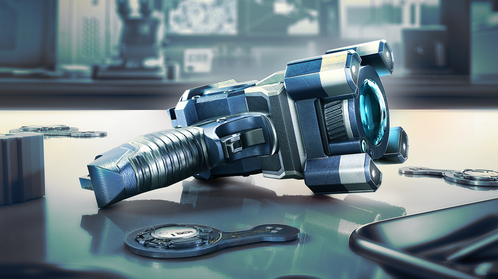

各位干员，我是你们的老朋友主理人。今天这条消息先给结论：**《彩虹六号：围攻》Year 11 Season 4 已经进入揭晓倒计时**，而且官方把揭晓专场安排在大阪 Major 总决赛期间——排面给足，信息量也值得蹲。

## 🎯 核心看点速览

- **新赛季关键词**：玩法更新、竞技改进、全新机会。官方明确表示会带来“meaningful changes”，说人话就是：改动不是小打小闹，排位和车队配合大概率都会受影响。
- **揭晓时间**：11 月 14 日 9:30 PM ET / 11:30 PM BRT；11 月 15 日 3:30 AM CET。按常见时区换算，对应北京时间 11 月 15 日 10:30 左右，具体以直播页面显示为准。
- **观看渠道**：Twitch 官方直播间。
- **当前未公布**：具体干员、地图、数值调整尚未放出，先别被来路不明的“爆料”带节奏。

The next chapter of Rainbow Six Siege is almost here. 新赛季的脚步已经很近了。

## 📌 重点深度解析

官方这次话不算多，但几个措辞值得细品：

1. **玩法更新（gameplay updates）**：通常意味着干员、地图、武器手感或道具交互层面的调整。对《彩虹六号：围攻》这种战术射击来说，一处小改动都可能让老点位焕发第二春，也可能让某些“祖传套路”当场退役。
2. **竞技改进（competitive improvements）**：排位玩家重点看这里。匹配质量、段位环境、竞技规则都有可能被摆上台面。新赛季初冲分还是先打非排名热手，等揭晓后再定计划更稳。
3. **全新机会（fresh opportunities）**：这个词比较宽，可能是新活动、新奖励，也可能是给新玩家或回坑玩家的入口。具体内容等开发团队在直播里揭晓。
4. **开发团队直接分享**：揭晓专场会有开发团队出镜，这比只看补丁说明更有价值，能听到改动思路和后续方向。

揭晓专场会在 Osaka Major Grand Final 期间通过 Twitch 播出，直播间地址：https://www.twitch.tv/rainbow6 。建议提前关注频道，免得开场后还要到处找链接。

## 💡 玩家实操与上手建议

- **想看首播**：把 11 月 15 日北京时间 10:30 左右先记在日历里，提前十分钟进 Twitch 直播间。手机、平板都能看，别给自己找“错过直播”的借口。
- **冲排位的老哥**：揭晓后先看竞技改动，再决定赛季初是猛冲还是先适应。新赛季初环境最混沌，固定车队开黑比单排更稳。
- **开黑车队**：直接把直播时间甩群里，别到时候四个人等一个人，结果那哥们还在问“几点开始”。
- **新玩家与回坑玩家**：先别急着上高价版本或冲动消费，等赛季内容明朗后再看本体与 DLC 的需求。Steam 库中已有《彩虹六号：围攻》的玩家，记得关注客户端更新和 Ubisoft Connect 启动状态。
- **配置与下载**：揭晓不等于补丁立刻上线，正式赛季更新通常另有时刻表。直播看完先别狂点更新，等官方公告和 Steam 下载节点给准信。

## 📢 官方 Telegram 频道推荐

想蹲秒级限免、特惠和版本节点，建议加入官方 Telegram 频道 **@steamhunterlink**。我平时也会盯着那边的推送，尤其是限免喜加一和史低折扣，手快有手慢无，别等入库截止才拍大腿。

## ❓ 常见问题 FAQ

### Q1：Year 11 Season 4 揭晓直播到底什么时候？

A：官方给出的时间包括 11 月 14 日 9:30 PM ET、11:30 PM BRT，以及 11 月 15 日 3:30 AM CET。按常见时区换算，对应北京时间 11 月 15 日 10:30 左右，最终以 Twitch 直播页面为准。

### Q2：在哪里看？需要门票吗？

A：在 Twitch 的 Rainbow Six 官方频道观看即可，线上直播不需要门票。建议提前关注频道并打开提醒。

### Q3：揭晓后新赛季会马上上线吗？

A：揭晓专场是前瞻发布，不等于补丁立即上线。具体上线日期、测试服安排和完整改动，以官方后续公告为准。Steam AppID 359550 页面和 Ubisoft Connect 都可以留意更新动态。
