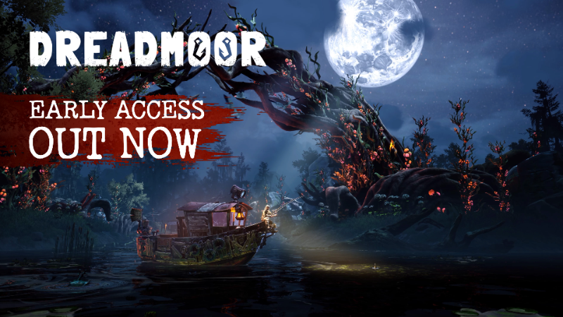
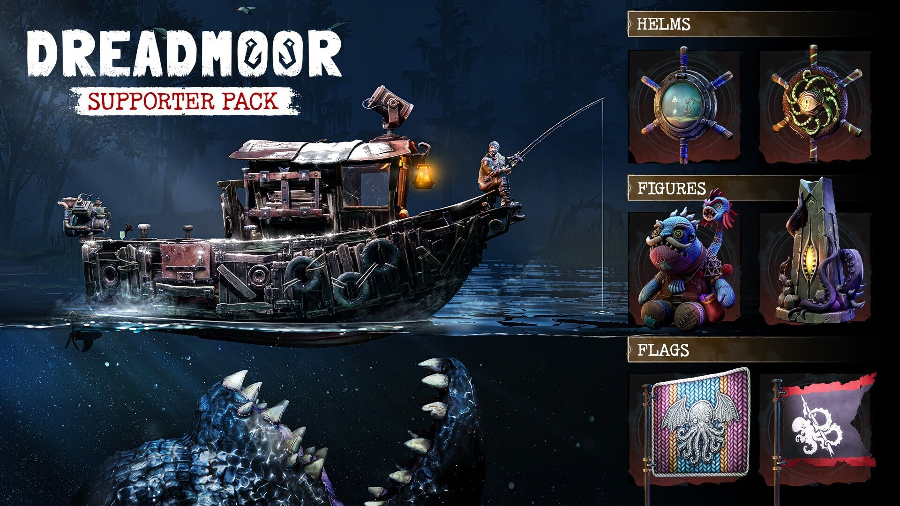

各位老哥，深海钓鱼佬的噩梦来了！经过数月开发和多轮测试，**《DREADMOOR》**终于以抢先体验（Early Access）形式登陆 Steam。Steam AppID：3629430。官方同时公布了首发价格、10%折扣、支持者包以及六款联动捆绑包。对于喜欢《Dredge》式诡异氛围、又想体验拖网渔船生存玩法的玩家，这波值得先加愿望单再观望。

## 🎯 核心看点速览

- **EA 正式上线**：DREADMOOR 现已开启抢先体验，码头开放，拖网渔船等你出航。
- **首发价格**：$19.99 USD，首发期间提供 **10% 折扣**，各区价格以本地 Steam 商店为准。
- **支持者包**：$4.99 USD，包含 6 件纯外观饰品——2 个仪表台摆件、2 面旗帜、2 个船舵。
- **六大捆绑包**：与《Pacific Drive》《Cast n Chill》《Murky Divers》《GONE Fishing》《Fishing Inc》《Voodoo Fishin'》联动。
- **愿望单里程碑**：Steam 愿望单突破 **75 万**，进入 Steam 愿望单前 50。
- **EA 启动预告片**：官方放出全新预告，出发前可以先看看 Submerged Lands 里到底藏着什么。

## 📌 重点深度解析

### 1. 抢先体验开航：这次不是画饼，是真能开船了

官方在公告里直说：经过数月开发、玩测和准备，DREADMOOR 终于开放抢先体验。对一款氛围向深海生存恐怖游戏来说，EA 上线意味着核心循环——开船、探索、拖网、应对未知——已经能端上桌。当然，EA 也意味着后续还会有平衡性调整、内容扩充和修 bug，建议首发入手的玩家做好“边玩边反馈”的心理准备。

### 2. 价格与折扣：19.99 美元，首发 10% off

DREADMOOR 抢先体验版定价 **19.99 美元**，首发期间有 **10% 折扣**。官方也说明区域定价已启用，各位在本地 Steam 商店看到的价格和折扣才是最终价。想冲首发的玩家，建议先看商店页折扣倒计时，别错过首发窗口；不急着开船的也可以等一波玩家实测再决定。

### 3. 支持者包：纯外观，不卖数值

官方准备了一个可选的 **Early Access Supporter Pack**，售价 **4.99 美元**（未计折扣）。里面是 6 件纯外观物品：两个仪表台摆件、两面旗帜、两个船舵。比较有梗的是针织版 Bozur 和他的话痨鱼伙伴、长着发光眼睛的神秘石方尖碑，以及中心嵌着迷你水族箱的船舵。官方明确说这些只是装饰，不影响玩法，适合想给渔船加点个性、顺便支持开发组的玩家。

支持者包 Steam 页面：[DREADMOOR Supporter Pack](https://store.steampowered.com/app/5307520/DREADMOOR_Supporter_Pack)

### 4. 六大联动捆绑包：钓鱼佬和公路佬都能凑一桌

为了庆祝 EA 上线，官方拉来了六款游戏做捆绑包，分别是：

- 《Pacific Drive》
- 《Cast n Chill》
- 《Murky Divers》
- 《GONE Fishing》
- 《Fishing Inc》
- 《Voodoo Fishin'》

部分捆绑包链接如下，具体折扣和补齐价格以 Steam 结算页为准：

- [DREADMOOR x Pacific Drive](https://store.steampowered.com/bundle/95626/DREADMOOR_x_Pacific_Drive)
- [DREADMOOR x Voodoo Fishin](https://store.steampowered.com/bundle/95629/DREADMOOR_x_Voodoo_Fishin)
- [DREADMOOR x Fishing Inc](https://store.steampowered.com/bundle/95630/DREADMOOR_x_Fishing_Inc)
- [DREADMOOR x Murky Divers](https://store.steampowered.com/bundle/95635/DREADMOOR_x_Murky_Divers)
- [Chill n Thrill 捆绑包](https://store.steampowered.com/bundle/90037/Chill_n_Thrill)

如果你库里已经有其中某款，Steam 捆绑包通常会按已拥有内容自动扣减，结算前记得看一眼价格。

### 5. 75 万愿望单意味着什么？

官方特别感谢玩家支持，DREADMOOR 在发售前已经突破 **75 万 Steam 愿望单**，并进入 Steam 愿望单前 50。这个数字对独立/中小团队来说相当能打，也说明“深海钓鱼+生存恐怖”这个题材确实戳中了不少人。对玩家来说，愿望单高不代表一定神作，但至少说明关注度高、社区讨论不会少，后续 EA 更新也更值得盯。

## 💡 玩家实操与上手建议

- **先加愿望单再决定**：EA 阶段最怕冲动消费。建议先看商店页截图、预告片和首批玩家评价，再决定是否首发。
- **想拿首发折扣就盯紧倒计时**：10% 首发折扣有时限，Steam 商店页会显示截止时间。别等 EA 热度过了才想起来。
- **支持者包只买自己喜欢的**：它不影响数值，纯外观。喜欢收集船只装饰、想支持开发组的再入；只关心玩法的可以省下这 4.99 美元。
- **捆绑包先算账**：如果你已经拥有《Pacific Drive》或《Murky Divers》等联动游戏，捆绑包可能比单买更划算；但别为了凑包买一堆不玩的游戏。
- **EA 心态放平**：抢先体验版本可能存在性能优化、平衡性、存档兼容等问题。遇到 bug 建议通过 Steam 社区或官方反馈渠道提交，别硬憋。
- **下载与配置**：购买后在 Steam 库中安装，安装前看一眼商店页的系统和存储空间要求；深海场景如果帧数不稳，优先调低阴影、水体和后期特效。
- **内容节奏**：EA 游戏更新频率很关键，建议关注官方公告和社区路线图，别把当前版本当成最终完整版。

## 📢 官方 Telegram 频道推荐

想第一时间收到 Steam 限免、喜加一、史低折扣和 EA 上新提醒？欢迎加入官方 Telegram 频道 **@steamhunterlink**。秒级推送，不用天天刷商店页，适合我这种怕错过“背刺价”和限时入库的老哥。

## ❓ 常见问题 FAQ

**Q1：DREADMOOR 现在买是完整版吗？**

A：不是。当前是抢先体验版，核心玩法已经可玩，但后续还会继续更新、调整和修 bug。适合愿意参与 EA 阶段、能接受版本变化的玩家。

**Q2：支持者包会影响游戏平衡吗？**

A：不会。官方明确说明支持者包内是 6 件纯外观饰品，包括仪表台摆件、旗帜和船舵，只改外观，不卖数值。

**Q3：首发 10% 折扣和捆绑包折扣能叠加吗？**

A：Steam 捆绑包通常按打包内容计算折扣，具体能否与首发折扣叠加、最终价格多少，以结算页显示为准。建议购买前先看购物车总价，别看到“折扣”两个字就冲动下单。

**Q4：这款游戏适合什么类型的玩家？**

A：喜欢深海探索、生存恐怖、氛围向钓鱼/开船玩法的玩家可以重点关注；如果你只想要纯爽快战斗或完整正式版体验，建议先观望 EA 更新节奏。

结语：DREADMOOR 这波 EA 上线，价格不算离谱，首发有折扣，支持者包也不卖数值，再加上六款联动捆绑包，整体姿态比较克制。至于 Submerged Lands 里到底藏着什么，等各位船长亲自下网就知道了。
