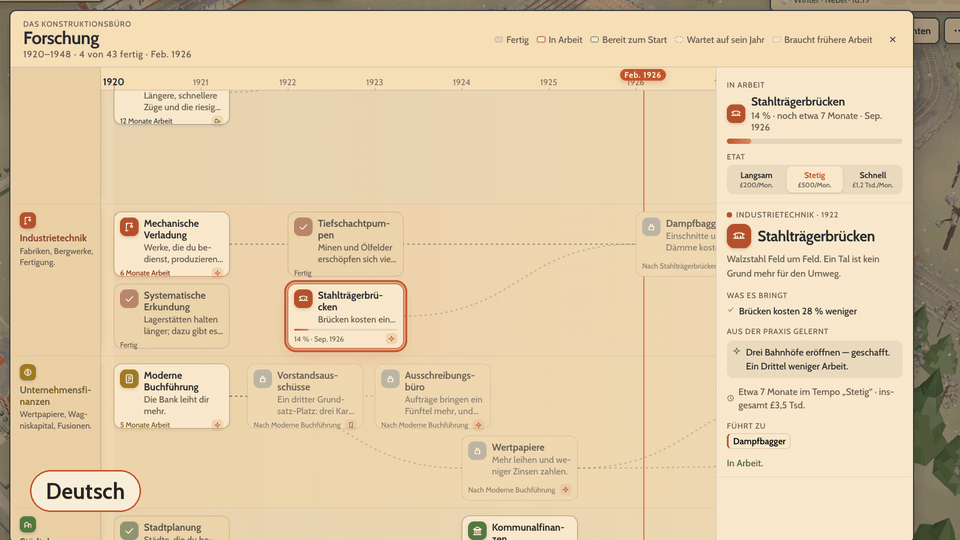
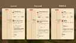
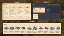

铁路经营模拟新作《Ironline》的发车时刻表改了：原定11月9日（周一）上线，现在改为11月13日（周五）。好消息是，这次改档不是内容缩水，而是德语、俄语、简体中文完整本地化同步首发。对国内玩家来说，最舒服的打开方式莫过于首日直接母语开局。

## 🎯 核心看点速览

- **发售改档**：11月9日 → 11月13日（周五），多出的四天用于多语言版本通过 Steam 检查。
- **四语首发**：英语、德语、俄语、简体中文同步上线，不再英文先发、后续补语言。
- **文本覆盖**：菜单、提示框、窗口、研究室、账目、战役、场景、新闻、城镇报告等约7900行/语种。
- **数字与字体**：日期、金钱、数字按各语言习惯显示；俄文与中文字体专门匹配游戏风格。
- **语言切换**：系统语言为四语之一时默认跟随；也可在 Settings → Language 手动改，重启生效。

## 📌 重点深度解析

官方这次把“多语言”从售后补丁提到了首发配置。原本可以先发英文版，再把德语、俄语、简体中文慢慢补进去，但作者选择让四个语种在第一天一起发车。为此发售日往后挪了四天，用来让多语言版本完整走完 Steam 的检查流程。对玩家来说，这四天不是摸鱼，而是把首发体验打磨得更稳。

这次本地化覆盖的不是几个按钮那么简单：从研究办公室到账目界面，从菜单、提示框到窗口信息，再到战役、场景、新闻和城镇报告，全部纳入语言适配范围。每个语种大约7900行文本，量级不算小。经营类游戏最怕“界面能看，报告看不懂”，这次把文本和数字格式一起处理，体验会顺很多。

细节方面也值得一提：日期、金钱和数字会按照各语言的习惯书写，不是生硬套英文格式；俄文和中文还专门选择了与游戏视觉风格匹配的字体。对中文玩家来说，简体中文首发同步意味着不用边查词边研究线路，开局就能把注意力放在经营决策上。

官方还幽默地补了一句：13号周五，对某些人来说不太吉利；但列车会准点发车。发售日虽然往后挪了四天，但首发品质和多语言体验更稳，这笔账怎么算都不亏。

## 💡 玩家实操与上手建议

- **先加愿望单**：Steam 搜 Ironline 或 AppID 5461620，先关注/愿望单，13日发车不迷路。
- **语言设置**：系统是简中就默认简中；想手动改，进 Settings → Language 选简体中文，重启游戏。
- **首发开荒**：经营模拟先跑教程或战役，熟悉线路、账目和研究系统，别一上来就硬刚高难度。
- **反馈文本**：如果发现语句别扭、术语不统一，去 Steam 讨论区或公告评论区反馈，修复会随首批更新推送。
- **下载与配置**：发售前留意商店页配置需求和下载体积，预留硬盘空间；首发日下载慢可换个时段。
- **购买建议**：喜欢铁路经营、管理模拟的玩家可以首发入手；观望党先看实机与评价，别急着给第三方 key 商送钱。

## 📢 官方 Telegram 频道推荐

想第一时间收到《Ironline》发售改档、Steam 喜加一、永久入库、免费周末、史低特惠和联机避坑提醒，欢迎加入官方 Telegram 频道 @steamhunterlink。秒级推送，别让好价和入库机会从站台溜走。

## ❓ 常见问题 FAQ

**Q1：Ironline 为什么从11月9日推迟到11月13日？**

A：为了德语、俄语、简体中文完整本地化版本在首发日同步上线，并留出时间通过 Steam 的多语言检查。不是砍内容，也不是临时跳票摆烂。

**Q2：简体中文怎么设置？**

A：如果你的电脑系统语言是简体中文，游戏会默认跟随；也可以打开 Settings → Language，选择简体中文后重启游戏生效。

**Q3：首发遇到文本显示或语句问题怎么办？**

A：直接在 Steam 讨论区或公告评论区反馈，作者会逐条看，相关修复会随首批更新推送。遇到字体或数字格式问题也可以一并说明。
