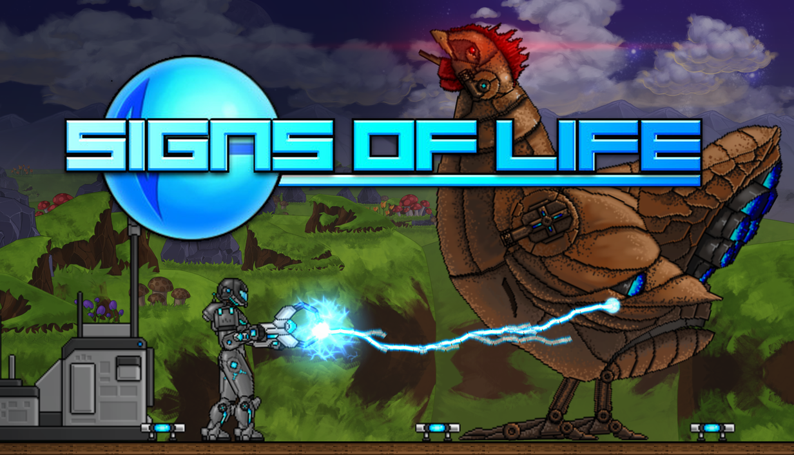

有生之年系列又少一个。Sweet Dog Studios 正式宣布《Signs of Life》1.0 上线，Steam 抢先体验阶段收官。对一款 2014 年 1 月就进入 EA 的外星生存游戏来说，这不是改个版本号，而是给十年长跑补上终点线。先把官方主视觉放这儿：

## 🎯 核心看点速览

- **1.0 正式版上线**：游戏正式离开抢先体验，进入完整发行阶段；官方明确表示 1.0 不是终点，后续还会继续修 Bug、做改进、听玩家反馈。
- **十年长跑终于冲线**：从 2011 年受《Terraria 1.1》启发，到 Steam Greenlight 获得玩家投票支持，再到 2014 年 1 月开启 EA，这条线拉得够长，也够有故事。
- **核心玩法不变**：合作探索、制作、建造，在陌生外星世界扎根生存，仍是《Signs of Life》的招牌体验。
- **最后一轮 EA 更新很实在**：Xenoid 城市对话与家庭、档案记录、住宅布局、New Earth 神龛布局、Monstralorps 出现条件，以及装备与战斗问题都有调整和修正。
- **官方喊你留评测**：如果你已经玩过，官方希望你在 Steam 留下诚实评价，或把老评测更新到 1.0 版本，帮助后来玩家判断这游戏合不合胃口。

## 📌 重点深度解析

### 十年 EA 收官，这波真有“老玩家泪目”那味

官方回忆，2011 年某个晚上，Hayes 和 Alex 还在玩《Terraria 1.1》，聊着“要是做一个科幻背景、带更多故事的同类游戏该多酷”。那会儿两个人都没做过完整游戏，后来靠玩家在 Steam Greenlight 投票支持，才把项目推上 Steam；2014 年 1 月，《Signs of Life》正式以抢先体验形式与玩家见面。

说白了，这不是那种一年一波大宣发的项目，而是一款慢慢熬、慢慢改、慢慢长出来的外星生存游戏。如今 1.0 上线，官方感谢了这些年玩过、报过 Bug、提过反馈、一路围观的老哥。对还在观望的玩家来说，1.0 也是一个比较适合上车的节点。

### Xenoid 城市更有“人味儿”，世界生成也在补细节

这轮从 Update 27 到 1.0 的收尾更新里，Xenoid 城市是重点之一。官方扩展了 Xenoid 城市对话，并在新生成的城市里加入带孩子的家庭；新增 7 条可重复使用的 Xenoid 档案记录，玩家完全学会 Xenoid 语言后，AGIS 可以把这些档案记录提取到 MEG 中，位置就在 Xenoid 城市的档案区域。

住宅方面也有加强：更多样的 Xenoid 住宅布局、带家具和容器与战利品的房间，以及刷新过的公共家具、补给和照明。翻译成人话就是，逛城市不再只是看几堵墙，翻箱倒柜和看文本的乐趣更足了。

### 世界生成、装备与战斗：老问题集中补课

世界生成方面，官方移除了新生成 Pioneer Stations 里散落的可拾取方块，更新了新生成 New Earth 世界中 Energy 与 Animate 神龛的布局，并让入口与周围隧道连接；击败 Buff Mechington Mk2 后，Monstralorps 可以在 New Earth 出现。此外还修了一堆世界生成相关的毛病。

装备与战斗部分，光学迷彩现在支持那些会阻挡普通护甲的修补义肢手臂和腿；爆发步枪在弹药充足时，轻点后无法完成三连发的问题已修正，战斗霰弹枪的相关表现也有修正。对长时间联机开荒的老哥来说，这类手感修复比多两张新图更实在。

### 1.0 不是散伙饭，官方还要继续折腾

官方说得很清楚：就算到了 1.0，也没有离开《Signs of Life》的计划，接下来会继续修 Bug、做改进、回应反馈，同时琢磨游戏下一步往哪走。这个态度值得点个赞。毕竟生存建造游戏最怕“正式版一挂，人没了”，目前看 Sweet Dog Studios 还没打算收摊。

## 💡 玩家实操与上手建议

**新玩家上车**：Steam 搜游戏名或 AppID **263200** 就能找到《Signs of Life》。1.0 是完整发行节点，喜欢外星题材、合作生存、基地建造和慢节奏探索的玩家，可以先看商店页和 1.0 预告片再决定。官方预告片在这里：https://www.youtube.com/watch?v=XjsHToSkvzg

**老玩家回归**：建议先把游戏更新到最新版，进游戏前看一眼更新说明；如果是很久没回归，稳妥起见先备份存档。官方正在收集反馈，遇到问题可以去 Steam 社区反馈，顺手把老评测更新成 1.0 体验，也算帮后来人避坑。

**联机开黑避坑**：合作生存最怕版本不一致和分工混乱。开黑前统一更新到最新版，提前说好谁负责建造、谁负责探索、谁管资源；主机网络尽量稳一点，别一个人跑太远导致队伍节奏断裂。1.0 刚上线， Mod 或旧习惯如果遇到异常，先回官方原版环境排查。

**购买建议**：目前没有额外折扣信息可确认，是否史低、有没有捆绑包，以 Steam 商店页实时显示为准。别急着开香槟，先看页面、看评测、看朋友有没有人一起开荒，再决定是否入手。

## 📢 官方 Telegram 频道推荐

想第一时间蹲 Steam 限免、喜加一、永久入库和秒级特惠推送，欢迎加入我们的 Telegram 频道 **@steamhunterlink**：https://t.me/steamhunterlink 。大作试玩、免费周末、折扣背刺和联机避坑提醒，都会尽量帮你盯紧。

## ❓ 常见问题 FAQ

**Q1：1.0 对已经买过游戏的老玩家还要再收费吗？**

A：1.0 是正式版更新，已拥有游戏的玩家更新即可；新玩家则需要在 Steam 购买本体。具体价格和折扣以商店页为准。

**Q2：现在入坑《Signs of Life》合适吗？**

A：合适。1.0 是完整发行节点，喜欢外星合作生存、建造和探索的玩家可以直接上车；想联机就提前拉好固定队友，统一版本再开荒。

**Q3：更新后遇到问题怎么办？**

A：官方已表态会继续修 Bug 和回应反馈。可以先在 Steam 社区查看是否有同类问题，必要时备份存档并向官方反馈；如果体验不错，也别忘了留个诚实评测。
