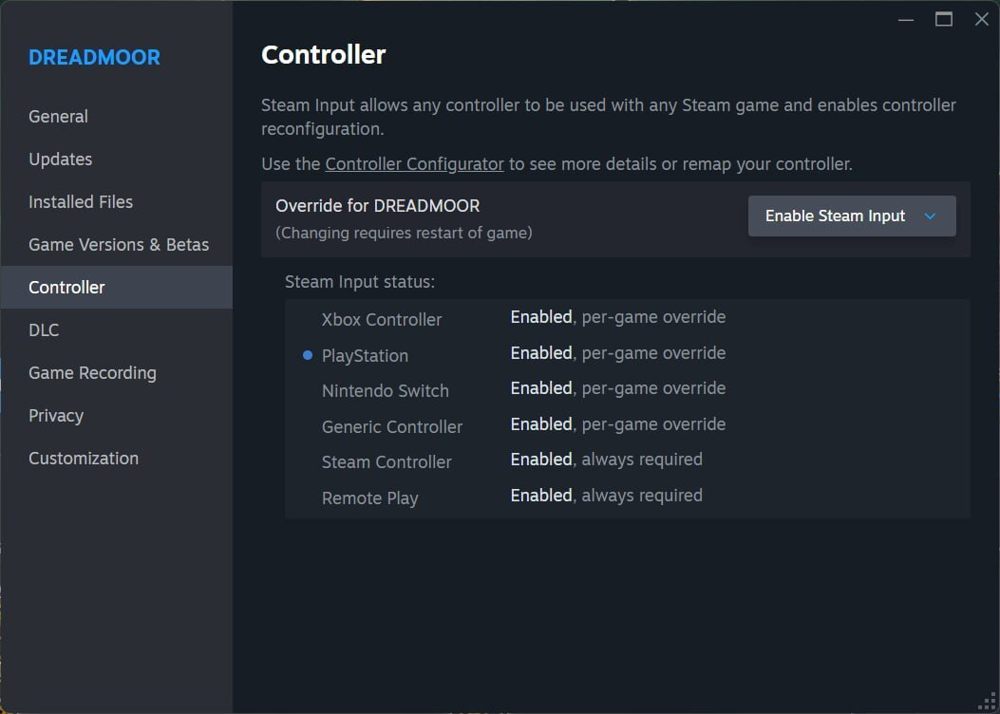

各位钓友，我是你们的老朋友、专盯 Steam 动向的主理人老K。DREADMOOR 这波抢先体验更新 #1 来得挺实在：不是画个大饼，而是把手柄支持、鱼模型、危险警告、任务卡进度这些实际痛点挨个处理了。下面我按老规矩拆成看点、深度解析、实操建议和 FAQ，方便你一眼判断这次更新值不值得回坑。

## 🎯 核心看点速览

- **手柄支持补强**：DualSense（PS5）获得原生支持；DualShock 4（PS4）需要开启 Steam Input 后使用。
- **内容与机制更新**：新增三款鱼模型，加入危险警告系统，进入受任务进度或船只升级限制的区域会触发危险计时。
- **交易与事件逻辑调整**：与 Gill 的交易改为任务 57 后才开放，修复过早可交易的问题；码头鱼贼出现概率降到 80%。
- **进度阻塞修复**：处理首次睡觉后失去角色控制、旅店任务睡觉时间跳错、发电机相关任务提前触发导致任务步骤无法登记等卡进度问题。
- **视觉与教程打磨**：Betsy 战斗光照、Jacqueline 对话动画、John the Fifth 动画过渡、Railer 入水水花、瀑布水花，以及 Hook Gun 教程提示均有改进。

## 📌 重点深度解析

### 🎮 PS 手柄支持：DualSense 原生，DS4 走 Steam Input

这次更新最直接的变化是手柄党终于能更舒服地下潜了。**DualSense（PS5）手柄获得原生支持**，插上就能在 DREADMOOR 里用；**DualShock 4（PS4）手柄则要通过 Steam Input 适配**。各位用 DS4 的钓友别急着骂手柄没反应，先去 Steam 控制器设置里把 Steam Input 打开，具体位置可以参考官方这张截图：

我个人建议：DualSense 优先用有线连接测试震动和按键映射；DS4 开启 Steam Input 后，进游戏先跑一遍按键提示，确认左键、拉线、互动这些操作没有串键。要是你之前用键鼠惯了，也可以趁这次更新试试手柄开船，沉浸感确实不一样。

### 🐟 新鱼模型与危险警告系统

三款新鱼模型加入，对喜欢收集图鉴和看鱼种变化的玩家来说是个小惊喜。更关键的是**危险警告系统**：当你进入受任务进度限制，或者船只升级等级不够的区域时，屏幕会触发危险计时。说白了，就是游戏在提醒你“这片水域你现在硬闯会出事”，别再头铁往里冲。

这个机制对新手尤其友好。以前有些区域没有明确反馈，玩家容易误判自己是不是漏了任务；现在警告一响，你就知道该回头推主线、升船或者检查任务链。

### 🛠️ 进度阻塞修复：这次真的救命

这次更新里我最看重的是修卡进度。官方处理了多个可能让流程走不下去的问题，包括：

- 首次在床上睡觉后可能失去角色控制；
- 旅店任务中睡觉导致时间错误跳过；
- 心坑上方吊笼消失；
- 发电机相关任务提前启动，导致任务步骤无法登记、后续流程被卡住；
- UI 缩放设置问题。

另外，与 Gill 的交易现在锁定到任务 57 后才开放，修复了此前可过早交易的问题；码头鱼贼出现概率调整为 80%。如果你之前正好卡在发电机任务或旅店任务，更新后建议先读档试一次，很多老问题应该已经顺了。

### 🎨 视觉、动画与教程优化

Betsy 首次遭遇和最终水怪战的光照做了改善，Jacqueline 的对话动画修好了手卡在珊瑚里的尴尬场面，John the Fifth 的动画过渡也顺了。制作台上骨板位置调整后，文本更易读；Railer 入水和瀑布的水花效果也修了。

教程方面，Hook Gun 教程增加了左键点击和拉线缆的额外提示，Gill 任务对话里那句关于 Snappers 数量的多余台词被移除。对刚入坑的玩家来说，少一点迷惑，多一点开钓，挺好。

## 💡 玩家实操与上手建议

- **更新方式**：Steam 库中右键 DREADMOOR，检查更新或重启客户端，让补丁自动下载。抢先体验阶段建议每次大更新前手动备份存档。
- **DS4 手柄设置**：Steam 设置里进入控制器选项，开启 Steam Input，再进游戏测试按键。DualSense 用户优先测试原生支持下的震动、扳机和摇杆死区。
- **旧存档处理**：这次修了多个进度阻塞问题，旧档通常可以继续，但建议先复制一份存档再推进关键任务。若你之前卡在发电机任务，更新后按任务提示重新触发步骤。
- **别硬闯危险区**：看到危险计时先撤退，检查任务进度和船只升级。交易 Gill 之前先确认任务 57 是否已到，避免白跑。
- **新手开钓顺序**：先跟 Hook Gun 教程走一遍，记住左键点击和拉线缆提示；遇到鱼贼别慌，码头出现概率虽降到 80%，但该防还是要防。
- **画面与 UI**：更新后进设置检查 UI 缩放，尤其是高分屏或小屏幕玩家；Betsy 战斗光照有调整，遇到明暗变化属于正常优化。

## 📢 官方 Telegram 频道推荐

想第一时间蹲 Steam 限免、喜加一和秒级特惠推送，建议加入官方 Telegram 频道 **@steamhunterlink**。像 DREADMOOR 这种抢先体验阶段的更新、临时折扣和免费周末，频道里通常会推得很快，省得你天天刷库错过背刺价。

## ❓ 常见问题 FAQ

**Q1：DualShock 4 手柄连上了但游戏里没反应怎么办？**
A：先在 Steam 控制器设置中开启 Steam Input，再启动游戏。DualSense 是原生支持，DS4 则需要这一步适配。

**Q2：更新后旧存档会不会坏？卡住的任务能继续吗？**
A：一般可以继续。此次修复了多个进度阻塞问题，但保险起见先备份存档；如果旧档正好卡在发电机任务或旅店任务，建议读档后按当前任务提示重新推进。

**Q3：为什么我现在不能和 Gill 交易了？**
A：这是本次逻辑调整：交易改为任务 57 后才开放，修复此前可过早交易的问题。先推任务，别急着倒货。

**Q4：危险警告计时是什么？看到计时该怎么做？**
A：进入受任务进度或船只升级限制的区域会触发危险计时。看到警告就撤离，先检查任务链和船只升级，别拿小船硬闯深水区。
