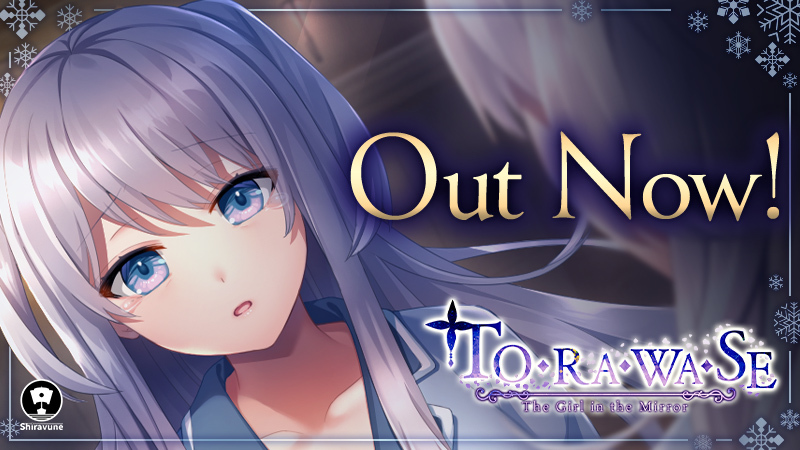

## 🎯 核心看点速览

- **正式发售**：Shiravune 官宣《TORAWASE: The Girl in the Mirror》现已上架 Steam，商店页与 AppID 4215660 已公开。
- **发行阵容**：本作由 Shiravune 与 Co-FUN Games 联合发行，属于日系视觉小说/剧情向作品阵容。
- **官方态度**：公告直接喊话玩家，如果玩得开心请考虑留下好评，支持对团队很重要。
- **同厂矩阵**：公告附带一长串 Shiravune 相关作品链接，适合顺藤摸瓜扩充愿望单。
- **购买提醒**：公告未列出价格、语言支持与首发折扣，入手前务必以 Steam 商店页实时信息为准。

## 📌 重点深度解析

### 1. 这是新作发售，不是“喜加一”

先把预期摆正：官方口径是 **OUT NOW**，也就是正式发售，不是限时免费领取或永久入库的喜加一活动。想玩就去商店页确认价格后购买；暂时观望就先加愿望单，等折扣或季节性特卖。别在社区里等“免费入库”消息，容易白等。

### 2. 视觉小说玩家该看什么

从发行商阵容看，本作面向的是喜欢日系视觉小说、剧情向叙事和角色互动的玩家。购买前建议重点检查三项：

- **语言支持**：商店页语言栏是否包含简体中文；公告本身没有逐项列出。
- **版本内容**：本体是否包含全部内容，是否有 DLC、原声集或合集包。
- **首发状态**：首发折扣、是否支持 Steam Deck、配置要求，都以商店页为准。

### 3. 同厂作品顺藤摸瓜

Shiravune 在公告里放出了大量关联作品链接，包括《Eye of the Incubus》《Princessfall》《Heavenly Island》《Cicada Communication》《Kudos Kuppa》《Kokuhaku Confessional》等。对视觉小说老饕来说，这相当于一份现成的“同厂待玩清单”。建议先看商店页标签、评价和语言支持，再决定先入哪一部。

### 4. 官方为什么强调好评

独立和中小体量视觉小说很吃 Steam 评价系统的曝光。官方公告专门请求好评，说明首周评价对后续推荐位和社区可见度很关键。如果你入手后觉得对胃口，留一句真实感受比单纯点赞更有用；如果遇到 bug，先去社区反馈，别一上来就差评轰炸。

## 💡 玩家实操与上手建议

### 入库与购买路径

1. 打开 Steam 商店页：`https://store.steampowered.com/app/4215660`
2. 登录 Steam 账号，确认价格、语言支持、是否首发折扣。
3. 决定购买后直接结算，游戏会自动入库；想观望先点“添加至愿望单”。
4. 不急着玩也别买第三方来路不明的 key，优先走 Steam 官方渠道。

### 购买前检查清单

- 语言栏有没有简体中文，别买完才发现啃生肉。
- 看评价数量与近期评价，首发期样本少，建议等一两天。
- 确认是否锁区、是否支持家庭共享、是否有 DLC 合集。
- 视觉小说建议窗口模式 + 合适文本速度，善用 Auto、回想和快速存档。
- 本作不是联机游戏，别找“开黑房”；想讨论剧情去社区或发行商 Discord。

### 首发避坑提醒

- 公告没有承诺免费，别把“发售”当成“喜加一”。
- 首发折扣通常限时，但别为了折扣仓促入手，先确认语言和内容。
- 遇到启动黑屏、字体显示异常，先验证文件完整性，再更新显卡驱动。

## 📢 官方 Telegram 频道推荐

想第一时间收到 Steam 限免、喜加一、史低折扣和版本更新推送，建议加入 **@steamhunterlink**：

`https://t.me/steamhunterlink`

限免和特惠往往窗口很短，尤其首发折扣、免费周末和临时喜加一，靠手动刷商店页容易错过。把推送开起来，看到合适再入手，省钱也省心。

## ❓ 常见问题 FAQ

**Q1：本作是免费喜加一吗？**

A：不是。官方公告是正式发售，按 Shiravune 的发行惯例为付费视觉小说新作。是否免费、是否有试玩版，以 Steam 商店页为准。

**Q2：支持简体中文吗？**

A：官方公告没有逐项列出语言支持。购买前请直接看商店页语言栏；如果暂时没有中文，可以先加愿望单等后续更新。

**Q3：首发有折扣吗？值得等吗？**

A：公告未写明首发折扣，商店页会显示实时价格与优惠。视觉小说通关时长因人而异，建议先看评价和语言支持；不着急就等季节性特卖，着急尝鲜再首发入手。
