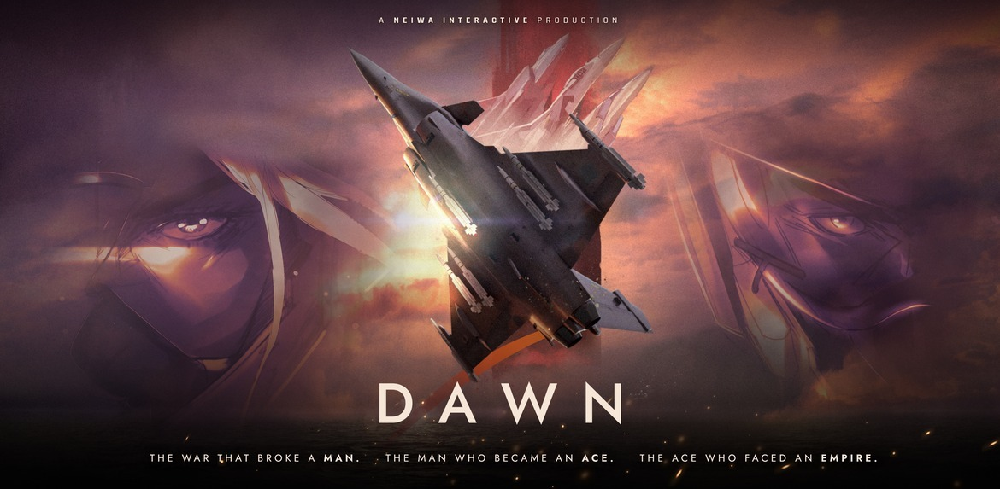
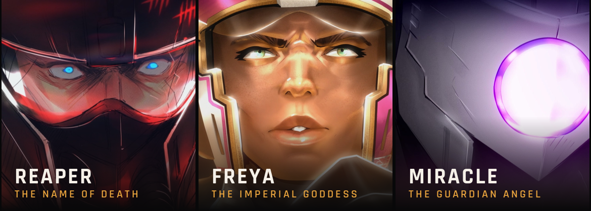
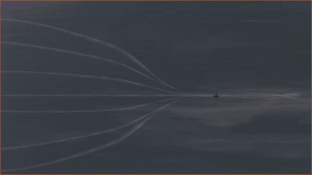
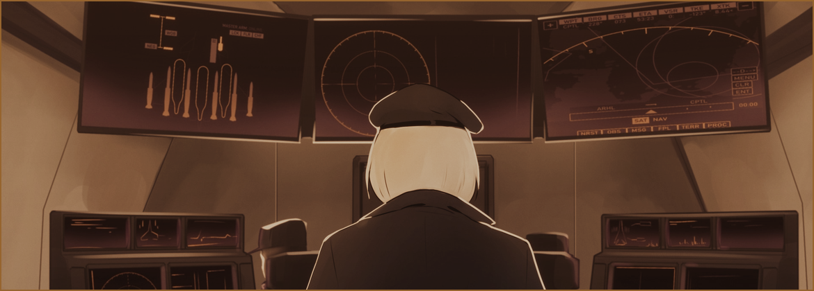

# DAWN AEROWAR 正式上线：两小时十二集空战动画电影，4K 免费包同步放送

来了，真的来了。Steam 库里的愿望单钉子户终于可以点“开始游戏”了——《DAWN AEROWAR》现已正式上线，战情室大门敞开，第一架次出击权交到你手上。

先替制作组说句人话：**如果你看完觉得对味，麻烦在商店页面留个评测**。这不是客套，独立团队的口碑基本靠这一条条评测撑着，对后续作品的立项和曝光有实打实的影响。

## 🎯 核心看点速览

- **形态特殊**：这不是飞行射击游戏，而是一部 **12 集、总时长约 2 小时**的动画电影，在 Steam 上以“影片”形式发行，买断即永久入库。
- **制作规格**：3D 动画 + 手绘 2D 混编，多位独立创作者耗时数年，专业配音班底三十余人。
- **免费 4K 包**：全片 2160p、10-bit 色彩版本，**拥有本体即可免费下载**，为可选组件，体积约 20GB。
- **原声带**：77 分钟原创配乐，随附 MP3；无损 FLAC 为可选下载项。
- **捆绑包折扣**：影片 + 原声带组合包 **8 折（-20%）**。
- **众筹回馈**：Kickstarter 支持者的激活码正在通过邮件陆续发放，没收到的先翻垃圾箱。

## 📌 重点深度解析

### 世界观：一家独大的帝国，与最后一次出击

故事发生在一个被连年战火犁过一遍的世界里。自由邦国已经被逼到悬崖边，萨阿尔·鲁纳帝国碾平了几乎所有抵抗力量，只剩最后一支。主角 **Zodiac** 的任务听上去就很不祥——护送一件“本不该有人知道它存在”的武器，横穿整个帝国，完成最后一次出击。

他的家人、家园、人生目标全被帝国夺走，剩下的只有复仇。天上、海上、地面都有敌人，而真正压在天平另一端的，是下面这三位：

- **Reaper（死神之名）**：比起和平，他更爱战争本身。
- **Freya（帝国女神）**：会在缠斗中段的无线电里跟你引经据典，素质极高，也极度瘆人。
- **Miracle（守护天使）**：名号来自于她救过的人，而不是她杀过的人。

还有一个关键角色：Zodiac 全程单机突入，唯一的引导是位他此前从未听说过的预警机操作员。嘴快、话密、反应极快，而且对 Zodiac 的底细知道得异常清楚，对这场战争的了解更是近乎全知。

### 配音与配乐：这份名单值得单独拎出来说

配音阵容包括 **Sam Hughes、Kira Buckland、Lara Sawalha、Blythe Melin、Sandra Espinoza、Mark Mullens、Jeremiah Foltz**，外加三十余位额外声优。熟悉欧美动画与游戏配音圈的玩家，看到 Kira Buckland 这个名字基本就懂含金量了。

配乐是整部片子最硬的一张牌：**77 分钟原创配乐，由《Project Wingman》的作曲家按画面逐段谱写**。管弦乐队、合唱团、保加利亚人声、古典吉他，另有两首原创歌曲。如果你是《Project Wingman》那套“空战 + 史诗管弦”风格的受众，光冲着音乐就值回票价。

### 免费 4K 包与捆绑包：怎么选不亏

- **4K Pack**：全片 2160p、10-bit 色彩，**所有拥有本体的玩家免费**，作为可选下载约 20GB。想看高码率大屏效果就下，硬盘紧张就先不勾。
- **Original Soundtrack**：MP3 随包，FLAC 无损作为可选下载，同样是“想要就勾”的设计，不占冤枉空间。
- **捆绑包**：影片和原声带打包，**立减 20%**。如果你还没单独买本体、又确定要收 OST，直接从捆绑包下单最划算。

## 💡 玩家实操与上手建议

**1. 入库与下载**
在 Steam 商店页点击购买/入库后，进入库中右键《DAWN AEROWAR》→ 属性 → 下载内容（或直接在安装对话框里勾选可选组件），把 **4K Pack** 和 **FLAC 无损音轨**按需勾上。默认不勾选，不会自动吞你 20GB 硬盘。

**2. 硬盘与带宽取舍**
1080p 本体 + 20GB 的 4K 包，对固态紧张的玩家建议先只装本体试看一集，觉得值再补下 4K 版本——反正它是免费的，随时可以勾。

**3. 观影环境建议**
这片子的卖点是空战镜头和管弦乐，**别用笔记本外放凑合**。大屏 + 耳机（或像样的音箱）体验差距极大；支持 HDR 的显示器上 10-bit 色彩版本能明显看出层次。

**4. 分集观看节奏**
12 集、总长约 2 小时，平均单集 10 分钟左右。建议按集看，别一口气倍速刷完——空战段落的信息密度和配乐编排都是按“集”设计的，快进等于白买。

**5. 购买建议**
- 只要片子：单买本体，4K 包白嫖。
- 要片子 + 音乐：直接上 **捆绑包（-20%）**，别先买单版本再补 OST。
- 众筹支持者：激活码走邮件发放，收到后直接在 Steam 激活；若长时间未到，先查垃圾邮件与促销标签页，再联系制作组。

**6. 顺手留个评测**
Steam 的推荐算法对这类小体量独立作品极其关键。花两分钟写两句，比在社交平台转发十条都管用。

## 📢 官方 Telegram 频道推荐

想第一时间蹲到 Steam 限免喜加一、临时工价、史低折扣和独立作品上线通知？加入我们的 Telegram 频道 **@steamhunterlink**，秒级推送直达手机，不用天天刷商店页面碰运气。像《DAWN AEROWAR》这种“上线即带免费 4K 包 + 捆绑折扣”的资讯，频道里会第一时间同步，避免错过限时优惠窗口。

## ❓ 常见问题 FAQ

**Q1：这到底是游戏还是电影？我买了能“玩”吗？**
A：是电影。12 集、总时长约 2 小时的动画长片，在 Steam 上以影片形式发行，购买后永久入库，可反复观看，没有操作玩法。想看空战题材的飞行射击，请另寻他作；想看空战题材的动画正片，这就是。

**Q2：4K 包要额外付费吗？会不会强制占我 20GB？**
A：完全免费，所有拥有本体的玩家都能下。它属于可选下载组件，默认不勾选，不会自动占用空间，需要时在安装选项或属性里手动勾上即可，体积约 20GB、规格为 2160p 10-bit。

**Q3：原声带怎么买最划算？FLAC 是另收费吗？**
A：原声带包含 77 分钟原创配乐，MP3 随包提供，**FLAC 无损为可选下载、不额外收费**。如果影片和音乐都想要，直接买影片 + 原声带捆绑包可享 8 折；已经单买了本体的玩家，再单独补 OST 就行，别重复消费。

**Q4：我是 Kickstarter 支持者，激活码还没收到怎么办？**
A：官方说明是“正在通过邮件陆续发放”，属于分批推送。先检查垃圾邮件、促销分类和当初填写的邮箱是否一致；若明显超出正常等待时间仍未收到，直接通过商店页或官方渠道联系制作组核对该笔众筹记录。

![](https://clan.fastly.steamstatic.com/images/46046758/6269
