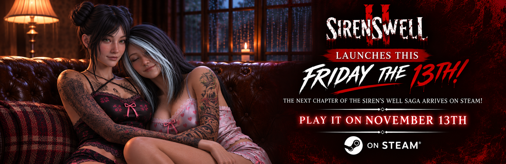

> 一句话总结这条公告：审核过了，周五见。等了这么久，《Siren's Well 2》终于从「愿望单钉子户」变成了「本周就能玩」。

## 🎯 核心看点速览

- **定档确认**：官方宣布《Siren's Well 2》已正式通过 Steam 发行审核，将于 **11 月 13 日（星期五）** 解锁。
- **续作定位**：《Siren's Well》系列的新一章，延续前作的世界观与压抑基调。
- **双主角结构**：官方原文强调「Two protagonists」，意味着两条视角线交织推进，叙事信息会被拆成两半。
- **舞台设定**：一座藏有可怕秘密的小镇，暗处潜伏着「数不清的恐怖存在」。
- **版本信息**：除标准版外，豪华版（Deluxe Edition）商店页已同步开放，可按需选择。
- **氛围关键词**：黑暗探索、 disturbing secrets（令人不适的秘密）、terrifying encounters（恐怖遭遇）。

## 📌 重点深度解析

### 1. 双主角 = 双份叙事陷阱

恐怖游戏一旦上双主角，通常不是为了「换皮多玩一遍」，而是为了制造**信息差**：A 线看到的真相，B 线可能是完全相反的版本。你在第一条线里建立的安全感，往往会在第二条线被彻底推翻。所以上手时别急着速通，把两个视角的日记、录音、NPC 对话对齐着看，很多细节是互相咬合的。

### 2. 小镇秘密：探索驱动的恐怖，而非纯 jump scare

官方文案把重心放在「explore the darkness」「uncover disturbing secrets」上，这说明玩法骨架更偏**探索 + 解谜 + 环境叙事**，而不是全程靠突然贴脸的惊吓撑时长。这类设计的好处是回味长，坏处是——卡关时真的会迷路。建议进游戏第一件事就是把亮度调到「能看清路但不至于破坏气氛」的档位。

### 3. 「无数的恐怖」意味着资源管理压力

原文那句 countless horrors waiting in the shadows 听起来很虚，但翻译成玩法语言就是：**敌人不止一种，而且规避手段大概率不通用**。躲怪 A 的套路对怪 B 可能完全无效，跑与不跑的判断会成为核心操作。心理准备先做好：这游戏不是让你打通关的，是让你活着走完的。

### 4. 前作没通关，能直接上续作吗？

从「next chapter of the saga」的措辞看，两部之间是**同一世界观下的延续**而非完全独立。如果你时间有限，至少把前作的结局与关键设定补一遍（视频回顾也行），否则续作里那种「哦——原来是他」的爽点会打折。

### 5. 周五 13 日发恐怖游戏，是营销也是态度

把发售日压在星期五 13 日，是恐怖品类的传统彩蛋式操作。对玩家来说有个现实好处：**当天上线正好接周末**，不用担心第二天上班顶着黑眼圈。坏处也很现实：恐怖游戏周末深夜独玩，容易被邻居的敲门声吓到摔手柄。

## 💡 玩家实操与上手建议

**第一步：先把愿望单点掉**

商店页在这里，标准版与豪华版都在同一入口：

- [Siren's Well 2 Deluxe Edition 商店页](https://store.steampowered.com/app/4905800/Sirens_Well_2_Deluxe_Edition/)

加入愿望单后，Steam 会在解锁时推送通知，避免错过首发窗口。

**第二步：版本怎么选**

- 只想体验剧情与恐怖氛围 → **标准版**足够，恐怖游戏的核心体验不在附加内容里。
- 系列老玩家 / 喜欢收藏设定与音乐 → 看**豪华版**是否包含原声带、美术设定集之类的数字特典，值不值取决于你对这个 IP 的感情。
- 不建议首发冲动加购一堆捆绑包，先把本体跑通再补。

**第三步：上线前的设备准备**

- 恐怖游戏对**音频定位**要求高，戴耳机是刚需，别用外放——很多线索藏在左右声道里。
- 首次进游戏先跑一遍画质设置，把帧数稳在 60 再谈特效，掉帧 + 黑暗场景 = 双重折磨。
- 手边备一只手电筒（现实中的），别笑，停电时真的有用。

**第四步：开黑与直播避坑**

- 这类游戏适合**一人操作一人围观**的「双人恐怖」模式，比单人硬扛体验更好。
- 直播的话提前把音量压缩一下，突然的音效爆音会被平台判定为异常音频。
- 存档前想清楚：恐怖游戏的自动存档点往往不在你觉得「安全」的地方。

**第五步：首发日节奏建议**

解锁当晚先玩 1～2 小时熟悉操作与地图，不要一口气肝到天亮，这类游戏后半段的压迫感是递增的，疲劳状态下体验会崩。

## 📢 官方 Telegram 频道推荐

想第一时间拿到这类**定档、解锁、限时特惠、喜加一**的推送，建议加入官方 Telegram 频道 **@steamhunterlink**。发售日当天临时调价、首发折扣、捆绑包上架这类信息流很快，靠手动刷商店页很容易漏。

## ❓ 常见问题 FAQ

**Q1：《Siren's Well 2》具体什么时候解锁？**

官方公告给出的日期是 **11 月 13 日，星期五**（Friday the 13th）。Steam 的解锁时间通常以商店页显示为准，建议加入愿望单后看商店页倒计时，以页面时间为准最稳。

**Q2：没玩过前作《Siren's Well》能直接玩 2 吗？**

能玩，但会损失一部分叙事乐趣。续作是同一传奇故事的下一章，前作的结局与关键设定大概率会被直接引用。建议至少补一段前作剧情回顾。

**Q3：豪华版比标准版多了什么？值得买吗？**

具体特典以商店页列出内容为准，通常这类 Deluxe Edition 会包含原声带、美术设定或数字周边。判断标准很简单：如果你只是想体验恐怖流程，标准版够用；如果你是系列粉丝、想要收藏内容，再考虑豪华版。

**Q4：这作支持联机吗？**

本次公告聚焦的是发售定档与剧情设定，未提及多人模式信息。从系列定位看应以单人叙事体验为主，购买前建议再看一眼商店页的功能标签确认。

> 11 月 13 日，星期五。灯光调暗，耳机戴好，你的噩梦准时开场。
