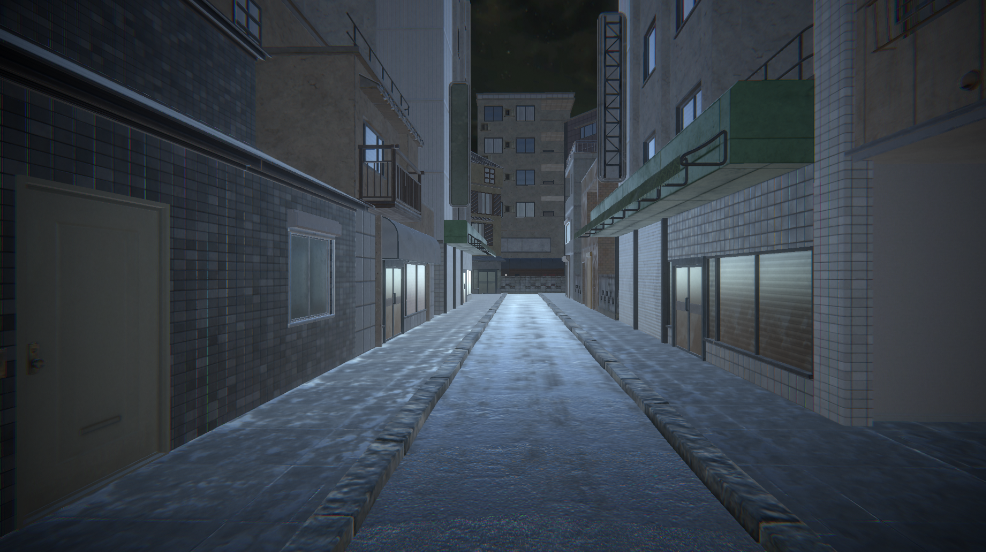

## 🎯 核心看点速览

等了这么久，夜班终于排到你了。**Market Moe 已经正式在 Steam 上架**，而且不是那种“原价先摆两周再打折”的套路——**发售头 14 天直接 20% OFF**，属于典型的首发窗口期福利，手快有手慢无。

- **首发折扣**：上架起 14 天内 20% 优惠，错过就得等下一次季节性特惠。
- **一份钱两份内容**：本作把 **Prologue 序章**和**完整正篇**打包在同一份购买里，序章不是独立试玩，而是整条剧情线的开场，打完可以直接续进正篇，不用二次掏钱。
- **恐怖双人套餐**：官方同步上架 **Market Moe x Reality Breach 特别捆绑包**，捆绑再享 **10% 折扣**；如果在首发促销期内买这个包，两层折扣会叠加，实际到手价更低。
- **后续动向**：开发组已经在做下一款同样日式题材的小体量新作，并且明确表示**不会出 Demo**——理由很实在：Demo 基本会把整个游戏透个精光，不如让大家发售时一次性完整体验。

商店页直达：https://store.steampowered.com/app/4174620/Market_Moe/

---

## 📌 重点深度解析

### 1. 序章 + 正篇一体化，这才是“完整体验”的正确做法

很多独立恐怖游戏喜欢把 Prologue 单独拆出来免费放，玩家玩完发现正篇要另外买，体验被硬生生截断。Market Moe 这次的做法是**买一次，两段都给你**：先在序章里感受“噩梦的开端”，摸清氛围、操作节奏和叙事调性，然后一路无缝推进到正篇。对新手来说这是最友好的入门曲线，对老玩家来说也不用重复下载两份客户端。

### 2. 首发 14 天 20% 折扣：窗口期明确，别拖

注意这里的规则细节——**20% 折扣只覆盖上架后的前 14 天**。这类“发售纪念折扣”通常不会在后续的季节特惠里原样复刻，尤其是小体量独立恐怖游戏，折扣力度和周期都由开发组自定。想省这笔钱，就趁现在。

### 3. 捆绑包：想一次补齐恐怖库存的看这里

官方准备了 **Market Moe x Reality Breach 组合包**，捆绑本身自带 **10% 折扣**。关键点在于：**首发促销期内购买捆绑包，会在此基础上再叠一层优惠**，形成“组合折扣 + 首发折扣”的双重叠加。如果你本来就打算两款都收，那单买两份是最亏的买法。

捆绑包页面：https://store.steampowered.com/bundle/96933/Market_Moe_x_Reality_Breach/

### 4. 开发组的下一步

Blusagi Team 在公告里提到，新项目依然是**日式题材**，但体量偏小，所以**不做试玩版**。这个决定其实挺坦诚：小游戏的可玩内容就那么多，切一块出来当 Demo，剩下的悬念就不成立了。所以对这款新作，发售日就是唯一的“初见”机会。

> 官方原话大意是：夜班在等你，只是记住……**有些东西，过了午夜就不该被找到**。

---

## 💡 玩家实操与上手建议

**① 入库与购买路径**

1. 登录 Steam 客户端或网页版，打开商店页（上头有链接）；
2. 想只玩本作 → 直接买本体，自动包含序章 + 正篇；
3. 想连 Reality Breach 一起收 → 先打开捆绑包页面，**确认页面显示的叠加后总价**，再下单，别在单品页面分开买；
4. 下单前核对倒计时/促销标识，确认自己还在 14 天首发窗口内。

**② 开黑/独狼玩法建议**

恐怖游戏的核心体验是“未知感”，建议**第一周目关掉攻略、关掉弹幕、别看剧情解析视频**。这类日式恐怖作品一旦被剧透关键桥段，惊吓值会直接砍半。想联机陪玩的话，用 Steam 的好友直播（Remote Play 一起看）比自己先通关再复述体验好得多。

**③ 配置与体验优化**

- 优先把**帧率稳定性**放在画质之上：恐怖游戏里卡顿一下，氛围就断了；
- 戴耳机，别用外放——环境音效是这类作品的一半功力；
- 怕黑的把房间灯留着，别硬撑，这没什么丢人的。

**④ 买之前先看一眼评价区**

如果你是那种“必须知道游戏多长、有没有跳吓”的玩家，先刷一下 Steam 评价区的中文评测再决定。开发组也在公告里专门请求玩家留下真实评价——对独立团队来说，一条评测就是一次曝光。

---

## 📢 官方 Telegram 频道推荐

首发折扣只有 14 天，捆绑包的叠加优惠更是稍纵即逝。想第一时间收到**秒级限免、喜加一、史低特惠**推送，建议加入官方 Telegram 频道：**@steamhunterlink**。临时工价、限时免费、捆绑包叠加这些信息，往往比你自己刷商店页快上几个小时——而那几个小时，常常就是折扣还在和已经没了的区别。

---

## ❓ 常见问题 FAQ

**Q1：我已经买过 Market Moe 的序章了，还需要再买一次完整版吗？**

不需要分开考虑。本作的发行方式就是**序章与完整正篇打包在同一份购买中**，不存在“序章单独收费、正篇再收一次”的拆分。直接购买本体即可获得两段完整体验。

**Q2：20% 首发折扣和捆绑包的 10% 折扣能一起用吗？**

可以。官方明确说明，**在首发促销期内购买 Market Moe x Reality Breach 捆绑包会获得更高的叠加折扣**。操作上请务必从捆绑包页面进入结算，而不是先买一份单品再补另一份，否则拿不到组合优惠。

**Q3：这款游戏会不会后续推出试玩 Demo？**

本作没有相关计划。开发组在公告中提到，正在制作的下一款日式题材小体量新作**不会提供 Demo**，原因是试玩内容几乎会覆盖整部作品。同理，想体验 Market Moe，最直接的方式就是在首发窗口内入手本体，序章本身已经承担了“试玩”的功能。

