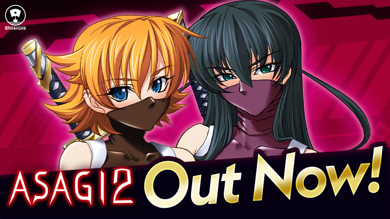

# 对魔忍阿莎姬2 正式上架 Steam：Shiravune 新作首发情报全解析

## 🎯 核心看点速览

- **《对魔忍阿莎姬2》已在 Steam 正式发售**，商店页 AppID 为 4514060，发行方 Shiravune 亲自下场官宣。
- 官方同步放出了发售宣传图，并号召玩家**玩得开心就留下好评**——这类日系视觉小说/galgame 品类，好评率对后续曝光和系列引进影响极大。
- 官宣里还顺手带了一长串 Shiravune 与 Co-FUN Games 的兄弟作品，等于给新玩家递了一份“同厂宇宙”清单。

## 📌 重点深度解析

### 一、这是一次“正统续作级”的上架

《对魔忍阿莎姬》这个 IP 在日系黑暗幻想题材里属于老牌硬货，阿莎姬本人更是系列标志性角色。二代上架 Steam，对老玩家来说是补票和收藏的时机，对新玩家来说则是入坑的第二个节点——但注意，**系列剧情有强连贯性，直接从 2 开始会有理解门槛**。

### 二、Shiravune 的发行矩阵值得关注

官方这次列出的关联作品覆盖面很广，从《Eye of the Incubus》《Princessfall》《Heavenly Island》到《Cicada Communication》《Kudos Kuppa》《Kokuhaku Confessional》《Vivi and the Magical Island》等，基本构成了 Shiravune 近期的发行版图。对喜欢同一美术与叙事调性的玩家，这是一个可以成批加愿望单的信号。

- 官方商店入口：https://store.steampowered.com/app/4514060
- 发行商主页：https://store.steampowered.com/publisher/shiravune/

### 三、好评的重要性

官方在公告中明确请求玩家留好评，这不是客套。Steam 的推荐算法对评价数量和近期好评率极其敏感，尤其对体量不大的日系作品，前期评价几乎决定了它能不能进“热门新品”和推荐位。你的一条好评，实际价值远超一句“支持”。

## 💡 玩家实操与上手建议

**1. 入库与购买**

直接走商店页 https://store.steampowered.com/app/4514060 加购即可。建议先加入愿望单观察是否有首发折扣窗口，日系作品上架首周常有小幅优惠。

**2. 入坑顺序建议**

- 纯新手：先补《对魔忍阿莎姬》初代，再上 2 代，剧情衔接更顺。
- 老玩家：直接入手 2 代补票，顺手把同厂作品加愿望单。
- 收藏党：关注是否有捆绑包（Bundle），同发行商作品打包通常比单买划算。

**3. 安装与配置**

这类 2D 视觉小说对硬件几乎无压力，集成显卡即可跑满。真正需要注意的是：

- **存储路径尽量全英文**，避免部分日系引擎在中文路径下读取资源出错。
- 首次启动后进设置检查**文本速度、跳过已读、窗口/全屏**三项，体验差别很大。
- 若遇到画面比例异常，优先调整分辨率而非改系统缩放。

**4. 内容分级提醒**

该系列题材偏黑暗向，购买前请务必看清商店页的内容描述与年龄分级，确认符合自己的接受范围。

**5. 关注官方渠道**

- X（推特）：https://twitter.com/shiravune
- Discord：https://discord.gg/qBmrqDy
- 官网：https://shiravune.com/

## 📢 官方 Telegram 频道推荐

想第一时间蹲到限免、史低和上架提醒？加入我们的 Telegram 频道 **@steamhunterlink**，秒级推送 Steam 限免喜加一与特惠情报，不用天天刷商店页，福利自己找上门。

## ❓ 常见问题 FAQ

**Q1：《对魔忍阿莎姬2》需要先玩一代吗？**

强烈建议先玩。系列剧情线前后咬得很紧，2 代很多人物关系和设定直接承接初代，跳过会有明显的信息断层。预算有限的话，可以先补初代再等 2 代折扣。

**Q2：现在买划算吗？**

首发期通常是最佳观察窗口。建议先加愿望单，如果首周有折扣就直接入；没有折扣又不急，可以等季节性特卖。日系作品降价节奏一般较慢，别指望短期腰斩。

**Q3：游戏打不开或黑屏怎么办？**

按这个顺序排查：① 安装路径改为纯英文；② 用管理员权限运行；③ 校验游戏文件完整性；④ 更新显卡驱动；⑤ 关闭覆盖层类软件（录屏、加速器悬浮窗）。多数日系引擎的启动问题都出在路径和覆盖层上。
