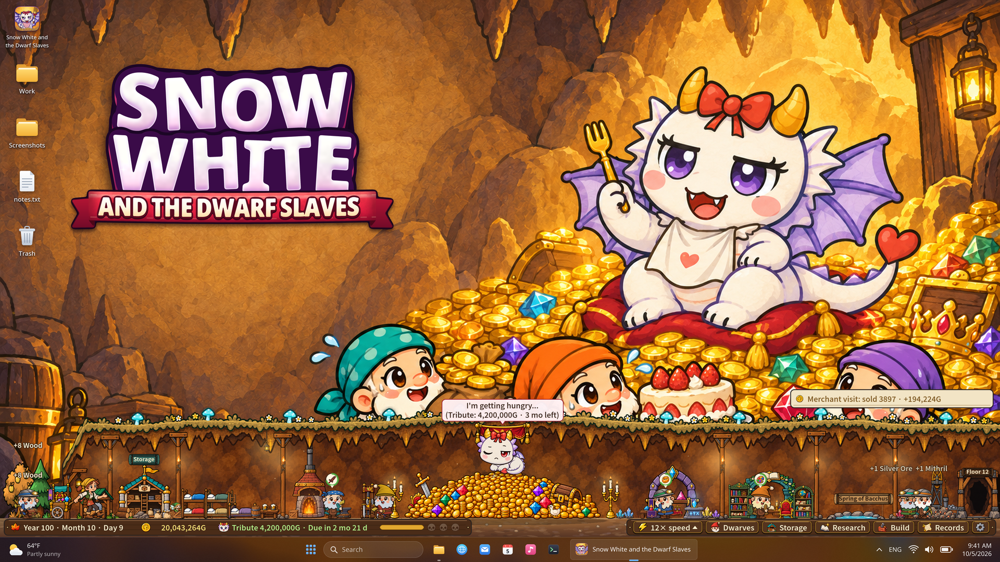
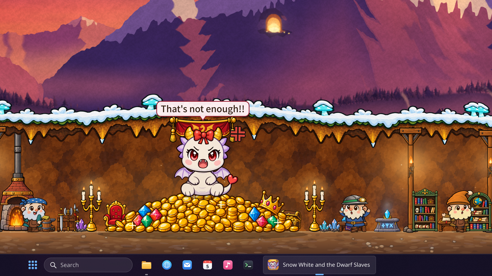
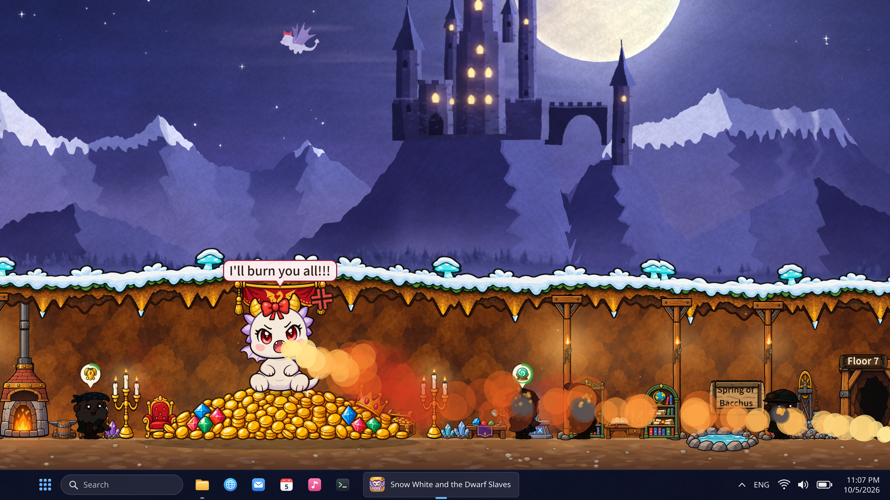

桌面挂机党这周的日程可以加一项了。SUPERLINK 的童话经营小品 **《Snow White and the Dwarf Slaves》** 定档 **11 月 13 日（周五）13:00 KST**，换算成我们的时间是 **北京时间 11 月 13 日中午 12:00**，也就是太平洋时间 11 月 12 日晚 8 点。官方同步放出了首发福利：**上架即 8 折**，原价 US$4.99，折后大概就是一份早餐钱。

*桌面之下的小村庄，统治者是一条名叫白雪公主的龙*

## 🎯 核心看点速览

- **发售时间**：11 月 13 日 12:00（北京时间）／11 月 12 日 20:00（PST），还有两天。
- **首发价格**：**20% off**，原价 US$4.99，本地货币价格直接看商店页，别按汇率脑补。
- **游戏类型**：桌面常驻型挂机经营 + 黑暗童话叙事，挂在屏幕角落自己长 village 的那一类。
- **核心循环**：养矮人 → 造货 → 搞研究 → 攒金色贡品 → 每 10 年上交一次 → 活满 100 年。
- **内容体量**：矮人从 3 人起步、最多 7 人；30 种可制作品、6 个研究领域；11 种结局 + 24 个 Steam 成就。
- **平台与语言**：Windows 与 macOS 双端，游戏内 14 种语言（是否含简体中文以商店页语言栏为准）。

## 📌 重点深度解析

### 白雪公主是条龙，矮人是你的固定资产

这作最大的脑洞在于把经典童话整个掀翻：白雪公主从来不是什么怕苹果的柔弱公主，而是一条货真价实的巨龙。你接手的是一批「幸存下来」的矮人，在桌面底下开个小村，替龙女王种地、打铁、跑商、交税。听着像殖民模拟，玩起来更像**给老板打工的桌面版**——只这位老板会喷火。

*贡品交不够？她会当场告诉你「这远远不够！！」*

### 贡品经济学：每十年一次的金色账单

游戏的骨架是一张**每 10 年递增一次的金色贡品账单**，100 年就是十次结算。30 种制作品、6 条研究线、可扩建的工坊与仓库、外加一辆跑商马车，构成了你全部的还款手段。前期穷得叮当响，后期产线铺开才有喘气余地——说白了就是一款披着童话皮的**供应链管理入门课**，只不过 KPI 没达标不是扣奖金，是村子里少几个人。

*真把她惹毛了，整个村子都能给你点成篝火晚会*

### 100 年 ≈ 5 小时，而且只在你开着游戏时走

官方给的数据很干脆：正常速度下 **100 年大约 5 小时**。一周目通关时长差不多是一部电影马拉松，剩下的重玩价值全压在 **11 种结局**上——事件走向和你的选择会把故事掰到完全不同的岔路，配 24 个成就，够刷一阵子。

**关键机制**：游戏时间只在客户端运行时流动，关掉游戏没有任何补偿性收益。所以别指望像某些挂机游戏那样「睡一觉回来收菜」，这是一款需要你把窗口常驻在任务栏上的游戏。

### 画风治愈，内容劝退：这是黑暗童话

官方特意提醒了一句，我觉得很有必要原样传达：**美术是可爱绘本风，但故事是黑暗童话，矮人是真的会被吃掉、被烧死的**。冲着「萌系桌面宠物」来的朋友，做好心理准备；好这口黑色幽默的朋友，这反而是加分项。

## 💡 玩家实操与上手建议

1. **先加愿望单**：现在点进商店页加愿望单，发售瞬间会推送提醒，首发 8 折这种小体量游戏通常不会提前造势，靠通知抢第一波最稳。
2. **窗口化常驻，别全屏**：这游戏的正确用法是缩到小窗丢在屏幕一角，边写文档边看矮人搬砖。全屏玩反而浪费。
3. **前期别乱铺产线**：第一次贡品结算来得比想象中快，先把最基础的两三条生产链拉满，再考虑开研究树和扩仓库，不然容易在第一个十年就被龙女士当面点名。
4. **接受「Demo 存档不继承」这件事**：试玩版的进度不会带进正式版，正式开局是全新的村子。别在 Demo 里肝太久，不值得。
5. **购买建议**：折后 3.99 美元级别的定价，属于「闭眼入不心疼、踩雷也就一杯饮料钱」的区间。喜欢《Factorio》那套产线思维又想要轻量版的，或者单纯想在桌面养点活物的，直接冲；对挂机玩法零容忍的，建议先看实机再决定。

## 📢 官方 Telegram 频道推荐

限免和特惠这种事，最怕晚一步。建议加入官方 Telegram 频道 **@steamhunterlink**，秒级推送喜加一、限时免费、史低折扣，第一时间就能把该入库的入库、该蹲的价格蹲到，省得事后在群里看到「昨天免费」四个字拍大腿。

## ❓ 常见问题 FAQ

**Q1：11 月 13 日到底是几点能玩上？**
A：官方给的解锁时间是 13:00 KST，对应**北京时间 11 月 13 日中午 12:00**，太平洋时间则是 11 月 12 日晚 8 点。Steam 商店页按钮刷新即可购买。

**Q2：首发 8 折会持续多久？之后会涨价吗？**
A：官方目前只公布了「为庆祝发售打 20% 折扣」，没有给截止日期，也没有涨价计划。按惯例这种发售折扣通常维持一到两周，想省钱就趁早，别等它悄悄回到 4.99 美元。

**Q3：关掉游戏，村庄里的时间还会走吗？Demo 存档能带进正式版吗？**
A：两个都不行。**游戏时间只在客户端运行时流动**，关掉窗口没有任何后台收益；Demo 进度同样**不继承**，正式版会从一座新村庄开始。想要效率最大化，就把小窗挂着别关。

**Q4：支持中文吗？配置要求高不高？**
A：官方标注游戏内支持 **14 种语言**，具体语言清单请以 Steam 商店页的语言支持栏为准。这类 2D 桌面挂机作品对硬件几乎没有压力，老笔记本和核显办公机都能跑，Windows 与 macOS 双端都覆盖。

11 月 13 日，桌面底下见。
