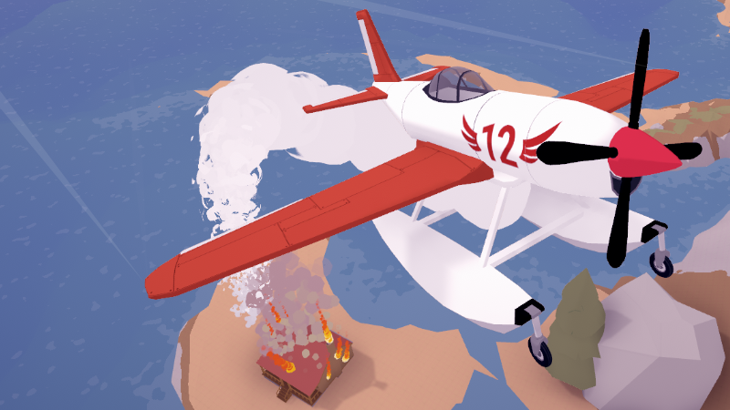
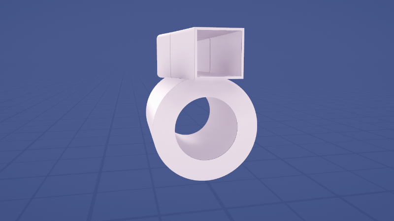

# Aviassembly 正式版上线：灭火、浮筒、硬核模式，一次全给你

各位飞行员老哥，我是你们的主理人。攒了整整 18 个月抢先体验的 Aviassembly，这回终于把「1.0」的牌子挂上墙了。更妙的是，本体同时开 30% 折扣——还没上机的，这波算是把「等打折」和「等正式版」两件事一次性办完了。

这次更新不是那种「修了几个崩溃、加了两个贴图」的敷衍式发版，而是实打实往里塞了四套新东西，外加一批语言支持。下面按老规矩，先速览，再拆解，最后给上手建议。

## 🎯 核心看点速览

- **版本状态**：结束 18 个月抢先体验，正式版（1.0）上线，全部内容解锁。
- **价格动作**：本体 30% 折扣，观望党可以下手了。
- **新增玩法 · 消防灭火**：海上低空取水，飞到着火建筑上空投水，扑灭即得金币。
- **新增部件 · 水上飞机**：两种浮筒，可在水面起降，取水效率大幅提升。
- **新增难度 · 硬模式**：螺旋桨撞地即损且更脆、任务奖励缩水、废料变少、研究点不满。
- **建造升级 · 空心机身**：机身可设为中空，两侧 gizmo 直接调中空程度，减重党狂喜。
- **语言支持**：新增法语、西班牙语、德语、葡萄牙语、荷兰语，设置菜单里切换。

## 📌 重点深度解析

### 一、消防灭火：从「运输大队」转职「空中消防队」

新玩法逻辑非常直白：贴着海面低空掠过，把机舱灌满水，然后飞到地图上那些烧起来的建筑头顶，开仓倾倒。火灭掉，金币到账。听起来简单，实操起来是两件事的叠加——低空掠海考验你的高度控制，空中投水考验你的航线规划。以前你只需要管「别摔」，现在还得管「别烧」。

顺带一提，着火建筑是散布在战役地图各处的，不是固定刷在机场门口。想高效刷金币，就得先摸清地图上的火点分布，规划一条「取水点 → 火点 → 取水点」的闭环航线。飞行模拟老手的优势在这里体现得很明显：同样的飞机，航线顺的人一趟能灭两处，绕圈的人一趟只够看风景。

### 二、水上飞机：浮筒不是越多越好，但少了真的会沉

灭火玩法一上线，浮筒就成了刚需——毕竟从陆地机场装满水再飞过去，效率实在太低。本次加入两种浮筒，装上就能在水面漂浮与起降，取水几乎零距离。

但作者留了一手很硬的物理规则：**超重会沉，落地太猛也会沉**。也就是说，浮筒不是「装上就无敌」的免死金牌，你得按机体重量去配浮筒数量。轻机一两个够用，重载水上飞机得老老实实加浮筒，否则一次重着陆就是「扑通」一声，飞机变潜艇。这条规则我很喜欢——它把一个看起来很福利的部件，变成了需要配平计算的工程问题。

### 三、硬模式：把「摔机成本」正式写进难度设计

抢先体验期间，作者曾加过「螺旋桨触地即损」的设定，结果社区反应两极分化：一派觉得真实带感，一派觉得纯属折磨。这次的解决方案很干脆——把这套机制挪进硬模式，标准难度下不再强制忍受。**硬模式包含三项核心改动：**

1. **螺旋桨撞击地面更容易损坏**，容错率被压得很低，起落架压得稍微狠一点就得回厂；
2. **任务奖励降低**，同样的活儿，进账明显缩水，攒钱节奏被拉长；
3. **废料总量减少**，你没法把整棵科技树点满，必须做取舍——研究什么、放弃什么，是要提前想清楚的。

第三条其实是硬模式最狠的地方。标准模式里你可以「全都想要」，硬模式里你只能「选我所需」。想玩全解锁的，留在标准模式；想体验资源紧绷、每一次研究都像下注的，硬模式欢迎你。作者也明确表示欢迎平衡性反馈，后续数值大概率还会调。

### 四、空心机身：减重党的技术红利

建造模式里一个长期缺失的选项终于补上了——机身可以做成中空的。机身两侧各有一个 gizmo，直接拖动就能设定中空程度。

别小看这一个开关。在气动与重量都参与计算的建造系统里，「减重但不减外形」意味着大量新构型成为可能：以前因为超重被迫砍掉的油箱、货舱、灭火水箱，现在可以靠掏空机身换回来。对于喜欢在机库里折腾三小时的玩家，这一项的价值可能比灭火玩法还高。

### 五、多语言支持

正式版新增法语、西班牙语、德语、葡萄牙语、荷兰语五种语言，在设置菜单里选择即可。作者也公开征集语言显示方面的反馈，后续可能继续扩充语种。对中文玩家来说，这次没有新增中文支持，界面依旧需要一点英文基础；不过建造类游戏的关键术语不算多，摸两把基本就熟了。

## 💡 玩家实操与上手建议

**1. 灭火任务的正确起手式**

别急着装大水箱。先拿一架轻型机，装最小容量水箱，在最近的取水点反复练「贴海取水 → 拉升 → 投水」的循环，把高度感和投水时机练顺，再考虑换大飞机。灭火收益跟「一趟灭几处」直接挂钩，航线效率比载水量更重要。

**2. 浮筒配置别抠门**

按「机体总重 ÷ 单个浮筒承载力」估算后再加一档冗余。降落时把下沉率压住，宁可拉长进场距离也别硬砸水面——省下来的那点进场时间，不够你修一次沉机的。

**3. 硬模式开局思路**

废料有限，优先点「性价比最高的载具部件」和「提升任务收益」的科技，别一上来就冲冷门分支。前期接低风险运输任务攒本金，等机体成型再碰灭火这类高风险高回报的活儿。

**4. 空心机身的调法**

先在机库里做对照实验：同一构型分别用实心与 50% 中空版本各飞一圈，看重量曲线与操控手感的变化，再决定掏空多少。掏太空会牺牲结构强度，撞一下就知道疼。

**5. 折扣与购买建议**

本体 30% 折扣期间，新玩家直接上本体即可，本作目前没有必须捆绑的关键 DLC。已在抢先体验期入手的老玩家，正式版内容为免费升级，不需要再买一遍。

## 📢 官方 Telegram 频道推荐

限免和特惠这种东西，向来是「手快有、手慢无」。想第一时间拿到秒级推送的喜加一、限时免费周末与史低背刺信息，建议加入官方 Telegram 频道 **@steamhunterlink**。入库提醒、折扣倒计时、临时工价错误，基本都能在第一时间收到，省得刷商店页刷到手指发酸。

## ❓ 常见问题 FAQ

**Q1：抢先体验期的存档，正式版能继续用吗？**

本次发布公告没有提到存档重置，按现有信息判断，原有进度正常延续。稳妥起见，首次启动正式版前手动备份一次存档目录，尤其是已经点满科技树的老档。

**Q2：30% 折扣什么时候结束？**

公告只说明「发布期开启 30% 折扣」，未给出具体截止时间，实际以 Steam 商店页的倒计时为准。想卡的建议别拖到最后一天。

**Q3：硬模式可以中途切换吗？标准档能直接转吗？**

公告没有明确说明切换规则。保守做法是新开一档专门跑硬模式，别拿已经成型的主力档去试水——废料总量减少、研究点不满这两条一旦生效，旧档的build很可能直接失效。

**Q4：水面降落总是沉机，问题出在哪？**

九成是浮筒数量不足或下沉率过高。先按机体重量补浮筒，再把进场速度与下降率压下来，别用陆地机场那套「短跑道硬着陆」的习惯对待水面。
