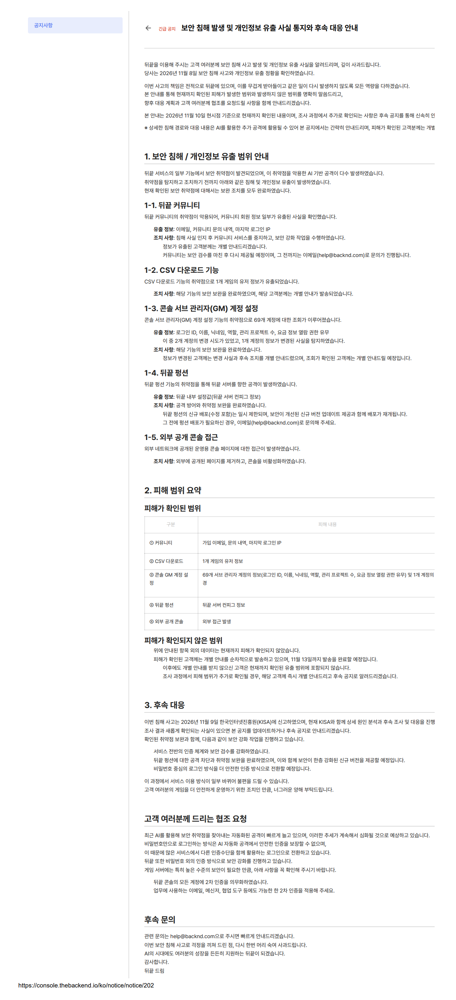

# TBH 数据泄露事件：先别慌，但这些事必须做

各位老哥，今天不聊喜加一，也不聊史低。这条得正经看：TBH 开发组发布安全通告，确认第三方游戏服务器服务商的管理工具存在漏洞，部分玩家账号信息被未授权第三方下载。

## 🎯 核心看点速览

- **事件窗口**：2026 年 10 月 17 日 — 11 月 8 日，第三方利用外部游戏服务器服务管理工具的漏洞，下载了玩家信息。
- **确认时间**：2026 年 11 月 9 日（KST）接到服务商通知并完成确认；漏洞已修复，第三方访问已阻断。
- **影响范围**：2026 年 11 月 9 日 15:59 KST 之前玩过《TBH: 塔斯克巴·英雄》的账号。
- **泄露字段**：SteamID64、游戏服务器账号 UUID 与注册时间、最后登录时间与 IP、设备信息（主板型号/电脑名）、操作系统类型与版本、账号状态（是否被限制或删除）。
- **关键结论**：这些信息**不能**登录 Steam、**不能**支付、**不能**访问或篡改其他玩家数据；但可能被用于冒充官方的诈骗。
- **官方动作**：修复漏洞、收紧服务器数据与管理员权限、复查开发者账号安全，服务商已向韩国 PIPC 与 KISA 上报并配合调查。

## 📌 重点深度解析

### 泄露清单：哪些信息真要紧？

| 字段 | 风险等级 | 说明 |
| --- | --- | --- |
| SteamID64 | 中 | 个人资料页公开可见，可被用来精准定位与冒充好友 |
| 服务器账号 UUID、注册时间 | 低 | 主要用于区分账号，单独无法登录 |
| 最后登录时间与 IP | 中高 | 可推测大致地区与活跃时段，是社工话术的“素材” |
| 主板型号/电脑名 | 中 | 设备指纹，可增强钓鱼信息的可信度 |
| 操作系统类型与版本 | 低 | 可用于筛选攻击目标（如老旧系统） |
| 账号状态 | 低 | 限制/删除状态，影响较小 |

### 为什么“不能登录”也必须当回事？

官方明确说明，这批信息不含 Steam 凭据、令牌、支付信息，单靠它登不进 Steam，也动不了钱包。真正的风险在**社工与钓鱼**：骗子拿着你的 SteamID、最后登录时间和设备信息，冒充“TBH 官方客服”，话术会显得非常真——“我们检测到你的账号在 X 月 X 日从 XX 地区异常登录，请点击链接验证”。一旦你点了钓鱼站、输了令牌验证码，账号才真的危险。

****

### 官方处置时间线

1. 10 月 17 日 — 11 月 8 日：第三方利用服务商管理工具漏洞下载信息。
2. 11 月 9 日（KST）：服务商通知开发组，事件确认。
3. 漏洞修复、第三方访问阻断；服务商全面复查并加强游戏服务器管理权限与安全设置。
4. 开发组同步复查服务器数据访问权限、管理员权限与所有可访问服务器的开发者账号安全。
5. 服务商向韩国个人信息保护委员会（PIPC）与韩国互联网振兴院（KISA）上报，配合调查。
6. 截至通告发布，未收到泄露信息被滥用的确认报告。

## 💡 玩家实操与上手建议

**第一步：确认自己在不在影响范围**
2026 年 11 月 9 日 15:59 KST 前玩过 TBH 的，都算。没玩过的可以放心吃瓜。

**第二步：Steam 侧加固（十分钟搞定）**
- 开启 Steam 令牌（手机 App），别用邮箱验证凑合。
- 检查“登录设备”与“授权设备”，踢掉不认识的。
- 检查 API 密钥页面，有不明 Key 直接撤销。
- 家庭共享只留信得过的人。
- 密码有复用习惯的，顺手把 Steam 密码和邮箱密码换掉——不是因为这次泄露了密码，而是趁这个机会把老账清了。

**第三步：防冒充三原则**
- **官方不会先加你好友**。TBH 团队明确表示不会通过 Steam 好友请求或私信主动联系玩家。
- **不点陌生链接、不给验证码**。任何人要你 Steam 令牌码，都是骗子。
- **核对信息来源**。只认 Steam 商店页公告、官方社区与官方认证渠道。

**第四步：收到可疑联系怎么办**
截图留证 → Steam 举报该用户 → 拉黑 → 必要时在 Steam 客服页面报备。别跟骗子辩论，浪费时间。

**第五步：别被“二次诈骗”收割**
常见套路还有“付费找回账号”“内部解封”“补偿礼包领取”。TBH 这类通告事件后，钓鱼站会集中上线，搜索引擎广告位也可能被买。认准官方域名，别从陌生短链进。

## 📢 官方 Telegram 频道推荐

想第一时间拿到秒级限免、临时工价、史低推送和账号安全提醒，建议加入官方 Telegram 频道 **@steamhunterlink**。这类安全通告往往先在社区扩散，频道推送能让你少走弯路，避免被假消息带节奏。

## ❓ 常见问题 FAQ

**Q1：我的 Steam 账号会被盗吗？**
A：单凭这次泄露的信息不能登录 Steam，也不能支付。风险在于后续钓鱼。开启令牌、不点陌生链接、不给验证码，基本就稳。

**Q2：我需要改 Steam 密码吗？**
A：泄露内容不包含密码。但如果你在多个平台复用同一个密码，建议改掉，顺手开启令牌，成本很低。

**Q3：官方会通过 Steam 好友申请联系我吗？**
A：不会。TBH 团队明确表示不会主动通过 Steam 好友请求或私信联系玩家。遇到自称官方的，一律按骗子处理并举报。

**Q4：这事会影响我在其他 Steam 游戏里的数据吗？**
A：通告说明该信息无法访问或篡改其他玩家游戏数据，也不涉及 Steam 账号本身。其他游戏不受直接影响。
