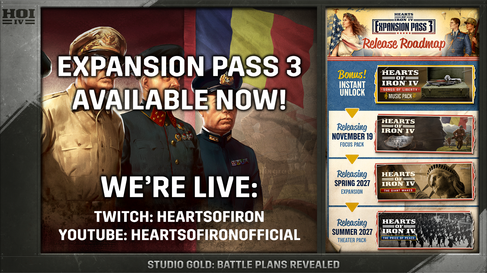

将军们，集合了。

今天这波情报量不小：**Expansion Pass 3（第三张扩展通行证）已经正式上架 Steam**，同时官方的大型直播活动 **Studio GOLD: Battleplans Revealed** 正在 Twitch 与 YouTube 双线开播。新内容不光开卖了，还附赠一场现场揭晓——这种「边卖边讲」的节奏，P 社确实很熟练。

## 🎯 核心看点速览

- **Expansion Pass 3 已上架**：商店页 AppID `4758580`，游戏本体 AppID `394360`，包含内容与定价以商店页展示为准。
- **直播正在进行**：Studio GOLD: Battleplans Revealed 在官方 Twitch 与 YouTube 同步开播，节目单信息量很足。
- **1.19.4 体验优化补丁**：官方定义为 Quality of Life 更新，属于体验优化方向，具体条目以补丁日志为准。
- **罗马尼亚国策包**：巴尔干半岛的这位关键角色，终于被单独拿出来做重点内容。
- **下一弹国家包**：美国、加拿大以及更多国家被明确点名。
- **下一个战区包（Theater Pack）**：官方把它列进了后续路线图。
- **现场 Q&A**：节目最后安排现场问答，对机制有疑问的可以直接去提问。

## 📌 重点深度解析

### 1）Expansion Pass 3：先买通行证，再等内容陆续开放

按 P 社一贯的运营方式，扩展通行证是把后续若干个内容包（国家包、战区包、单位或音乐类内容等）一次性打包，分批解锁。本次官方公告只确认了「已上架」，没有在公告里逐项列出全部内容清单。

因此下单前请务必打开商店页，逐项查看「包含项目」：**通行证只覆盖它列明的内容，不包含此前已经发售的旧 DLC**；Steam 通常会自动剔除你库里已经拥有的条目，实际结算价以下单页面为准。

### 2）1.19.4 补丁：体验优化，但别指望它只修几个拼写错误

官方直播把它排在议题第一位。按以往节奏，QoL 补丁一般涉及界面交互、AI 行为、性能与一批历史遗留 Bug 的修复。这类改动对老玩家的日常体验提升往往比新内容更实在——尤其是后期卡顿、部队堆叠、前线补给这类长期痛点。具体数值和条目请以官方补丁说明为准，联机前建议先单机跑一局验证。

### 3）罗马尼亚国策包：油田、山地与四周的列强

罗马尼亚在二战剧本里的处境一向微妙：普洛耶什蒂油田是德国战争机器的关键供给地，北面是苏联，西边是匈牙利，南边是保加利亚，国内还有政治派系拉扯。按 P 社的设计思路，这个国策包大概率会围绕**外交站队、油田保卫与巴尔干区域霸权**展开分支选择。想玩小国逆袭、靠外交翻盘的玩家，这大概率是本轮最值得关注的一块。

### 4）美国与加拿大国家包：北美工业体系与英联邦纽带

官方明确提到下一个国家包将涵盖美国、加拿大及更多国家。美国的看点历来集中在**大萧条后的工业转军工、国会与孤立主义的拉扯、租借法案与两洋战略**；加拿大则围绕自治领地位、对英联邦的义务与大西洋护航展开。具体内容以官方后续开发日志为准，这里先记在期待清单上。

### 5）战区包（Theater Pack）：官方路线图上的新形态内容

公告把 Theater Pack 单独列为后续内容。这个命名与此前的国家包、单位包不同，具体形态官方尚未在本次片段中展开，等直播与开发日志放出细节后再做判断更稳妥。

## 💡 玩家实操与上手建议

**买不买？三步判断：**
1. 打开 Expansion Pass 3 商店页，看「包含项目」里有没有你真正想玩的内容（罗马尼亚、美加，以及后续战区包）。
2. 只玩本体、对国策包兴趣一般的玩家，完全不需要跟。HOI4 的 DLC 是可选增强，本体机制照样能玩。
3. 注重性价比的玩家可以继续等打包折扣，但首发通行证通常没有额外优惠，能否等来取决于你的耐心。

**入库与启用：**
- 在商店页完成购买后，DLC 会自动进入库中，Steam 无需单独下载。
- 打开游戏启动器，在 DLC 管理页确认新内容已勾选启用；没生效就重启启动器，或在 Steam 库中右键游戏 → 属性 → DLC 检查是否勾选。
- 内容未解锁时，先在 Steam 客户端校验一次游戏文件。

**联机避坑清单：**
- 全员版本必须一致，本次即 1.19.4，版本不一致会导致无法加入或中途报错。
- 模组用同一合集与同一加载顺序，房主订阅的模组清单最好截图发群里对照。
- 联机时可用内容以房主为准，开黑前先确认房主持有哪些 DLC。
- 大版本更新后旧存档可能不兼容，开新档前先备份 `Documents/Paradox Interactive/Hearts of Iron IV/save games` 目录；需要回滚可在 Steam 属性 → 测试版里选择旧版本分支。

**配置优化：**
- 降低 3D 单位模型与特效质量、开启 UI 缩放，老机器也能稳住帧率。
- 后期卡顿主要来自部队数量与 AI 计算，减少无意义的小国部队扩充会明显改善体验。

**官方直播入口：** Twitch 搜 heartsofiron，或 YouTube 频道 @HeartsOfIronOfficial 的直播页。错过直播的，回放同样能看，重点议题顺序依次是 1.19.4 补丁、Expansion Pass 3、罗马尼亚国策包、美加国家包、战区包，最后是现场问答。

## 📢 官方 Telegram 频道推荐

想第一时间拿到秒级限免、临时闪促与喜加一情报，建议加入 Telegram 频道 **@steamhunterlink**。P 社的通行证分批解锁周期较长，中间还常有折扣与免费周末，靠人盯着商店页并不现实，让频道推送帮你紧盯更省心。

## ❓ 常见问题 FAQ

**Q1：买了 Expansion Pass 3，是不是等于把所有 DLC 都拿到手了？**
不是。通行证只覆盖它列明的后续内容，不包含此前已经发售的旧 DLC。已拥有的条目 Steam 一般会自动剔除，最终以商店页「包含项目」和结算页为准。

**Q2：只有本体、没买任何 DLC，这次更新会影响我玩吗？**
会有影响。1.19.4 属于本体层面的体验优化补丁，所有玩家都会收到；新增国策内容才需要通行证或对应 DLC 解锁。联机时可用内容以房主持有的 DLC 为准，开黑前先对一下版本和内容清单。

**Q3：更新到 1.19.4 之后旧存档和模组还能用吗？**
不一定。大版本更新后模组常见失效或加载报错，先备份存档，再逐个排查模组更新情况；如果必须保留旧档，可在 Steam 测试版分支回滚到更新前的版本，等模组作者跟进后再切回。

**Q4：直播错过了，还有什么值得补看的？**
最值得回看的是 1.19.4 补丁与罗马尼亚国策包两段，前者影响你每天的游戏手感，后者决定这一轮新内容值不值票价；末尾的现场问答则常有机制层面的细节补充。
