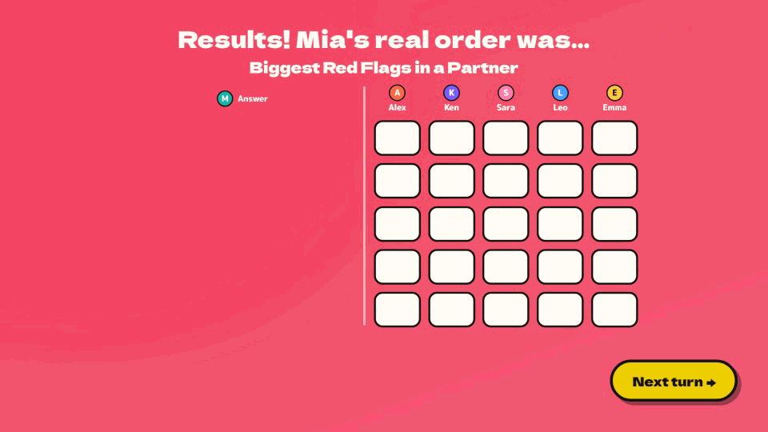
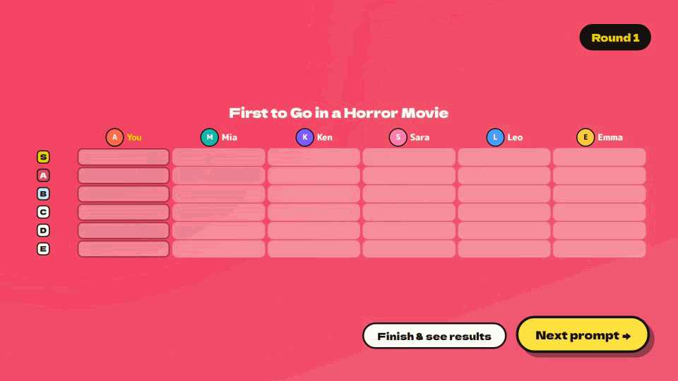

# 《EVERYONE'S TIER LIST!》首发特惠15%：2到10人猜朋友排名的派对游戏上线

Steam 上又迎来一款看名字就知道要“互相伤害”的派对游戏——**《EVERYONE'S TIER LIST!》**（AppID: 4921660）现已正式发售，首发限时 **15% off**。如果你正愁联机游戏荒，或者想找一款能让开黑语音瞬间炸锅的小体量作品，这次首发折扣值得看一眼。

## 🎯 核心看点速览

- **首发折扣**：正式上架，限时 **15% off**，愿望单玩家可以直接出手。
- **人数与联机**：支持 **2–10 人**在线游玩，仅限联机，**没有单人模式、没有随机匹配**。
- **加入方式**：靠 Steam 好友邀请或房间 ID（Room ID）进房。
- **语言支持**：英语、日语、简体中文。
- **内容体量**：500+ 条英文题目，其中 314 条是面向日本以外玩家设计的题单与词库。
- **创作生态**：支持自建题目与词表，发布到 **Steam 创意工坊**，同一房间里的人也能各自带题进场。

## 📌 重点深度解析

### 玩法一：猜朋友的脑回路

核心循环非常直白：每轮会有一个玩家当“明星”，系统给他一个题目和五个词条，他偷偷把这些词从 **S 到 D** 排进分级表。其他人只能看到打乱顺序的五个词，任务就是猜出“明星”到底把每个词放在了哪一档。

全中五个就是 **Perfect**；如果猜得离谱，那基本就要在语音里讨个说法了。所有人轮流当一次明星后，本局收尾会颁发“神探”“最神秘”之类的称号，还会评出化学反应最强的一对玩家。

### 玩法二：两种模式，两种快乐

- **Guess the Order（轮流猜）**：每轮换一个明星，适合多人轮着玩，人人都得被扒一次。
- **锁定一人模式**：固定一位玩家当被猜对象，看看谁最懂他。
- **All in Sync（合作模式）**：所有人偷偷给“在场玩家”做分级，题目类似“死亡游戏里谁先出局”，要求每一档完全一致才算过关。

### 题目与创意工坊

官方自带 500+ 英文题目，其中包含“伴侣最大的红旗”“最糟糕的求婚地点”这类天然带话题度的题单。更关键的是支持自定义题目和词表并上传 **Steam 创意工坊**，房间内每位玩家都能把自己的题带进同一局，长期开黑不容易腻。

### 主播模式

主播可以另开一个窗口做分级表，确保不会出现在直播画面里；分享 **Room ID** 后，观众不用加好友也能进房参与。

### 试玩数据

官方给出的免费试玩版从 9 月 26 日开放到 10 月底，共有 **55,163** 名玩家参与，反馈已直接进入正式版。

## 💡 玩家实操与上手建议

**购买建议**

- 这是一款典型的“有人才好玩”的游戏：单人无法开局，也没有路人匹配。**先确认能不能凑到 2 人以上**，再考虑入手。
- 首发 15% off 属于常见的上架促销档位，想尝鲜可以现在买；如果只打算自己玩、没人开黑，建议先放愿望单观望。

**开黑准备**

1. 提前把好友拉进语音（Discord、KOOK、YY 都行），这游戏的乐趣一半在猜中，一半在“你为什么这么排”。
2. 由一人建房，通过 **Steam 好友邀请**或复制 **Room ID** 拉人，最多 10 人。
3. 第一次玩建议先用官方题目跑一轮熟悉节奏，再切创意工坊题单。
4. 想整活就开 **All in Sync**，全员给在场玩家做分级，笑点最密集。

**主播开播**

- 务必开启 **Streamer mode**，把分级窗口放到直播画面之外，否则答案直接剧透。
- 把 Room ID 打在公屏，观众无需加好友即可入局，适合做互动环节。

**避坑提醒**

- 游戏**仅支持在线联机**，没有单机内容。
- 官方题目以英文为主，虽然支持简体中文界面，但题面语言和词条本地化程度建议入手前看一眼商店页说明。

## 📢 官方 Telegram 频道推荐

想第一时间拿到这类小体量新作的首发折扣、限时喜加一和秒杀特惠，建议加入官方 Telegram 频道 **@steamhunterlink**，推送速度比刷商店页快得多，错过促销的概率也低很多。

## ❓ 常见问题 FAQ

**Q1：首发 15% off 持续多久？现在买划算吗？**

A：官方标注为“限时首发折扣”，具体截止时间以 Steam 商店页倒计时为准。按惯例首发档通常覆盖上架后的一到两周，想尝鲜建议在倒计时结束前下手。

**Q2：可以单人玩或者随机匹配路人吗？**

A：不行。游戏为 **2–10 人在线联机**，没有单人模式，也不提供匹配系统，只能通过 Steam 好友邀请或 **Room ID** 进房，买之前务必确认有一起玩的人。

**Q3：自定义题目怎么分享？支持中文题目吗？**

A：在游戏内写好题目和词表后可发布到 **Steam 创意工坊**，其他玩家能直接订阅使用，同一房间的每个人也可以各自带题进场。题面文本由玩家自行输入，中文题目理论上可以自建自玩，官方内置题库以英文为主。
