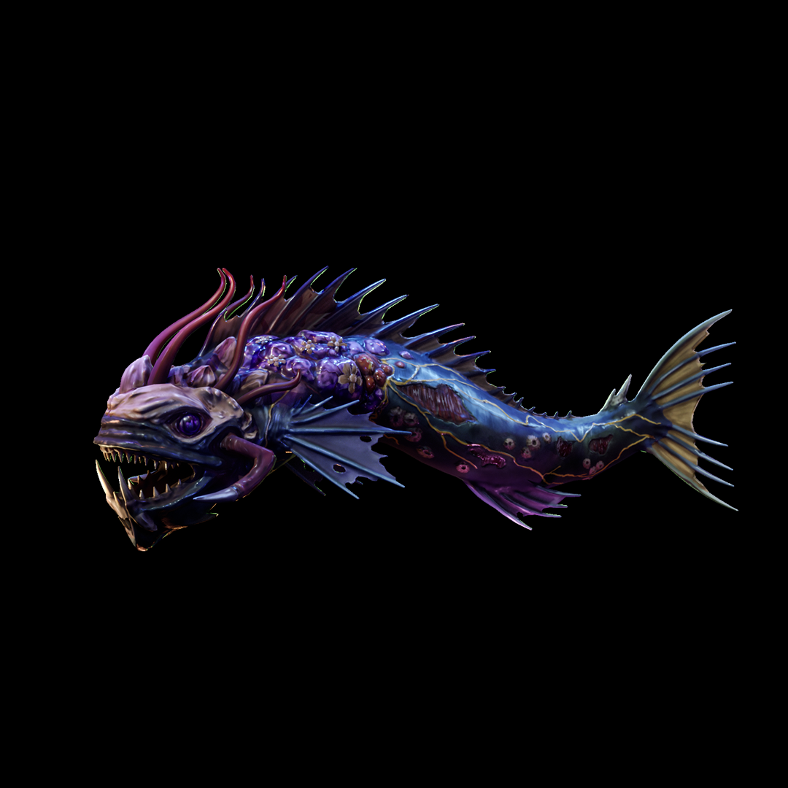

# DREADMOOR 抢先体验第4更：任务修复、手柄优化与钓鱼机制改动

钓客们，淹没之地的第四次抢先体验更新已经推送。这次制作组把力气花在了玩家反馈最密集的几个地方：任务推进卡点、钓鱼手感、手柄兼容与一堆细碎的交互问题。下面我按可执行的方式，把这份改动清单拆开讲清楚，顺便给出上手建议。

## 🎯 核心看点速览

- **任务链不再无故卡死**：Precious Junk 的水中宝箱打捞判定修复；Hymn to Deformity 任务描述新增食尸鬼残肢计数器；Find Resonance 在音叉顶部提前安装的情况下会自动完成对应步骤。
- **钓鱼系统有实质变化**：鱼线启用碰撞，新增 Sawfin 钓点，钩枪配件 Geared Hook Grip 的显示名称得到修正。
- **手柄体验集中修补**：暂停后斧头格挡卡死、开船摇杆死区、DualSense 直连与 Steam Input 切换、多手柄同时连接等问题一并处理。
- **交互与 QTE 更干净**：启动发电机、操作水泵新增退出动作，净化系统加压的 QTE 逻辑同步更新，维修引擎时手持物不再穿模乱入画面。
- **教程、音画与碰撞细节**：燃料站首次拾枪提示消失、初始钩枪手柄提示错误、初始钓鱼教程文字重叠、起始区域码头木桩碰撞、Dry Dock 环境音与可破坏物撞击音等均已修正。

## 📌 重点深度解析

### 任务线：三个真实存在的“推进障碍”被拆掉

这次更新的含金量主要在任务侧。Precious Junk 的宝箱打捞此前存在判定异常，鱼咬钩、收线、出水三个环节任何一环出问题都会让任务停摆，现在这条链路被重新梳理。Hymn to Deformity 则是信息透明度问题：任务描述里加了食尸鬼残肢计数，你不用再翻背包一件件数碎片，缺几个一眼可见。Find Resonance 修的是顺序容错，如果你在任务推进到对应步骤之前就把音叉顶部装好了，现在会自动判定完成，不会出现“做了但没记录”的尴尬。

同时，交易系统异常、停靠组件逻辑、睡觉后玩家出生位置、宝箱掉落内容，以及罗盘上任务标记的显示距离都做了调整。罗盘标记看得更远，对淹没之地这种视野受限的地图来说，实际探图效率提升明显。

### 钓鱼与装备：鱼线终于有碰撞了

鱼线启用碰撞是手感层面的关键改动。此前鱼线可以无视地形穿过去，视觉和物理反馈脱节；现在鱼线会被环境阻挡，抛竿位置和收线角度需要更讲究，钓大鱼时的空间感也更真实。配合新增的 Sawfin 钓点，中期刷材料的路线可以重新规划。

Sawfin 的设定是变异把背鳍变成了真正的锯片。它不再带毒，但那条锯状背鳍本身就是重武器，加上拉长的牙齿和覆满骨质增生的头部，使它成为一个从过度骨化中获益的危险掠食者。长长的触须帮助它在水中导航，连最轻微的震动都能捕捉。它的颌部与毒液被认为是最有价值的资源。

装备侧还有几处直接影响操作的修复：加油时快捷栏槽位异常、维修引擎时手持物仍然显示、鱼钩动画消失、Hook Gun 的 Geared Hook Grip 名称显示错误。都是小问题，但每一条都会在长时间游玩里反复打断节奏。

### 手柄与 QTE：这次是真正照顾手柄玩家

手柄相关的修复清单相当具体：暂停游戏后斧头格挡卡住、驾驶船只时的摇杆死区、DualSense 在直连与 Steam Input 之间切换的兼容问题、同时连接多个手柄的支持。启动发电机与操作水泵增加了退出动作，不用再担心误触后被困在交互界面里。净化系统加压与发电机启动的 QTE 逻辑也做了更新，判定窗口的体验会更稳定。

### 教程、环境与音画

燃料站第一次捡枪后“如何收起枪”的提示可能消失、初始钩枪教程里的手柄按键说明错误、初始钓鱼教程文字重叠，这三条对新手前半小时的体验影响其实很大。环境侧修复了起始区域码头木桩的碰撞，补上了 Angler 的贴图，并调整了环境音淡入淡出、可破坏物撞击音与 Dry Dock 内部的环境声。

## 💡 玩家实操与上手建议

1. **先验证任务状态再决定是否回档**。如果你此前卡在 Precious Junk 打捞或 Find Resonance 音叉判定，更新后先读最近一次存档进游戏看任务是否继续推进；仍卡住再考虑回退到任务开始前的存档，不要盲目重开新档。
2. **钓鱼路线重排**。鱼线有碰撞之后，原先贴着礁石、沉船边缘抛竿的位置可能不再适用，建议先在开阔水域试抛确认手感，再去新 Sawfin 钓点刷资源。
3. **手柄玩家更新后重设一次输入**。DualSense 用户建议明确选择“直连”或“Steam Input”其中一种，不要在游戏运行中来回切换；多手柄同接的玩家进游戏前先确认只保留要用的那一只处于唤醒状态。
4. **开荒阶段优先跑主线任务节点**。任务标记显示距离拉远后，罗盘信息更密，建议先把主线节点点亮再回头清支线，减少在淹没之地里无谓绕路。
5. **养成手动备份存档的习惯**。抢先体验阶段每次更新都可能影响任务标记与掉落，重要进度前复制一份存档目录，成本极低。
6. **遇到问题按复现路径反馈**。制作组仍在持续排查已上报问题，附带复现步骤、存档时间点与手柄型号的报告，处理效率会高很多。

## 📢 官方 Telegram 频道推荐

抢先体验阶段的更新推送、临时热修与限时福利往往来得又快又散。建议加入官方 Telegram 频道 **@steamhunterlink**，秒级接收限免喜加一、史低特惠与版本更新提醒，不用自己天天刷商店页面。

## ❓ 常见问题 FAQ

**Q1：这次更新会破坏我现有的存档吗？**
A：更新本身不重置存档，但任务判定逻辑有改动。此前卡住的任务有可能在读取存档后继续推进，也可能需要回退到任务早期节点。建议先备份存档目录，再进游戏验证。

**Q2：Sawfin 新钓点在哪里，需要什么装备？**
A：本次更新为 Sawfin 增加了新的钓点，属于中后期资源鱼。它的颌部与毒液是主要产出。鱼线现在有碰撞，建议在开阔水域先适应抛竿角度，并确认鱼线强度足以应对它的拉锯。

**Q3：手柄还是识别不到，或者 DualSense 功能异常怎么办？**
A：先在 Steam 输入设置里固定一种连接方式（直连或 Steam Input），不要运行中切换；确认没有多余的虚拟手柄驱动或其他手柄同时唤醒。更新已修复多手柄连接与 DualSense 切换问题，若仍异常，附带手柄型号与连接方式提交反馈。
