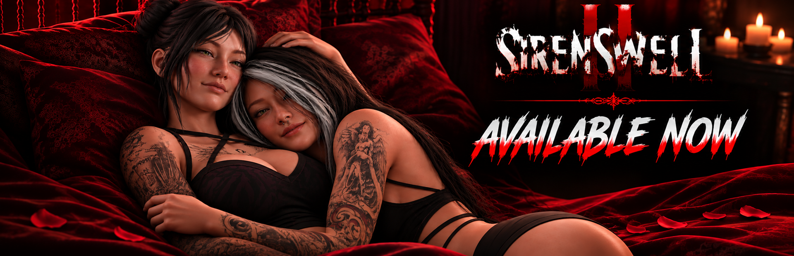

## 🎯 核心看点速览

- **发售状态**：官方宣布《Siren's Well 2》已在 Steam 正式上架，结束数月开发与打磨，属于正式发售而非抢先体验。
- **双主角叙事**：Naomi Chen 与 Ellie Chen 双线视角，噩梦从两个人的眼睛里看。
- **全新敌人登场**：本作反派换血为 **THE CROWLEYS**，带秘密、带恶意、带追着你跑的压迫感。
- **7 种结局**：路线与选择决定收尾，多周目体验是设计上明摆着的。
- **可解锁服装**：收集要素给重玩加了点甜头，也给截图党留了活路。
- **经典生存恐怖骨架**：资源管理、解谜、谨慎探索、正面遭遇，一个都不少。

## 📌 重点深度解析

### 🩸 一、续作接着上一部的噩梦往下走

官方这次的表述很直接："The nightmare continues."。Siren's Well 这个地名本身就是系列的核心谜团载体，本作的任务线就是让 Naomi 和 Ellie 去挖开水井周边的黑历史。对老玩家来说这是剧情延伸，对新玩家来说官方也明确表示欢迎"第一次接触这个系列"的人入场，所以不必因为没玩过前作就直接劝退自己。

### 👁️ 二、敌人从"环境"变成"有脸的威胁"

前作式的恐怖更多靠氛围和未知，这次官方把 **Crowleys** 单独拎出来当作卖点宣传——"a new threat with dark secrets and terrifying intentions"。这句话翻译成玩家语言就是：这不再是单纯的怪物，而是有意图、有秘密、会主动推进压迫感的对手。生存恐怖游戏里，敌人一旦具备"意图"，追逐段落、躲藏节奏和资源消耗的计算方式都会跟着变，这是本作最值得盯住的机制改动方向。

### 🎭 三、7 种结局 + 服装解锁 = 明牌的重玩价值

7 个结局意味着单周目绝对吃不全内容，路线分歧、关键选择、可能的收集完成度都会影响最终收束。再叠一层可解锁服装，就是典型的"多周目养成"结构：第一周目紧张兮兮地活下来，第二周目开始有底气去试别的分支。**建议第一周目别看攻略**，恐怖游戏的首次体验是消耗品，用完就没了。

### 🔦 四、老派生存恐怖的骨架没丢

官方列出的要素非常"复古"：管理资源、解谜、小心探索、面对危险遭遇。这套组合的关键在于**资源稀缺度**与**遭遇频率**的平衡——前者决定你要不要绕路，后者决定你敢不敢绕路。从宣传定位看，本作走的是"心理压迫 + 有限火力"的路子，不是那种一路突突的爽游。心理准备先做好。

## 💡 玩家实操与上手建议

**1）入库与购买**

直接在 Steam 商店搜索 **Siren's Well 2**（AppID：3999510）进入商店页，加入愿望单或直接购买入库。**价格、是否支持简体中文、配置要求请以商店页当日标注为准**，这几项会随地区和促销活动变动，别信截图，信页面。

**2）上手节奏建议**

- 前期别急着推主线，先把可探索区域的补给摸一遍，生存恐怖游戏的"穷"是设计出来的，不是你的问题。
- 遇到 Crowleys 相关的追逐段落，**优先记路线而不是记打法**。这类敌人的设计目的就是让你跑，不是让你打。
- 道具栏留一个空位给"临时捡到的东西"，别把自己卡在满包状态。

**3）多结局收集路线**

一周目随缘，二周目开始做分支记录：每个影响结局的选择点，建议自己在备忘录里记一句"这里选了什么"。7 个结局如果全靠记忆硬跑，三四轮之后必乱。

**4）画面与性能**

恐怖游戏吃的是氛围，不是帧数天花板。优先保证**稳定帧率**而不是拉满画质，掉帧带来的操作迟滞在这类游戏里比糊一点画面致命得多。进游戏先把垂直同步和动态模糊按自己习惯调好，再开始正式流程。

**5）联机/直播提醒**

本作为单人心理恐怖体验，官宣内容中未涉及多人合作模式，别指望拉朋友一起壮胆。想直播的话注意音量平衡，这游戏大概率靠声音吓人。

**6）玩得开心就留个评价**

官方在公告里明确提到希望玩家在 Steam 留下评测——对 OneManOnly Studios 这种体量的团队来说，评测数直接影响曝光，属于花 10 秒帮人一把的事。

## 📢 官方 Telegram 频道推荐

想第一时间接到这类"新作突然上架""限时免费""史低背刺"的消息，建议加入官方 Telegram 频道 **@steamhunterlink**。秒级推送，不用天天刷商店页，也不容易错过 24 小时窗口的喜加一。

## ❓ 常见问题 FAQ

**Q1：《Siren's Well 2》现在是正式版还是抢先体验？**

A：官方公告的措辞是 "officially AVAILABLE NOW"，并强调经历了数月开发与改进，属于正式发售版本，可以直接完整体验，不存在"等等再买"的观望理由。具体版本状态以 Steam 商店页标识为准。

**Q2：没玩过《Siren's Well》初代，直接玩 2 会看不懂吗？**

A：官方公告明确欢迎新玩家入场，说明本作在叙事上做了对新人友好的处理。但如果想完全吃透 Siren's Well 这个世界观和人物关系，先补初代体验会更完整。预算有限的话，直接上 2 也不会卡在"看不懂"这层。

**Q3：7 个结局需要打 7 周目吗？**

A：不一定。多结局通常由关键选择、路线分支和收集完成度共同决定，同一周目内不同存档点可以覆盖不同分支。实操上建议保留关键节点的手动存档，能显著减少重复流程。

**Q4：这游戏吓人吗，适不适合胆子小的？**

A：官方定位是 Psychological Survival Horror，靠氛围、声音和"未知"施压，加上有明确意图的敌人 Crowleys，属于持续紧张型而非纯跳脸型。胆子小的建议白天玩、开灯玩、戴耳机改成外放——效果会打点折扣，但人也还在。
