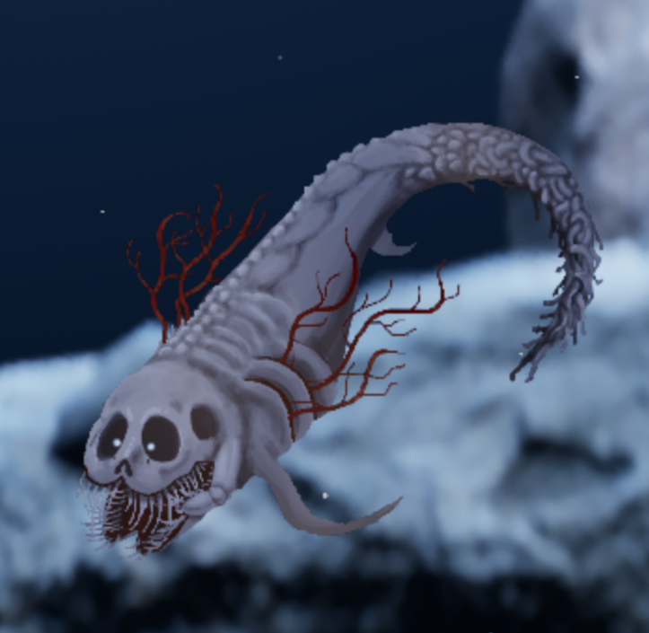
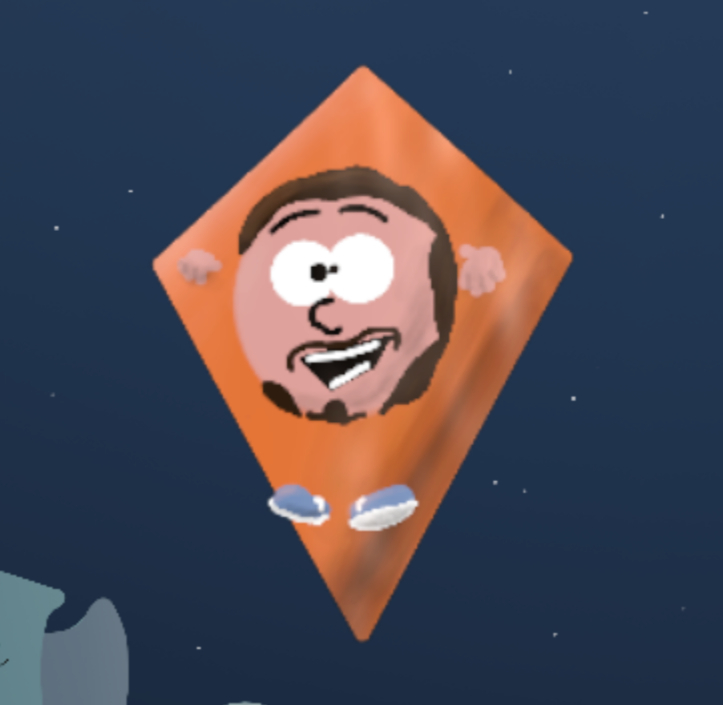

之前那场把玩家脑洞直接倒进水族箱的 Drawquarium 创意活动，终于把结果端上来了。官方这次一口气公布了三大赛道的社区投票榜与开发者 Kaleb 的个人精选，获奖作品里的一部分会被真正做成游戏内的鱼，游进所有人的鱼缸里。

先说结论：**这不是一次发个奖状就完事的仪式性活动，而是实打实的内容入库通道**——被点名的作者只要把鱼导出、通过 Discord 私信交给 Kaleb，你的作品就有机会变成 Drawquarium 里的正式鱼种。对一款主打“自己画鱼自己养”的游戏来说，这基本等同于官方给你的脑洞发了张通行证。

## 🎯 核心看点速览

- **三大赛道全部收官**：Themed Aquarium（主题水族箱）、Favorite Creator Fish（最爱创作者鱼）、Wildcard Fish（野生卡鱼）。
- **两套评选口径**：社区投票榜（Community Vote）选出前三名加若干佳作，另有 Kaleb's Picks 由开发者本人钦点。
- **有实际落地**：入选作品将由作者导出鱼只文件，通过 Discord 私信提交，后续以游戏内鱼种形式加入。
- **参赛规模不小**：仅主题水族箱一个赛道，在最短的创作周期里就有 9 位创作者按时交稿。

## 📌 重点深度解析

### 🏝️ 赛道一：主题水族箱（Themed Aquarium）

官方自己都承认这个赛道“最难做”——给的时间最短，结果还是有 9 位创作者卡点交卷，属实是把肝和灵感一起塞进了玻璃缸。

**社区投票获奖名单：**

- 🥇 **The Trench** —— MrMcman
- 🥈 **Halloween Town** —— _darkghost_
- 🥉 **Pink Aquarium** —— lulu
- **Constellations in the night sky** —— lamsect
- **Prehistoric** —— MerryWeather

**Kaleb's Picks：**

- **Undead Under Da Sea** —— Sarita
- **Level 94 backrooms Aquarium** —— Eldan
- **Alien Waters Tank** —— Dino/Tazz
- **Wedding Aquarium** —— maybeme

这一组的风格跨度相当夸张：深海沟、万圣小镇、粉色少女缸、星空、史前、海底亡灵、后室 Level 94、外星水域、婚礼主题——基本把“水族箱”这三个字的想象力天花板又顶高了一层。

### 🎨 赛道二：最爱创作者鱼（Favorite Creator Fish）

这组的题目很有意思：把你喜欢的内容创作者，或者他们社区里那些有意义的元素，变成一条鱼。本质上是把“粉丝二创”塞进了画鱼的框架里。

**社区投票获奖名单：**

- 🥇 **Iron Lung** —— xxkooki3xx
- 🥈 **Kairyu Crocodile** —— Calypso Deadlight
- 🥉 **Dumb Doggofish** —— CuddlerFish
- **RT Game Fish** —— Prinzess Nyx
- **Jubes "catfish" evanandkatelyn** —— Lamb Chops

**Kaleb's Picks：**

- **Creator Fish Entry** —— _darkghost_
- **Merkiplier** —— Eldan
- **Hello Im Spons** —— Glenn|LangeManGlenn
- **Shoshy** —— Flatbird
- **Crab** —— sjy

其中两条鱼已经明确给出了设计说明：

**Iron Lung** —— xxkooki3xx 创作  
*“灵感来自 Markiplier 电影处女作《Iron Lung》里的那只怪物。”*

**Hello Im Spons** —— Glenn|LangeManGlenn 创作  
*“致敬 Caddicarus，这条鱼游过来是为了卖你点东西。”*

（顺便说，第二条鱼那种“广告位招商”的气质，放进鱼缸里莫名合理。）

### 🌈 赛道三：野生卡鱼（Wildcard Fish）

无主题限制，从搞怪、怪异到漂亮得离谱，全都收。这一组最能看出 Drawquarium 社区的整体脑洞水位。

**社区投票获奖名单：**

- 🥇 **Ant** —— W a t e r
- 🥈 **Wildcard: Pearl** —— lulu
- 🥉 **Lanternfish** —— Ralof
- **Cute Vampire Squid** —— Calypso Deadlight
- **The Sea Angel** —— unraveled

**Kaleb's Picks：**

- **Ink-Wash Ryukin** —— CuddlerFish
- **Long Boy** —— Leslie3308
- **Tripod Fish** —— Princess Nyx
- **Kitty Feesh** —— TannyFox
- **Julby** —— MrMcMan

从蚂蚁、珍珠、灯笼鱼，到可爱吸血鬼乌贼、海天使，再到水墨琉金、长条怪、三脚鱼、猫猫鱼——这组名单光看标题就能想象出鱼缸里群魔乱舞的画面。

### ⚠️ 作者请留意：鱼要“导出”，不是截图

官方明确说明：入选作品要成为 Drawquarium 里的鱼，需要作者**把鱼导出成文件**，然后通过 **Discord 私信发给 Kaleb**。这一步是硬性流程，光有获奖名单不算完成入库。社区投票获奖者和 Kaleb's Picks 的作者都在被邀请之列，建议尽快登录游戏导出、尽快私信提交，别让自家鱼卡在最后一步。

## 💡 玩家实操与上手建议

**如果你是获奖作者：**

1. 打开 Drawquarium，进入自己的创作/水族箱界面，找到对应的鱼只作品；
2. 使用游戏内的导出功能把鱼导出为文件（别只截屏，官方要的是可导入的鱼只文件）；
3. 加入官方 Discord，搜到 Kaleb，私信发送文件，附上作品名与你的 Steam 昵称，方便对方核对名单；
4. 提交后先别急着删本地存档，等官方确认入库再清理。

**如果你只是围观群众：**

1. 这波名单本身就是最好的“临摹素材清单”，想练手的可以照着 The Trench、Level 94 backrooms、Lanternfish 这些方向自己做一版，练画鱼手感非常合适；
2. 想在下一届活动拿名次，重点是**主题契合度 + 一眼辨识度**：社区投票看的是瞬间记忆点，Kaleb's Picks 更看创意表达，两条腿都要走；
3. 官方活动通常会提前在 Steam 公告和社区频道放风，动手早的人天然占便宜——主题水族箱那组 9 位按时交稿的作者就是例子；
4. 提交前把鱼命名清楚，英文名 + 别用特殊符号堆砌，方便官方登记与后续实装。

**关于买不买：**

Drawquarium 的乐趣核心是“自己动手画 + 养成收集”，如果你本来就喜欢涂鸦类、水族箱养成类的小体量游戏，这类 UGC 氛围浓厚的作品通常能玩很久；如果只想看现成漂亮鱼，那就等一波折扣再入库，本体价格不高，但 DLC 与创意内容可以按需补。

## 📢 官方 Telegram 频道推荐

想第一时间蹲到这类**活动公告、限免喜加一、史低特惠**，建议加入官方 Telegram 频道 **@steamhunterlink**。秒级推送，不用天天刷商店页，尤其适合错过活动截稿日的马大哈玩家（比如我）。

## ❓ 常见问题 FAQ

**Q1：获奖的鱼什么时候能真正出现在游戏里？**
A：官方目前的流程是先收集作者导出的鱼只文件，再安排实装。名单公布只是第一步，实际入库时间要看作者提交进度与版本安排，建议关注 Steam 官方公告与 Discord 频道，有更新会同步放出。

**Q2：我的鱼没获奖，是不是就白画了？**
A：完全不是。Drawquarium 的核心玩法就是自己画、自己养，未入选的作品照样能在自己的水族箱里展示。获奖只是多了一条“进官方鱼种池”的路，不影响你正常玩。

**Q3：下一届创意活动什么时候开？怎么不错过？**
A：官方暂未给出下一届时间表，通常会在 Steam 公告、官方 Discord 与社区频道提前预告。想稳妥一点，把 Steam 页面加入愿望单并关注公告，同时挂上 Telegram 频道 @steamhunterlink，活动一开就能收到提醒。

最后恭喜所有上榜的创作者——你们的鱼，马上就要游进别人的缸里了。🫧
