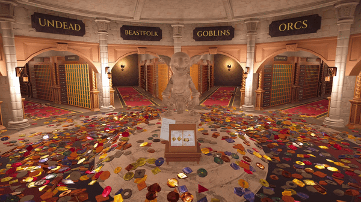

## 🎯 核心看点速览

- **1.0 正式版今日上线**：`The Coin Keeper : Tidy up!`（Steam AppID: 5302870）结束前期打磨，正式迈入 V.1 版本，意味着内容框架与核心玩法已经定型，不再是随时可能推倒重来的半成品状态。
- **首发两周 15% 折扣**：开发组明确表示，为庆祝正式版上线，游戏将在**上线后的两周内**保持 15% off。这是一个典型的"短窗口首发价"，过期回归原价，不会长期挂折。
- **独立小队作品**：署名 Teddy & Marine，工作室 Beardroid Games。从公告口吻看，这是一支规模不大的团队，公告结尾直接向玩家征集反馈，态度诚恳。
- **整理/收纳题材**：从作品名与宣传动图判断，这是一款以"收拾、归位、把混乱变整齐"为核心体验的休闲向作品，主打低压力与解压感。

---

## 📌 重点深度解析

### 1. 版本号从 0.x 走到 1.0，意味着什么

对独立游戏来说，`V.1` 不只是一个数字。它通常代表三件事：存档结构趋于稳定、核心循环不再大改、后续更新以"加内容"为主而非"修地基"。对玩家而言，最直接的好处是——现在入手，不太容易遇到"更新一次存档报废"的糟心情况。

当然，1.0 也不等于完结。公告中"我们很想听听你的反馈"这句话，基本可以理解为后续还会有平衡性调整与体验优化的小版本推送。

### 2. 整理类玩法的爽点在哪

这类游戏的门槛极低、上限却不低：

- **零操作压力**：没有血条、没有倒计时追杀，节奏完全由玩家自己掌控，适合下班后"脑子放空但手不想停"的状态。
- **秩序反馈极强**：从杂乱到整齐的视觉变化本身就是奖励，属于典型的"看着就舒服"型正反馈循环。
- **适合碎片时间**：随时开、随时关，不像剧情向大作那样需要连续几小时的沉浸。
- **受众极宽**：既能自己安静玩，也能拉着不常玩游戏的朋友或家人一起上手，属于典型的"客厅共享型"小品。

如果你本身就是那种看到桌面上图标没对齐就手痒的人，这款基本属于精准命中。

### 3. 首发折扣的性价比判断

15% 的折扣幅度在 Steam 上不算"骨折"，但独立小品的原价基数通常不高，实际优惠金额也就是一杯咖啡的级别。关键在于**时间窗口**：两周之后恢复原价，想等更大折扣，通常要等到夏季/冬季大促，中间可能隔好几个月。

判断标准很简单：

- 你本来就喜欢整理、收纳、装饰类玩法 → **现在入手**，早买早享受，折扣顺手拿下。
- 你对这类玩法无感，只是被画面吸引 → **先加愿望单**，等大促再看，别为了 15% 冲动消费。

---

## 💡 玩家实操与上手建议

**① 入库与折扣确认**

在 Steam 客户端搜索 `The Coin Keeper : Tidy up!` 或直接用 AppID `5302870` 定位商店页。购买前务必确认页面上显示的 `-15%` 折扣标识仍在有效期内，折扣结束时间以商店页倒计时为准，不要只信第三方比价站的信息。

**② 先看试玩与实机片段**

这类小品最容易出现"看着治愈、玩着重复"的落差。下单前建议把商店页的宣传动图与玩家截图翻一遍，重点看玩法是否只有单一动作重复。有 Demo 的话优先试玩。

**③ 画面与操作优化**

- 优先使用**窗口化或无边框窗口**运行，整理类游戏对帧率要求不高，但需要频繁在小窗口之间切换查攻略，窗口化体验更顺。
- 如果出现画面撕裂，在显卡驱动面板里为游戏单独开启垂直同步，比游戏内设置更稳。
- 手柄支持情况以商店页标注为准；这类游戏用鼠标拖拽通常比手柄精准，建议先键鼠。

**④ 反馈渠道**

遇到 Bug 或想提建议，优先走 Steam 社区中心与官方公告评论区——开发组在公告里明确表示希望收到玩家反馈，早期反馈被采纳的概率往往最高。

---

## 📢 官方 Telegram 频道推荐

Steam 的限免与折扣窗口越来越短，很多喜加一和首发折扣从放出到结束只有几十个小时，靠手动刷商店页很容易错过。建议加入官方 Telegram 频道 **[@steamhunterlink](https://t.me/steamhunterlink)**，秒级推送限免、喜加一、史低与首发折扣信息，不用再蹲点刷页面，手机上就能第一时间收到提醒。

---

## ❓ 常见问题 FAQ

**Q1：15% 首发折扣持续多久？之后还会打折吗？**

A：官方公告明确为**两周**。折扣结束后游戏回归原价，短期内不一定再有同等力度优惠；下一次较大折扣通常要等 Steam 季节性大促。想省钱就在窗口期内下单。

**Q2：现在是 1.0 正式版，内容和之后相比会不会缺东西？**

A：1.0 代表核心玩法与内容框架已定型，后续更新以优化与新内容补充为主。如果你介意"买了之后还在更新"，可以再观望一两个小版本；如果你只想现在就开始玩，1.0 已经是可完整体验的状态。

**Q3：这款适合什么样的玩家？会不会玩两下就腻？**

A：适合喜欢整理、收纳、装饰、低压力解压玩法的玩家，以及想找一款能随手开随手关的小品的人。如果你偏好有明确目标驱动、有难度曲线或剧情推进的游戏，这类作品确实容易在中后期显得重复——建议先看实机片段或 Demo 再决定。

**Q4：买之前需要关注 DLC 或捆绑包吗？**

A：以商店页当前标注为准。首发阶段通常只有本体，若页面出现本体+DLC 捆绑包且折扣叠加更划算，再考虑一并入手；否则先买本体足够。

