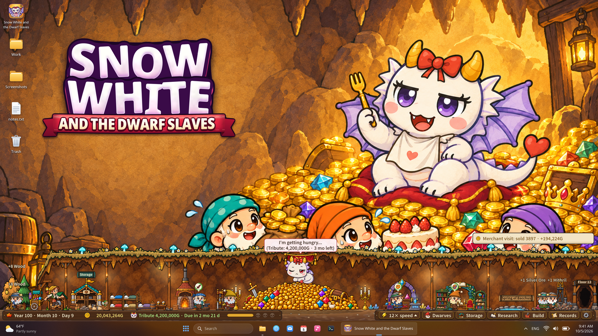

## 🎯 核心看点速览

- **发售状态**：本作现已正式上架 Steam，首发期直接 **20% off（八折）**，属于典型的新游首发窗口价，想入手的别拖到折扣结束。
- **玩法定位**：桌面挂机 + 资源经营。三个矮人在你屏幕最下方支起一座小铁匠铺，砍木头、挖矿石、把成品卖给路过的商人，你干别的事时它也在替你搬砖。
- **核心压力点**：每过十年，化身为龙的白雪公主准时回来收一次贡品，而且胃口一次比一次大。
- **完整版规模**：村庄可以一路经营到 **第 100 年**，沿途共 **11 个结局**可解锁。
- **Demo 玩家注意**：试玩存档不继承，正式版从一座全新的村庄重新起步。

[**前往 Steam 商店页查看首发八折**](https://store.steampowered.com/app/5381000/?utm_source=steam_community&utm_medium=announcement&utm_campaign=full_game_launch)

## 📌 重点深度解析

### 1. 把「桌面底栏」变成矿区，这才是真正的摸鱼经济

大多数挂机游戏要你专门开个窗口盯着，本作反其道而行：铁匠铺就钉在桌面最底部，木材、矿脉、熔炉、摊位一字排开。你在写文档、剪视频、等下载的时候，矮人们照样一锤一锤地敲。这种「零切换成本」的放置设计，是它最舒服的一点——你不需要为它腾出时间，它只是在你的工作流底下安静地滚雪球。

### 2. 十年一次的贡品通胀，才是真·难度曲线

游戏的经济循环很直白：采集 → 加工 → 出售 → 攒金币。但每十年一次的贡品让这套循环永远不无聊——**要价会随年份上涨**。于是每一次决策都变成灵魂拷问：

- 手里这点金币，是立刻**多买一双干活的手**（扩大产能），还是**死死攥住**准备下次进贡？
- 扩产太猛，贡品交不上直接翻车；过于保守，产能跟不上，后面几年的贡品直接劝退。
- 换句话说，这是一款披着童话皮的**现金流管理模拟器**，前期贪与不贪的差别，会在第 30 年之后集中爆炸。

### 3. 11 个结局：不是摆设，是重开动机

完整版把时间线拉到了第 100 年，并埋了 11 个结局。这类设计的价值在于：单周目你几乎不可能一次看全，不同经营路线（纯采矿暴富流、均衡流、极限压榨流）会把你推向不同的收尾。对喜欢「反复开新档试分支」的玩家来说，这是本作真正的长线内容。

### 4. 黑暗童话的皮，经营模拟的骨

题材上它走的是成人向黑童话路线，视觉与叙事都带着点阴冷的戏谑感。但落到玩法层面，依然是标准的资源管理 + 生产线优化 + 事件压力测试。冲着猎奇来的玩家会发现机制比想象中扎实，冲着经营来的玩家也能接受这层外壳。

## 💡 玩家实操与上手建议

**入库与购买**

1. 通过上方商店页链接进入，确认页面显示 **20% 折扣**再付款，别在第三方站买来路不明的 key。
2. 首发折扣通常只覆盖上线初期，建议先加愿望单观察一天评价再决定，避免冲动消费。
3. 买前确认系统需求与运行方式——桌面挂机类游戏对常驻内存和窗口行为比较敏感。

**桌面挂机设置**

- 优先用**无边框窗口 / 窗口化**模式，避免独占全屏导致切出去就停摆。
- 双屏用户把游戏丢到副屏底栏体验最佳；单屏用户建议调低分辨率占用，别挡住任务栏。
- 长时间挂机注意电源计划设为「高性能」，别让系统休眠把进度打断。

**前期节奏建议（避坑）**

- **第一次贡品前别急着炫富**：前十年优先把采集链条打通，产能稳定比短期金币数字更好看。
- **扩产要有节奏**：每多雇一双手之前，先算一遍「下一个十年贡品 + 日常开销」是否还能覆盖，留出至少一轮缓冲。
- **别囤货囤到爆仓**：成品卖不出去就是占地方，商人刷新周期要摸清，卡着点出货。
- **Demo 老玩家放平心态**：存档不继承，等于重新开荒，之前试玩积累的路线理解反而是你最大的优势。

**关于联机**

本作为单机放置经营，没有多人联机内容，不用组队也不用担心服务器排队，挂机进度全在自己本地。

## 📢 官方 Telegram 频道推荐

首发折扣、限时喜加一、临时工定价这类窗口期往往只有几小时到几天，等你刷到的时候经常已经结束了。建议加入官方 Telegram 频道 **[@steamhunterlink](https://t.me/steamhunterlink)**，限免、史低、新游首发折扣会以秒级推送直达手机，永久入库的机会不再靠运气碰。

## ❓ 常见问题 FAQ

**Q1：我玩过 Demo，正式版能继承进度吗？**

不能。官方明确说明，进入正式版会从一座**全新的村庄**开始。不过试玩期摸索出来的采集与扩产节奏完全可以直接复用，开荒速度反而更快。

**Q2：这次 20% 折扣是长期价还是限时？**

属于**首发期折扣**，并非永久降价。新游首发优惠一般只覆盖上线初期，建议先加愿望单，确认口碑与配置都能接受后尽快下手，别等回到原价再拍大腿。

**Q3：可以一直挂在后台吗？会不会影响正常工作？**

可以，这正是它的设计初衷——铁匠铺固定在桌面底部，切到别的软件也不会中断。只要用窗口化模式、关掉独占全屏、把系统电源设为高性能，就能一边办公一边让矮人搬砖。

**Q4：11 个结局需要反复重开吗？**

基本需要。不同经营路线会把村庄推向不同收尾，单周目很难一次看全。建议第一周目放开手脚按自己的直觉玩，第二周目再针对性调整贡品与扩产策略去解锁剩余分支。
