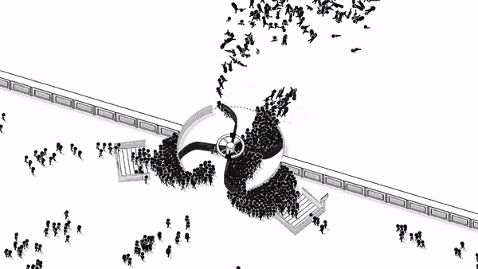

我先说结论：这不是那种让你正襟危坐算报表的经营游戏，而是一款把“旋转门”做成核心生产力、顺便把客人甩上天的欢乐作品。《Round and Round Inc.》完整版已经正式上线，首发还带着一周 15% 折扣。Demo 玩过的朋友，存档也能带进完整版，别手滑点错就行。

## 🎯 核心看点速览

- **完整版正式发售**：Demo 阶段积累的反馈已经落地，现在可以一口气玩到结局。
- **旋转门就是你的印钞机**：从小店的一扇小门起步，升级尺寸、更换叶片，让人流越转越快。
- **交通网络扩张**：人群变大后，公交、地铁、火车和飞机都会给你送人，规模感直接拉满。
- **手动与自动双模式**：想省心就交给自动驱动，想冲纪录就自己上手转。
- **力度过猛会出人命……不，是出笑点**：客人会被甩飞，连续甩飞还能打连击。
- **重生与合同系统**：用重生获得的 Spin Energy 选合同，让下一轮启动更快。
- **Demo 存档可继承**：同一台 PC 上启动完整版，先选 Continue。
- **首发 15% 折扣**：持续一周，本地价格和精确结束时间以商店页为准。

## 📌 重点深度解析

### 1. 从街边小店到“全人类入口”

游戏的核心循环很直白：转门 → 赚钱 → 升级 → 来更多人 → 转更大的门。一开始只是 neighborhood shop 的一扇小旋转门，随着客流增长，你需要把门体做大、换叶片，逐步承接公交、地铁、火车乃至飞机送来的访客。升级路线不只是数值变大，视觉上的“门”也会越来越夸张，这种从街角小店膨胀到全人类入口的荒诞感，是本作最抓人的地方。

### 2. 手感与连击：别把客人甩进隔壁街

这游戏最有意思的设计，是它把“经营”做出了动作游戏的手感。你可以自己控制旋转速度，也可以交给自动驱动。转得太猛，人会直接飞出去；但如果你连续把人甩飞，又能形成连击。换句话说，暴力转门既是失误，也是得分手段。建议新手先用小力度找节奏，等熟悉客流间隔后再加速冲连击；自动驱动适合挂机攒收益，手动模式则适合冲纪录和制造节目效果。

### 3. 重生、Spin Energy 与合同

重生系统让每一轮不只是重复劳动。通过重生可以获得 Spin Energy，然后挑选合同，让下一轮启动更快。合同相当于给你一个阶段性目标，避免无脑转门转到困。我的建议是：重生前先把当前轮能拿的里程碑尽量拿完，再根据合同目标决定升级路线。不要一有能量就急着重开，先看合同是否匹配你当前的升级方向，否则容易把节奏打散。

### 4. Demo 存档继承，别手滑点 New game

官方说得很清楚：在玩过 Demo 的那台 PC 上启动完整版，创建新的完整版存档前先选择 **Continue**。如果你已经有一个完整版存档，那么完整版进度优先；想从零开始，才选 **New game**。免费 Demo 仍然留在商店页，没试过的玩家可以先试再买。

### 5. 首发折扣窗口

首发 15% 折扣持续一周。具体本地价格和结束时间看商店页，不同区服会有差异。等等党当然可以等，但首发窗口通常是“早买早享受”最舒服的节点，尤其你已经在 Demo 里搭好了公司，直接继承存档继续扩张，比从零开坑省事得多。

## 💡 玩家实操与上手建议

- **先试 Demo 再决定**：商店页仍提供免费 Demo，先用它确认手感和旋转门节奏，再决定是否入库。这不是喜加一，需要购买。
- **存档继承三步走**：同一台 PC 启动完整版 → 创建新档前选 **Continue** → 已有完整版存档时以完整版进度优先；想重开才选 **New game**。
- **升级优先级按瓶颈来**：人群排队慢，优先门体尺寸与叶片；收益跟不上，考虑自动化驱动与交通解锁；想冲连击，就多练手动力度控制。
- **重生别上头**：先把当前轮能拿的收益和里程碑拿完，再结合合同目标重开。合同选得对，下一轮启动会顺很多。
- **性能设置**：本作体量不大，但后期人群和交通单位变多，建议先用 Demo 测帧。核显玩家可以窗口化、降分辨率与特效；卡顿时优先关后台占用，再考虑垂直同步。
- **反馈渠道**：如果你觉得某段节奏太慢或太快、某个界面看不懂、或者遇到 bug，直接去 Steam Discussions 反馈。官方明确在收集这类意见。
- **内容分享**：单机经营玩法，适合直播和录屏，甩飞客人打连击是天然节目效果。

## 📢 官方 Telegram 频道推荐

想第一时间收到 Steam 限免、喜加一、史低和首发折扣？加入 **@steamhunterlink**，秒级推送，不用天天刷商店页。像这种首发折扣窗口，最怕的就是刷到的时候已经结束；进频道蹲推送，至少不会错过时间点。

## ❓ 常见问题 FAQ

**Q1：Demo 存档能带到完整版吗？怎么操作？**

A：可以。在玩过 Demo 的同一台 PC 上启动完整版，创建新的完整版存档前先选 **Continue**；如果已经有完整版存档，则完整版进度优先。想重新开档才选 **New game**。

**Q2：首发 15% 折扣持续多久？**

A：上线后持续一周。具体本地价格和精确结束时间以商店页为准，建议在购买前确认所在区服的价格与倒计时。

**Q3：现在还能免费试玩吗？**

A：可以，商店页仍提供免费 Demo。建议先试玩确认手感和旋转门节奏，再决定是否入手完整版。
