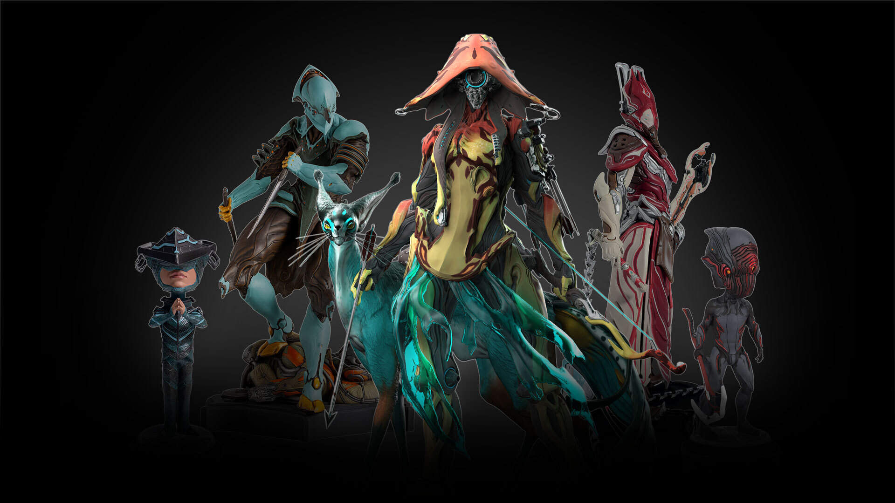

# Warframe 黑五周边特卖开锣：三座雕像加四只娃娃，桌面要被塞满

冬天来了，DE 也终于想起给 Tenno 们的钱包做一次「暖身运动」。官方周边商城正式开启黑色星期五特卖，雕像、摇头娃娃、联名潮玩一口气摆上打折货架。先说清楚最重要的一句：**这是实体周边清仓，不是游戏内商城，不花一个白金，也不给你任何游戏内数值**——想靠这波提升战力的仓鼠可以先去刷钢铁之路了。

## 🎯 核心看点速览

- **活动时间**：即刻起至 **11 月 30 日**，过时不候，属于典型的黑五限期清仓节奏。
- **活动渠道**：Warframe 官方周边商城（store.warframe.com）的清仓专区，与 Steam 游戏本体、DLC 折扣是两套体系，别在 Steam 商店里找。
- **打折内容**：3 座收集者雕像 + The Gunslinger Collection 合集 + 3 款摇头娃娃 + 1 款 Youtooz 联名潮玩。
- **商品性质**：全部为实体收藏品，需国际物流发货，国内玩家要自行承担运费、关税与较长到货周期。
- **核心看点**：连虚空商人 Baro Ki'Teer 本人也被挂上了折扣牌——这大概是本次黑五最幽默的一记「背刺」。

## 📌 重点深度解析

### 一、三座收集者雕像：桌面镇场担当

本次上架的是 **Harrow（主教）、Ivara（弓女）、Volt（电男）** 三款 Collector's Statue。收集者雕像一直是 Warframe 周边里体量最大、工艺要求最高的一档，属于「买回来要专门腾出一层格子」的级别。三只甲风格差异极大：主教走苦行宗教风，弓女是丛林猎手气质，电男则是经典的速度与电流。想要成组陈列的，这波是少数能一次凑齐多款且带折扣的窗口。

### 二、The Gunslinger Collection：主题合集，按页面为准

这是一组枪手主题的周边合集，通常打包形式购买比单件更划算。具体包含哪些单品、是否与单件折扣重叠，请以商城页面实时标注为准——黑五期间库存和套装构成变动较快，下单前务必核对清单，别凭印象冲。

### 三、三款摇头娃娃：小体积、低门槛、最容易冲动消费

**Excalibur、Baro Ki'Teer、Stalker** 三款 Bobblehead 同步打折。摇头娃娃一直是 Warframe 周边里最「上头」的品类：单价低、体积小、摆在显示器下面随键盘震动一起晃，属于典型的「反正才这么点钱」陷阱。尤其是虚空奸商巴罗版，摆在桌上每天提醒自己「周末别忘了去他家被宰」，仪式感拉满。

### 四、Lotus Youtooz：联名潮玩，收藏属性大于实用性

Lotus 与潮玩品牌 Youtooz 的联名款也在折扣名单内。这类方头方脑的联名手办在潮玩圈有自己的受众，造型辨识度高，适合和游戏内「莲妈」情怀绑定收藏。如果你本来就收 Youtooz 系列，这算是补票机会。

> 一句话总结：这次不是「游戏内容更新」，而是官方 merch 的限期清仓，折扣集中在展示类收藏品上，实用性为零，情绪价值拉满。

## 💡 玩家实操与上手建议

**1. 下单路径**

从 Steam 新闻页里的活动链接，或直接访问官方周边商城的清仓专区页面。注意链接指向的是周边站，账号体系与游戏内账号是分开的，别把白金余额当成付款方式。

**2. 先算总价，再点结算**

雕像类商品体积大、重量高，国际运费经常能顶掉折扣本身。建议把「商品价 + 运费 + 可能的关税」加在一起再判断值不值，别只盯着折扣百分比。国内玩家若有多人想买，**拼单合并发货**是摊薄运费最有效的办法。

**3. 关注发货与清关周期**

实体周边走国际物流，黑五期间订单集中，生产与出库都会排队。做好「下单即遗忘，某天突然收到一个巨大纸箱」的心理准备，别拿它当生日礼物卡点下单。

**4. 到手后的摆放建议**

雕像与娃娃都怕晒、怕潮、怕灰。避免长期阳光直射（树脂与涂装都容易褪色），远离加湿器和机箱出风口，落灰用软毛刷或气吹处理，别上手干擦。

**5. 理性消费提醒**

这波不影响任何游戏内体验，不买照样能打突击、开荒、刷紫卡。先看钱包，再看货架。

## 📢 官方 Telegram 频道推荐

除了这种「慢半拍才知道就卖完了」的周边清仓，日常更值得盯的是游戏本体的限免与史低。建议加入官方 Telegram 频道 **@steamhunterlink**，限免喜加一、临时工定价、本体与 DLC 打包史低都会以秒级速度推送，不用再靠刷论坛碰运气。

## ❓ 常见问题 FAQ

**Q1：这次打折的是游戏内道具吗？会给我白金或者战甲吗？**

不是。全部为实体周边商品，走的是官方 merch 商城，与游戏内账号、白金、库存完全无关。下单不会给游戏内任何物品，反过来游戏内的折扣也和这个活动互不影响。

**Q2：折扣会持续到什么时候？之后还会更低吗？**

官方标注为**即日起至 11 月 30 日**。这类清仓特卖通常按库存走，热门款可能提前售罄，历史上很少出现「清仓之后再打骨折」的情况。看中了就别拖到最后一小时。

**Q3：国内玩家怎么买？运费和关税怎么算？**

通过官方周边商城线上下单，走国际直邮或转运，具体运费在结算页按重量与目的地计算，关税视清关情况由收件方承担。建议下单前先试算一次总价，多人拼单合并发货更划算，同时预留较长的物流等待时间。
